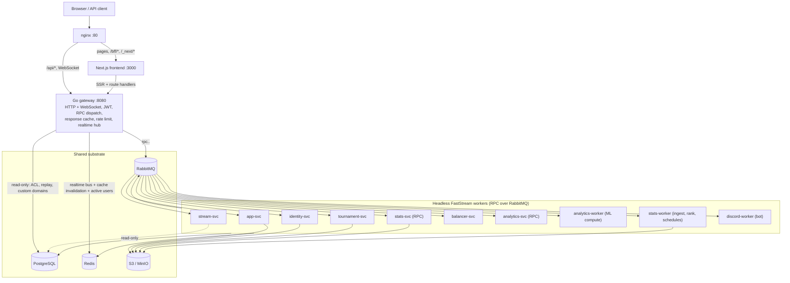

# OWT Architecture

This is the canonical, system-level overview of the Overwatch Tournament (OWT) platform:
its components, how a request flows through them, how services communicate, the data model,
multitenancy, and deployment topology. Per-component detail lives in the linked READMEs.

- Backend services: [`backend/README.md`](../backend/README.md)
- Gateway: [`gateway/README.md`](../gateway/README.md)
- Shared kernel: [`backend/shared/README.md`](../backend/shared/README.md)
- Frontend: [`frontend/README.md`](../frontend/README.md)
- Monitoring: [`monitoring/README.md`](../monitoring/README.md)
- Data model / ERD: [`docs/database_erd.md`](./database_erd.md)

## 1. The shape of the system

OWT is a **monorepo** with three tiers:

1. **Edge** — nginx → a **Go gateway** for the API and WebSocket, nginx → the frontend for
   everything else. The gateway is the only backend process that speaks HTTP and WebSocket
   to the outside world.
2. **Backend** — a set of **Python 3.14 headless workers** built on
   [FastStream](https://faststream.airt.ai/). They expose no HTTP; the gateway reaches them
   with **request/reply RPC over RabbitMQ**. All workers share one PostgreSQL database
   through a single ORM layer in [`backend/shared/`](../backend/shared/README.md).
3. **Frontend** — a [Next.js 16](https://nextjs.org/) app served by nginx on the same origin
   as the API; it talks to the backend through the gateway.



The Go gateway is the single API ingress. The Python services are headless workers driven
entirely by RabbitMQ; the one that also holds a long-lived outside connection is
`discord-service`, a `discord.py` bot that answers its `rpc.discord.*` subjects from the same
process as its Discord gateway session.

## 2. Request flow

1. **nginx** (`nginx/nginx.conf`) is the internal HTTP edge: it recovers the real client IP
   from `X-Forwarded-For` (trusted only from private ranges and loopback), enforces the
   per-IP DoS layer (`limit_req` / `limit_conn`
   zones for ordinary traffic, auth, WebSocket handshakes and the upload paths, with internal
   networks exempted via an empty zone key), applies anti-slowloris timeouts, allows
   WebSocket upgrades, caps body size at 12 MB (60 MB for match-log upload paths), and
   `proxy_pass`es by path with runtime DNS re-resolution: `/api/*`, the WebSocket endpoints
   and `/health` to `gateway:8080`; everything else — pages, `/_next/*`, the frontend's own
   cookie-authenticated `/bff/*` and `/auth/*` route handlers, `/api/health` — to
   `frontend:3000`. It drops client-supplied `x-owt-*` scoping headers, stamps
   `Cache-Control: private, no-store` on `/bff/*` responses that carry none, and caches the
   signed-out homepage for 30 s (one copy for any query string). Homepage renders go through
   the `frontend_home` upstream, capped at 16 concurrent per frontend replica, so a flood on
   `/` that gets past the cache cannot starve the rest of the site. It emits a JSON access log
   (`$uri` only — the WS token must never be logged) carrying `$limit_req_status`, which
   promtail turns into both Loki streams and Prometheus rejection counters. The limits are
   enforced (`limit_req_dry_run off`, `limit_conn_dry_run off`).
   nginx speaks only HTTP/1.1.
2. The **gateway** (`gateway/cmd/gateway/main.go`):
   - verifies access JWTs locally (EdDSA, with identity's public key `JWT_PUBLIC_KEY`; it holds
     no signing secret); for RBAC-gated routes it revalidates and enriches the principal via
     `rpc.identity.validate_token`;
   - dispatches typed REST routes to workers as **RabbitMQ request/reply RPC**
     (`rpc.app.*`, `rpc.identity.*`, `rpc.tournament.*`, `rpc.stats.*`, `rpc.balancer.*`,
     `rpc.analytics.*`, `rpc.discord.*`), carrying an `x-deadline-ms` budget;
   - serves `/api/v1/realtime/ws` (and the legacy `/ws`, `/api/realtime/ws`) from an in-process
     **Redis → WebSocket hub**, replaying missed events from `realtime.workspace_event`;
   - caches anonymous public reads in-process (30 s TTL), invalidated by the workers' Redis
     pub/sub;
   - enforces per-IP rate limits (auth / anonymous / WS custom-domain);
   - emits Prometheus metrics on `:9110` and OpenTelemetry spans to the collector.

## 3. Inter-service communication

Everything between the gateway and the workers, and between workers, runs on **RabbitMQ**
via FastStream. See [`backend/shared/README.md`](../backend/shared/README.md) for the code.

- **RPC (request/reply).** The gateway publishes to `rpc.<service>.<method>` with a
  `reply_to` + `correlation_id` and an `x-deadline-ms` header (matched by a per-message
  TTL). Workers return an `{ok, data, error}` envelope. Requests whose deadline has passed
  are dropped by `DeadlineDropMiddleware`; `prefetch_count` provides QoS backpressure;
  failures route to per-queue DLX/DLQ.
- **Domain events + transactional outbox.** State changes write an `event_outbox` row in the
  same DB transaction; every service that writes rows drains them every second
  (`FOR UPDATE SKIP LOCKED`, retry with backoff), so no service's events depend on another
  service being up. The event map (`backend/shared/messaging/config.py`,
  `backend/shared/schemas/events.py`): `tournament.events` carries `encounter.completed`,
  `registration.approved` / `rank_check_requested`, `state.changed` (consumed by
  analytics-worker to create the completed tournament's compute job, and by the discord bot to
  refresh its watched channels), `standings.invalidated`, `encounter.challonge_push_requested`
  (the Challonge push of a confirmed result, retried by the queue instead of swallowed in the
  request); `cache.invalidation` fans `cache.invalidated.*` out to one queue per caching
  service; `notifications` feeds app-service's Discord delivery (it claims `discord_message`
  rows, the bot renders them); `pickup_mix_changed` is balancer (and tournament, when a mix
  match's hero room settles) → the bot (re-render a mix's live cards); `match.ingested` is stats
  → tournament's match layer; `workspace_member_changed` is app → identity (drop the cached RBAC
  payload); `discord_member_changed` is the bot → stats (re-resolve a Boosty entitlement).
  `backend/tests/test_messaging_config.py` fails on a queue nobody consumes or a DLQ nobody
  declares.
- **Long jobs.** Durable queues decouple minutes-long compute: `balancer_jobs`,
  `analytics_job`. Status/results live in Redis
  (balancer) or the `AnalyticsJob` table (analytics).
- **Realtime.** Workers publish to Redis topics (`tournament:{id}:bracket`,
  `encounter:{id}:map-veto`, `tournament:{id}:balancer`, `workspace:{id}:analytics_jobs`,
  workspace `logs.updated`) via `realtime.workspace_event` rows; the gateway relays them to
  WebSocket clients with replay. `workspace:{id}:subscriptions` is non-durable (no event row,
  no replay): one thin `subscription.updated` per resolve pass that actually moved a verdict,
  which the admin subscription views and the tournament hub refetch on.
  `tournament:{id}:streams` is likewise non-durable and, being spectator data, is
  publicly subscribable under the same `allowSpectateTournament` ("public unless hidden")
  rule as the bracket: `stream-svc` emits one thin `stream.updated` per tournament whose
  set of live channels actually changed — never one per channel, and never for a hidden
  tournament.
  `user:{id}:notifications` is non-durable in the same way — one thin `notification.created`
  per row `notify()` writes, with no event row and no replay, because a client that missed the
  signal refetches the inbox it is about to read anyway. Its ACL rule is self-only: the id in
  the topic must equal the caller's own, and unlike every other rule it grants the platform
  superuser no bypass — an operator's blanket read right over workspace data is not a licence
  to watch one person's inbox arrive.
  `user:{id}:catalog-sync` carries a catalog sync's progress to the superuser who started it, under the same self-only
  rule: one non-durable `catalog_sync.progress` per change (a stage, a mirrored image) with the whole snapshot, sent
  straight from stats-service's RPC process (no transaction to wait for); a client that missed one reads the snapshot
  over GET.
- **Discord.** `discord-service` is the only process that talks to Discord — identity-service's
  OAuth login is the one exception — and holds the platform's only `DISCORD_TOKEN`. Everyone
  else reaches Discord through it over RabbitMQ:
  - *Reads and voice.* `shared/services/discord_client.py`'s `DiscordClient` is RPC-only
    (member roles, guild roles/channels/info, voice moves on the bot's `discord_*` queues) with
    no REST fallback: a bot that does not answer is `DiscordUnavailable`, and a subscription
    gate counts that as an outage, never as a pass.
  - *Messages.* A publisher only *claims* a `discord_message` row — destination,
    `subject`/`slot`/`kind`, and `payload_json` as render input — and queues a cardless
    `send`/`delete` on `discord_commands`. The bot renders every card itself: notifications
    from the row's `payload_json`, mix signup and lineup cards from balancer's
    `rpc.balancer.custom.discord_view`. Edits are never commands: the bot consumes
    `pickup_mix_changed` and re-renders the mix's live cards, coalescing bursts in process.
  - *Gateway surface.* `rpc.discord.*` serves the workspace settings pickers (guild roles, text
    channels, server status) and the per-tournament match-log channel binding
    (`rpc.discord.channel.*`, the `stats.discord_channel` row the bot watches).
  - *Match-log ingest.* The bot uploads attachments as base64 to `UPLOAD_MATCH_LOG_QUEUE`,
    naming the Discord channel and message; stats answers on the `match_log_result` work queue
    with those ids echoed, and the bot reacts on that message. No in-memory waiter, nothing lost
    on a bot restart.

  It runs as **exactly one replica**, on purpose: every replica would open its own gateway
  session under the same token and receive the same events, and the edit coalescing lives in
  process memory. Production pins `deploy.replicas: 1`; see
  [`backend/discord-service/README.md`](../backend/discord-service/README.md).

## 4. Components

| Component | Kind | Responsibility |
| --- | --- | --- |
| [`gateway`](../gateway/README.md) | Go, HTTP/WS | Sole API ingress: JWT, RPC dispatch, realtime hub, response cache, rate limit, docs, metrics |
| [`app-service`](../backend/app-service/README.md) | RPC worker | Game catalog, player identity (directory/search/name lookup, admin, merge), workspaces, notifications + their Discord delivery, audit, binary assets |
| [`identity-service`](../backend/identity-service/README.md) | RPC worker | JWT auth, OAuth (Discord, Twitch, Battle.net, Riot) and Steam OpenID, RBAC, workspace membership, custom domains/subdomains, API keys, player linking, service tokens, SSO |
| [`tournament-service`](../backend/tournament-service/README.md) | RPC worker + scheduler | Tournament lifecycle, registration, brackets/standings, Challonge + Google Sheets sync, map veto, state machine, Challonge push consumer, the organizer dashboard and tournament readiness (`rpc.tournament.{admin_dashboard,admin_dashboard_trends,tournament_readiness}`) |
| [`stats-service`](../backend/stats-service/README.md) | RPC process (`stats-svc`) + worker (`stats-worker`), one image | Canonical match ingest and match-log parsing (`stats.ingest.<discipline>`), match import by external id (`stats.match_fetch`), native rank fetch (OverFast, Riot API, deadlock-api), achievement evaluation, MVP-impact backfill; the public statistics, `/users/*` player-statistics and achievement reads (`rpc.stats.{statistics,users,achievements}.*`), their read caches, the `cache.invalidated` consumer and the `stats.mv_entity_global_stats` refresh |
| [`balancer-service`](../backend/balancer-service/README.md) | RPC worker | Genetic team balancing (native Rust `tournament_balancer`) + live draft + draft clock |
| [`analytics-service`](../backend/analytics-service/README.md) | 2 workers | `analytics-svc` (RPC reads/mutations/job-control) + `analytics-worker` (heavy ML: v1 OpenSkill shifts, v2 ML pipeline) |
| [`stream-service`](../backend/stream-service/README.md) | RPC worker + scheduler | Tournament stream live-status: Twitch Helix poll tick (app token), public `rpc.stream.*` reads, POV recordings with match timestamps (`rpc.stream.{tournament,encounter}_vods`). Live state is Redis-only; owns the `stream` schema — the participants' observed broadcasts and their Twitch VOD ids |
| [`discord-service`](../backend/discord-service/README.md) | bot, single replica | The only Discord client (OAuth aside): renders and sends every card, `rpc.discord.*` pickers + match-log channel binding, match-log upload, slash commands, voice moves |
| [`shared`](../backend/shared/README.md) | library | Single-source ORM + cross-service kernel (models, repository, services, rpc, messaging, tenancy, rbac, observability, clients) |
| [`frontend`](../frontend/README.md) | Next.js | User-facing app + white-label multidomain |

**Achievements and analytics by discipline (P6).** The condition registry, evaluator and portable format are a shared
kernel (`shared/domain/achievements`, `shared/domain/analytics`) that reaches a game only through
`shared.disciplines` lazy hooks: Overwatch registers its conditions and owns its models
(`shared/disciplines/overwatch/{achievements,analytics}`); LoL declares neither, so it has no conditions, no models and
no fallback to Overwatch's. Every rule carries an immutable `discipline` (no column default since `achievement06`), the
achievement wire is `discipline` + `entity_id` (portable format v2), and a tournament/match event evaluates only its own
game's rules. Analytics resolves the module, rated role ids and declared algorithm from the tournament's discipline.
Details: [P6 release note](./releases/2026-10-18-multi-game-p6-achievements-analytics.md).

## 5. Data model & multitenancy

All services share **one PostgreSQL database** with **one SQLAlchemy metadata** defined in
`backend/shared/core/db.py`. Domain boundaries are **Postgres schemas**: `auth`, `players`,
`public`, `tournament`, `encounter`, `catalog`, `roster`, `stats`, `rank`,
`balancer`, `registration`, `mix`, `draft`, `achievements`, `analytics`, `realtime`. The migration-only
schemas the cutovers kept for their reconciles (`matches`, `log_processing`, `overwatch`, `casual`) and every other
legacy table and column were dropped by `legacy01`.
Full entity diagrams are in [`docs/database_erd.md`](./database_erd.md).

- **Multitenancy.** `public.workspace` is the tenant root. Nearly every business table
  carries `workspace_id` (directly or transitively via `tournament` / `workspace_member`);
  global rows allow `workspace_id NULL`. A request's workspace is resolved from the host: a
  **subdomain** or a **verified custom domain**, via `backend/shared/tenancy/hostnames.py`.
  Roster, registration, draft, and achievements are anchored on `public.workspace_member`
  (unique per `workspace_id + player_id`).
- **Dual identity.** `auth.user` (login account, owned by identity-svc) is distinct from
  `players.user` (domain player, owned by app-svc), linked 1:0..1 via `auth_user_id`. A
  player can exist without a login ("shadow player"). Full reference: [`docs/users-identity.md`](./users-identity.md).
- **Match layer (`encounter`) and disciplines (`catalog`).** A meeting of N participants is
  one `encounter.encounter` whatever its owner or format: a duel is `slot_count = 2`, a lobby is
  N, and the API returns `teams[]` with slot numbers, never home/away. An encounter has exactly
  one owner — a tournament (`tournament_id`) or a pickup mix (`custom_game_id`, a recorded mix
  round with result source `host`; its balancer facts are `mix.round` and
  `mix.round_member`). Tournament code reads tournament-owned encounters only, through
  `EncounterRepository`. Each seat is an
  append-only participation (`encounter.team`) with a roster snapshot; games, per-participation
  game results, game claims, series reports, the result journal, the scoring rule and the
  pre-game pick/ban room hang off the encounter in the same schema. The bracket position
  (stage, stage item, round) and the advancement edges stay in `tournament`
  (`bracket_encounter`, `encounter_link`), so the match layer carries no tournament structure.
  `catalog.discipline` lists the games the platform knows (`overwatch`, `lol` and `deadlock`); every tournament,
  mix and encounter carries its `discipline`, and one composite foreign key keeps the copy from
  disagreeing with its owner. Every result change goes through one writer,
  `backend/shared/services/encounter/result.py`: one transaction, the encounter row locked,
  `result_version` bumped, one `encounter.result_audit` row. Scoring is one engine,
  `backend/shared/domain/encounter_scoring.py`, driven by the `encounter.scoring_rule` formulas.
  The legacy columns and tables the old model used (home/away columns, `encounter_participant`,
  `encounter_map_report`, `encounter_captain_report` and the rest) are gone (`legacy01`).
  Vocabulary: [`glossary.md`](./glossary.md).
- **Discipline catalog (`catalog`).** `catalog.entity` holds each discipline's `character`, `map`
  and `mode` rows, with names, aliases, images and JSONB `attrs`; a map's `parent_id` is the mode it
  belongs to, if any, and a character's class is `attrs.class`. A played match's mode is not read from
  its map (Deadlock's Midtown hosts several): `stats.match.mode_entity_id` and `encounter.game.mode_id`
  store it. Names and slugs are unique per discipline and kind.
  Behaviour lives under `backend/shared/disciplines/<slug>/`, reached only through the
  `shared.disciplines` registry: supported kinds and labels ("Hero", "Champion"), character classes,
  sides, catalog sync, `native_ranks`, `native_ladder`, `native_rank_rows`, `identity_provider` and `match_fetchers`.
  Overwatch declares its 45-tier ladder, OverFast native reader and `battlenet`; LoL declares its 31-tier league-v4
  ladder, a Solo/Duo native reader and `riot`; Deadlock declares its 66-tier ladder (11 tiers × 6 subranks), a
  per-account native reader, `steam` and the `deadlock_api` match fetcher; VALORANT declares its 25-tier ladder and
  `riot`, with no native reader (organizers enter ranks). Catalog sources are OverFast, Data Dragon, deadlock-api and
  valorant-api.com. Each game's rank collector (OverFast for Overwatch, the Riot API for LoL, deadlock-api for
  Deadlock) runs as that module's jobs inside `stats-worker` and writes the shared `rank` schema, one `discipline` per
  row. These declarations are not the complete LoL, Deadlock or VALORANT gameplay vertical.
  Stats-service runs the module's sync (`rpc.stats.catalog.sync`) as a background job in its RPC process: one per
  discipline (409 `catalog_sync_running` otherwise), its stage snapshot in Redis for `rpc.stats.catalog.sync_status`
  and published to the starter's `user:{id}:catalog-sync` topic;
  app-service provides generic admin CRUD by discipline and kind on `rpc.app.catalog.admin_*`.
  `catalog.alias_miss` is the unresolved-name worklist, keyed by `(discipline, kind, raw_name)`.
  Old hero/map/gamemode ids no longer resolve: `legacy01` dropped their `catalog.entity_legacy` mapping and
  the old-link redirect with it. Runtime catalog reads and writes use `catalog.entity`, never `overwatch.*`.
  App-service startup projects module-declared role dimensions and roles into
  `catalog.role_dimension` / `catalog.role`; a removed module role is deactivated, not deleted.
  Exactly one dimension per discipline is rated. Workspace sub-roles share that ontology, with
  immutable parents and `<parent>_<slug>` codes. `CatalogRoleRepository` resolves an owner's
  discipline, dimension and workspace; the RBAC `RoleRepository` is a different repository.
  An assignment stores one leaf through `(role_id, dimension_id)`, never a separate parent
  assignment. Responses use `RoleRef` (`dimension`, leaf `role`, derived `parent`); inputs ignore
  `parent`. `flex` is an open-slot key only, never a catalog role.
- **Team formats (`roster`).** `team_format`, `team_format_dimension` and `format_role_rule`
  hold starter/substitute bounds, dimension modes and hard/recommended role quotas.
  Tournaments own an editable copy of the workspace default or module preset; mixes freeze
  their copy at creation (explicit preset, else clone format, else workspace default, else preset).
  There is no live inheritance. The legacy slot-map and role columns and the reconciliation snapshots
  (`roster.team_format_legacy`, `encounter.team_member_role_legacy`) are gone (`legacy01`).
  `encounter.team_member_role (team_member_id, dimension_id, role_id)` stores snapshot leaves.
  Composite assignment/quota FKs into `catalog.role` are `DEFERRABLE INITIALLY DEFERRED`.
  Hard validation checks every active dimension for each starter; benches are excluded.
  Only tournament/MOO sub-role rules with `recommended_max <= 1` gate the existing collision
  penalty; other recommendations, and all mix recommendations, are post-solve advisories and
  equal-objective tie-breakers. See the [P2 release and cutover guide](./multi-game-p2-roles-release.md).
- **Ranks and division grids (P3).** `balancer.member_rank` and `member_hidden_rating` reference
  catalog roles of the owner's rated dimension through `(role_id, dimension_id)`; identical codes
  such as `support` in two games never share storage. Domain rank maps remain code-keyed within
  that discipline. Registration/author overrides precede workspace canon and then the registry's
  native reader; effective source values use `native`. Open slots hold no hidden rating or host-book
  rank. `division_grid.discipline` scopes grids, mappings and fallback; tier native bounds are
  `native_rank_min/max`. A game with a native ladder (Overwatch, LoL, Deadlock, VALORANT) falls back to it when it has no grid of its own;
  a ladder-less game's creation/clone/runtime reads without a usable grid fail with 422 `division_grid_required`.
  `public.workspace_division_grid_default` selects one version per `(workspace_id, discipline)`.
  Activation and deletion affect only that game's assignment and preserve valid event pins.
  `WorkspaceRead.default_division_grid_versions` contains explicit IDs;
  `effective_division_grid_versions` contains persisted effective version/tier payloads, including
  matching system fallback. Absent versions are omitted, not synthetic IDs. Only single-workspace reads
  (`GET /workspaces/{id}`, `/workspaces/by-slug`) carry the effective map: `GET /workspaces` list rows
  (`WorkspaceListItem`) omit it, so listing every workspace never loads every grid's tiers. Neither map is writable
  through workspace create/update, and the old scalar fields are rejected. A valid event pin needs
  no workspace activation. Known-owner UI consumers retain the pin and discipline; unresolved owners
  expose no wrong-game controls. Legacy OW data explicitly chooses OW, and LoL grids show no OW native
  ladder/crests. Open-ended tiers stay open-ended. The legacy physical workspace pointer and old rank
  role columns are gone (`legacy01`).
  See the [P3 release and cutover guide](./multi-game-p3-ranks-release.md).
- **Statistics and ingestion (P4).** `stats.match` binds parsed observations to one
  `encounter.game`, with direct workspace/discipline ownership. `match_team.source_position`
  preserves decoder order; public duel fields use historical encounter slots. Facts have native
  participant/member/entity/segment/stat grain; events preserve duplicate and nullable endpoints.
  Observed scores remain separate from official game results. Discipline-qualified `stat_def`
  and `event_type` projection never reuses a same-code definition from another game.
  `stats.ingest_job` owns actual hash/raw-reference provenance and upload lifecycle, including
  `awaiting_link`. Baselines and the entity global-statistics MV also live in `stats`.
  A match stores its own mode (the document's `mode`, else the map's catalog parent); statistics,
  map filters, achievements and Push/Clash detection read that column, never the map's parent.
  Complete cutover receipts and narrow transaction-bound audit chains distinguish unchanged,
  review-required and unexplained data. Membership creation is absent→present only; identity
  changes require the original merge mapping. See the [cutover/operator notes](../backend/README.md#p4-statistics-cutover-stats01).
- **Canonical ingest (P5).** One strict `owt.match/1` document (`shared/schemas/match_doc.py`) is the only input of
  `stats-service`: producers post it with a workspace API key holding `stats.ingest` (`POST /api/v1/stats/matches`,
  raw bytes relayed by the gateway), the Overwatch Workshop decoder is a module that emits the same document, and
  `stats-worker` binds it to a game, replaces observations atomically and publishes `match.ingested`. A module with a
  `match_fetchers` entry (Deadlock's `deadlock_api`) also lets a captain or organizer import a tournament game's match
  by its external id: `stats.match_fetch` holds the request, and the worker retries the module's fetcher for up to
  24 h, then stores and queues the bytes exactly like an upload. The
  tournament process alone decides whether that evidence becomes an official result (`logs_official`, owner
  policy, receipts on the encounter journal). `stats-svc` (RPC) and `stats-worker` (one ingest queue per selected
  discipline) are separate processes of one image. See the
  [P5 release guide](./releases/2026-10-15-multi-game-p5-ingest.md) and the
  [Deadlock release note](./releases/2026-10-21-deadlock.md).
- **Registration form schema.** What a tournament asks its registrants is one document:
  a versioned `FormSchema` of ordered sections of typed fields, modelled in
  `backend/shared/domain/forms/`. `registration.form_version` keeps append-only
  snapshots, so a form edited after registrations exist does not orphan the answers
  already given — each registration records the version it answered. A schema is reusable
  across a workspace's tournaments through `registration.form_template`. Answers
  are validated server-side in one place and stored typed: built-in fields in their own
  registration columns and `registration.identity` rows, organizer-defined fields
  in `registration.registration.custom_fields_json`. Every field declares its visibility, which is what
  keeps organizer-only answers off the public roster.
  The module's provider chooses the default identity field, roster/chat handle and parser matching.
  `TournamentRead.identity_provider` is computed from discipline; backend `default_schema(provider)`
  requires it. Riot IDs preserve inner name spaces and match case-insensitively after normalization; a Steam
  handle is normalized to the decimal SteamID3 account id from any accepted spelling.
  Known-owner form loading/errors cannot create an implicit Battle.net default; loaded existing forms
  remain intact. Optional admin game identities remain optional, with fresh registration relationships
  initialized before flush and persisted reads still eagerly loaded. P7 owns primary-identity
  reconciliation, provider-explicit workspace upsert and the complete generic identity wire/UI rename;
  P8 consumes those contracts.
- **Registration role ontology (P2).** `registration.role` stores a rated
  `catalog.role` leaf through `(role_id, dimension_id)`, unique per registration
  and leaf. Its top-level role and qualified sub-role code are derived, never
  written to the legacy columns. Registration API roles use `RoleRef`
  (`dimension`, leaf `role`, output-only `parent`); form answers deliberately
  retain `{role, subrole?, is_primary, top_heroes?}` with an unprefixed sub-role
  slug. Both writers resolve against the tournament discipline and owning
  workspace. The roster engine uses module role codes rather than Overwatch enums.
- **Mix role preferences (P2).** `mix.player_role` stores ordered
  `(role_id, dimension_id)` references, restricted to module roles of the mix's
  rated dimension. Host and self-service `roles` inputs and outputs now use
  `RoleRef[]`, not strings (for example, `[{"dimension":"player_role","role":"tank"}]`).
  `null` still means all ranked roles; `[]` means an explicit empty selection.
  A foreign dimension returns 422 `role_dimension_mismatch`; unknown roles and
  workspace sub-roles return 422 `unknown_role`, regardless of submitted `parent`.
  Discord and the site use the same wire contract; rank maps remain code-keyed within the discipline,
  while P3 stores ranks and hidden ratings by catalog role ID.
- **Draft role references (P2 wire break).** Captain pins and pick assignments now
  store `(role_id, dimension_id)` references to the tournament's rated module roles.
  Open-slot picks store neither a role nor a dimension. Draft requests, boards,
  pick options, suggestions, fit scores, queues, journal reads, and realtime role
  fields use `RoleRef` instead of strings. Primary and secondary registration
  roles carry leaf refs with a derived `parent`; the separate `sub_role` field is
  removed. Code-keyed rank, source, sub-role, and hero maps are unchanged.
  All role inputs resolve through the tournament's discipline: foreign dimensions
  return 422 `role_dimension_mismatch`, and sub-roles cannot pin a captain or pick.
  Submitted `parent` is ignored. The pure draft domain uses module codes, not enums.
- **ML artifact roles (P2 wire break).** `analytics.ml_model_artifact` identifies
  role-specific models through `(role_id, dimension_id)` in `catalog.role`;
  all-role models keep both values `NULL`. Identity and activation are keyed by
  role id. The registry remains
  Overwatch-only until P6 and resolves only its rated module roles (no workspace
  sub-roles). Artifact responses now expose `role` as `RoleRef | null`, for example
  `{"dimension":"player_role","role":"tank","parent":null}`, instead of a string.
- **RBAC.** Grant-only permission catalog + workspace system roles, with a
  `user_permission_deny` overlay. Bootstrapped from `backend/shared/rbac/`.
- **Migrations.** A single Alembic project under `backend/migrations/`. `make migrate` runs
  `alembic upgrade head` inside a running dev `app-svc`; in production the release workflow
  (and `make prod-migrate`) runs it in a one-off container off the image being deployed, so
  the schema lands before the code that reads it.

## 6. Deployment topology

Four Compose files layer the deployments (details in [`backend/README.md`](../backend/README.md)
and [`monitoring/README.md`](../monitoring/README.md)):

- `docker-compose.yml` — dev/base (hot reload, local Postgres via the `db` profile, gateway
  published for direct testing). Profiles: `db`, `workers`, `monitoring`.
- `docker-compose.production.yml` — GHCR images (`ghcr.io/craazzzyyfoxx/owt-*`, tag
  `${IMAGE_TAG:-latest}`), external Postgres or the bundled Postgres 18 + pgBouncer via the
  `db` profile ([`production-host.md`](./production-host.md)), `restart: always`, resource
  limits, gateway reachable only through nginx.
- `docker-compose.monitoring.yml` — a separate `owt-monitoring` project (Prometheus,
  Alertmanager, Grafana, Loki, Promtail, Tempo, OTel Collector, exporters).
- `docker-compose.gpu.yml` — NVIDIA override for `analytics-worker`.

Shared substrate: **PostgreSQL** (optionally behind pgBouncer), **Redis** (cache + realtime
bus + active-user counters), **RabbitMQ** (all RPC/events/jobs), **S3/MinIO** (avatars,
icons, match-log files). Workers that call external APIs (Discord, Twitch, Challonge, S3)
egress through the outbound `proxy` container (xray); the self-hosted OverFast runs on the
production host and is called directly, and so are the Riot API (the LoL rank collector), deadlock-api (the
Deadlock catalog, rank collector and match fetcher) and valorant-api.com (the VALORANT catalog).

**Releases.** Pushing a `v*` tag is the whole ritual:

```bash
git tag -a v1.2.0 -m "…" && git push origin v1.2.0
```

`.github/workflows/deploy-production.yml` then runs the four CI gates, builds all ten
images on GitHub-hosted runners and pushes them to GHCR (one runner per image,
registry-backed build cache), opens one ssh session to the production host that pulls the
tag, runs `alembic upgrade head` from the *new* image while the *old* containers still
serve, recreates the stack (`make prod-up`), and finally publishes the GitHub Release —
notes rendered from the Conventional Commit subjects since the previous tag by
[`ops/release/changelog.sh`](../ops/release/changelog.sh). The Release is written last on
purpose: it means "this is what production is running", not "somebody clicked publish".

The `stats01` maintenance cutover is an exception: this ordinary rolling sequence is insufficient.
All writers must be drained for reviewed preparation, upgrade and immutable initial receipt capture;
backup/restore rehearsal and the later deletion gate remain explicit release prerequisites.

Nothing builds on the server and no self-hosted runner takes part. `workflow_dispatch`
deploys a tag without the gates (an operator's call, and the only way out while CI is
red), and with `skip_build` it redeploys images that already exist — which is the
rollback. The remote half is [`ops/deploy/remote-deploy.sh`](../ops/deploy/remote-deploy.sh),
runnable by hand. With the repo variable `DEPLOY_FREEZE=true` (e.g. during a tournament
final) any of these only pre-pulls the tag's images onto the host and writes no Release;
unset it and dispatch the tag with `skip_build` to restart onto them in seconds.

## 7. Observability

- **Metrics** — Prometheus scrapes the gateway (`:9110`) and each worker's
  `WORKER_METRICS_PORT`.
- **Tracing** — OpenTelemetry spans from gateway and workers → OTel Collector → Tempo
  *and* Sentry (Sentry Exporter). One OTLP stream, two backends: Grafana for the
  span-metrics/service-graph view, Sentry for traces sitting next to the Issues they
  caused. The Sentry SDKs emit no transactions of their own
  (`SENTRY_TRACES_SAMPLE_RATE=0`) and only link errors/logs to the OTel trace.
- **Logs** — structured JSON logs to `logs/` → Promtail → Loki.
- **Dashboards & alerts** — Grafana (Application Logs, Workers & Queues, Gateway, Tracing,
  Infrastructure) and Alertmanager → Discord.

See [`monitoring/README.md`](../monitoring/README.md).
