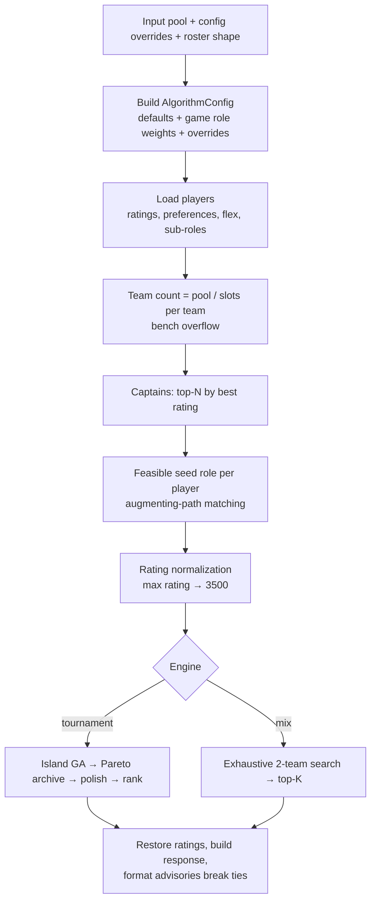

# Balancer algorithm

How `balancer-service` turns a player pool into teams, and every parameter that steers it. Service
surface (RPC, jobs, drafts, mixes) is in [`../backend/balancer-service/README.md`](../backend/balancer-service/README.md);
this document covers the solve itself.

There are two engines in the native crate `backend/balancer-service/native/balancer_native`:

| Engine | Used by | Teams | Method | Result |
| --- | --- | --- | --- | --- |
| `tournament_balancer` (`src/moo/`) | tournaments, the balancer job API, everything not pinned to mixes | any N ≥ 2 | multi-objective island genetic algorithm (NSGA-II style) + local search | ranked Pareto front of variants |
| `mix_balancer` (`src/mix.rs`) | workspace custom games (mixes) only | exactly 2, ≤ 32 players | exhaustive enumeration of every split and role layout | the true top-K splits by one scalar score |

Both share the Python preparation stage (`src/domain/balancer/runtime.py`) and the same request
envelope (`src/domain/balancer/native.py`).

## Pipeline

### 1. Effective configuration

`AlgorithmConfig` (`src/domain/balancer/config/defaults.py`) is the only place a knob is declared.
A run starts from its field defaults, seeds `role_settings` from the game's declaration
(`DisciplineSpec.balancer_role_settings`, e.g. `shared/disciplines/overwatch/__init__.py`), then applies
the run's overrides (`apply_config_overrides`). `role_settings` overrides merge field by field per role;
every other key replaces the value.

Where overrides come from:

- **Tournament**: the operator's config drawer, initialized from the saved tournament config
  (`balancer.tournament_config`) or the defaults; picking a preset replaces its values. The client sends
  it as the job's `config`.
- **Mix**: the host's own preferences (`balancer.user_config.config_json`: `mix_comfort_tilt`,
  `role_settings[*].mix_weight`, `open_slot_settings`, `max_result_variants`). A mix run asks for
  100 variants unless the host set their own count.
- **Synchronous API** (`balance_inline`): the request's overrides, with `time_limit_ms` capped at 60 000.

`role_mask` (slots per role per team) is never an override: it is the owner's roster shape, applied
after overrides. A run without one is refused.

### 2. Player loading

`player_loader.py` reads each player's active, ranked roles:

- `ratings[role]` — rank per role. A rating is what makes a role playable (0 counts as no rating).
- `preferences` — the player's roles that the mask fields, ordered by `priority`. `preferences[0]` is the main role.
- `is_flex` (`isFullFlex`) — equally comfortable on any playable role.
- `subclasses[role]` — sub-role (e.g. hitscan / projectile), used by the collision term.
- `must_play`, `rotation_priority` — who keeps a seat when the pool overflows.

A role-less `flex` slot in the mask is rated at the player's best rating and costs no discomfort.

### 3. Team count and bench

`num_teams = floor(valid_players / slots_per_team)` (capped at 2 for the mix engine). Players past the last
full team sit out (`seated_set`): `must_play` players are kept first, then lower `rotation_priority`,
then input (uuid) order; a player the remaining seats cannot take sits out instead of the next one.
More `must_play` players than seats, or a role nobody can cover, is a 422.

### 4. Captains

With `use_captains`, the top `num_teams` players by best rating (ties by uuid) become captains, each
pinned to their first preferred playable role (`captain_assignment_service.py`). In the tournament
engine each captain is locked to one team and that role: mutations, crossover repair and local search
never move a locked captain. The mix engine ignores captains.

### 5. Seed roles

`find_feasible_role_assignment` finds one complete player → role assignment that fills every role's
capacity (`mask[role] × num_teams`), trying preferred roles first and re-routing occupants along
augmenting paths. Captains keep their pinned role. No such assignment → 422. The result (`seed_role`) is
only the GA's starting point; the search is free to change roles afterwards.

`feasibility_analyzer.py` also computes `structural_min_off_role`: the minimum number of off-role
seats any solution must contain for this pool (bipartite matching of players to non-off-role slots).
It is reported, not optimized.

### 6. Rating normalization

`RatingNormalizer` scales every rating linearly so the pool's highest rating becomes
`rating_scale_ceiling` (3500). All weights and gap thresholds are calibrated on that scale, so they
behave the same for a 0–5000 SR pool and a 0–30 division pool. Ratings and rating-unit metrics are
scaled back after the solve. Discomfort values are not scaled.

### 7. Determinism

The seed is SHA-256 of the canonical JSON of the players, team count and full config
(`determinism.py`); sub-seeds are derived per stage. Players reach the engine sorted by uuid and the
engine uses ChaCha12. Same input → same output, unless `time_limit_ms` cuts the run short (wall-clock
dependent).

## How a seat is scored

`common.rs` gives each player a per-role cost:

| Seat | Discomfort (GA, lower is better) | Priority points (mix, higher is better, `max_priority` = 3) |
| --- | --- | --- |
| Flex player on a playable role, or anyone on a `flex` slot | 0 | 3 (flex player) |
| `preferences[k]` | `100 × k` (main role 0, second 100, …) | `max(3 − k, 1)` |
| Playable but not in preferences | 1000 | 1 |
| Not playable | 5000 | 1 (never seated: invalid layout) |

## Tournament engine (`tournament_balancer`)

### Two objectives

Each solution is scored on two axes, both minimized. Neither is folded into the other during the
search; a solution survives if no other one is at least as good on both and better on one (Pareto
dominance).

**Balance** (team strength):

$$
\begin{aligned}
\text{balance} ={}& w_\text{total}\cdot \sigma(\text{team totals})
 + w_\text{gap}\cdot P_\text{gap}(\max\text{total}-\min\text{total})
 + w_\text{avg}\cdot \sigma(\text{team averages}) \\
&+ w_\text{line}\cdot \overline{\sigma(\text{role line averages})}
 + w_\text{intra}\cdot \overline{\sigma_\text{in team}}
 + w_\text{spread}\cdot \overline{\text{role spread in team}} \\
&+ \sum_\text{roles}\big(\text{line\_gap\_weight}\cdot P_\text{line}(\text{max adjacent line gap}) + \text{line\_std\_weight}\cdot \sigma(\text{line})\big) \\
&+ w_\text{eff}\cdot \sigma\Big(\sum_\text{roles} \text{impact}\cdot\text{role total}\Big)
 + w_\text{low}\cdot \overline{\text{low-rank pairs}}
\end{aligned}
$$

**Comfort** (roles):

$$
\text{comfort} = w_\text{disc}\cdot\overline{\text{team discomfort}} + w_\text{maxdisc}\cdot\max\text{discomfort}
 + w_\text{teampain}\cdot\overline{\max_\text{team}\text{discomfort}} + w_\text{sub}\cdot\overline{\text{sub-role pairs}}
$$

Overlines are averages over teams (per-team normalization keeps weights valid from 4 to 40 teams), except
the role-line term, averaged over roles; σ is the sample standard deviation. A *role line* is the average
rating of one role inside one team.

Piecewise penalties are marginal (tax-bracket) so the landscape has no cliffs:

| Function | Rate per rating point |
| --- | --- |
| $P_\text{gap}$ (strongest − weakest team total) | ×1 up to 25, ×3 for 25–50, ×8 for 50–100, ×18 for 100–200, ×40 above 200 |
| $P_\text{line}$ (largest gap between adjacent-strength lines of a role) | ×1 up to 50, ×3 for 50–100, ×8 for 100–200, ×20 above 200 |

Only the composition inside an axis matters: multiplying every weight of one axis by the same factor
changes nothing, because dominance and the min-max normalization are scale-invariant.

### Search

1. **Islands.** `island_count` independent populations run in parallel (rayon), each with its own seed and
   a weight profile cycled from four: neutral; balance ×2 / comfort ×0.5; balance ×0.5 / comfort ×2;
   extremes (max gap, worst discomfort, per-team worst) ×2.5. Different profiles cover different parts of
   the front. Every island's solutions are re-scored with the real weights before merging.
2. **Initial population.** Up to `greedy_seed_count` (max 3) constructed solutions — a per-role snake
   draft by rating, a comfort-greedy layout, a snake draft with discomfort fixes (perturbed on islands
   other than 0) — then random layouts until `population_size`. Every one is repaired to a valid roster.
3. **Generation.** Parents by binary tournament (Pareto front rank, then crowding distance).
   - Crossover with probability `crossover_rate`: on ≤ 6 teams half of crossovers keep whole teams from
     parent A and fill from B; otherwise *role-line* crossover takes each role's line across all teams
     from A or B.
   - Mutation with the current adaptive rate, `mutation_strength` operations, each one of: move a strong
     player from the strongest team to the weakest (35 %), swap an off-role player with someone who wants
     that seat (35 %), even out the most uneven role line (20 %), random swap (10 %, also the fallback).
   - Repair (`ensure_feasibility`): removes duplicates and over-capacity, re-pins captains, fills holes
     preferring playable roles and the seed role.
   - Next population: NSGA-II environmental selection over parents + children + 3 archive elites (knee,
     best balance, best comfort).
4. **Archive.** Each island keeps an external Pareto archive (dedup by a team-order-invariant signature,
   capacity `max(max_result_variants, 96)` capped at 200, pruned keeping knee/extremes then crowding).
5. **Adaptive mutation.** After each generation the rate moves by $-(s - 0.25)\cdot 0.15$, where $s$ is
   the share of offspring that survived selection, clamped to `[mutation_rate_min, mutation_rate_max]`.
6. **Stagnation kick.** After `stagnation_kick_patience` generations without an archive improvement:
   strength ×3 (min 2), mutation rate ≥ 0.8, crossover rate ≥ 0.9, until the archive improves.
7. **Migration.** Every 20 generations each island sends its top 3 archive entries to every other island.
8. **Stop.** An island stops at `generation_count`, or when after `convergence_patience` generations the
   best balance and best comfort of its first front have both improved by less than
   `convergence_epsilon` (relative) over the last `convergence_patience` generations. `time_limit_ms`
   stops all islands and polishing.

### Polish

Every solution of the merged archive gets up to `polish_max_passes` passes of ε-Pareto local search
(a move is accepted only if it worsens neither objective and improves one):

1. same-role swap between two teams;
2. exact enumeration of every role layout inside one team (teams of ≤ 8 players);
3. cross-role swap between two teams.

Captains never move. Polished and unpolished solutions are merged into the final archive.

### Ranking and output

- Objectives are normalized against the bounds of the final Pareto front: front points land in [0, 1],
  top-up variants (below) are measured in the same coordinates and can exceed 1. Each variant gets
  `composite_score` $=\sqrt{(1-t)\,b^2 + t\,c^2}$ with $t$ = `rank_comfort_tilt` (distance to the ideal
  point; lower is better). With fewer than 4 points or a flat axis, ordering falls back to raw balance,
  then comfort.
- The **primary** variant (index 0) is the best-scored point of the front. If the front is thinner than
  `max_result_variants`, it is topped up with the best dominated solutions seen during the search.
- If the archive is larger, the rest are picked for diversity (5 best by equal-weight score, best
  balance, best comfort, then by crowding distance) and sorted by score.
- Teams inside a variant are numbered strongest first by total rating.
- Metrics per variant: `balance_objective`, `comfort_objective`, their normalized values and
  `composite_score`.
- After the solve, variants with an identical objective are ordered by fewer team-format advisories.

Inside the engine `rank_comfort_tilt` only reorders the result and picks the primary; the search never
reads it. But the seed hashes the whole config (`determinism.py`), so a run with a different tilt also
gets a different seed and may explore a different front. Only for a fixed seed is it a pure re-ranking.

## Mix engine (`mix_balancer`)

Port of the [mixtura-balancer](https://github.com/mixtura-dev/mixtura-balancer) C++ core (MIT). Enumerates every unordered
2-team split (Gosper's hack, player 0 fixed on team 1), and for each team every role layout that fills
the mask with playable roles. Each candidate gets four non-negative terms; partial sums above the
current K-th best are pruned early. Ties are ranked by enumeration order, so the output does not depend
on the thread count.

| Term | Formula (engine powers are 1) | Weight |
| --- | --- | --- |
| `fairness` | \|team 1 total − team 2 total\| | `fairness_weight` |
| `role_fairness` | mean over roles of \|role total₁ − role total₂\| × `mix_weight` of the role | `role_fairness_weight` |
| `uniformity` | \|mean abs. deviation of team 1 − of team 2\| from the lobby mean | none (always 1) |
| `role_points` | lost points Σ(3 − priority) of both teams, + ⌊0.2 × imbalance⌋ when the two teams' losses differ by more than 1 | `role_priority_weight` |

`total` is the sum; the K lowest totals are returned (`max_result_variants`). Python sets the three
weights from `mix_comfort_tilt` $t$: fairness = role_fairness = $2(1-t)$, role_priority = $2t$
(0.5 → all 1.0, the original engine's defaults). Uniformity is unweighted, so even $t = 1$ keeps some
pressure towards evenly spread teams.

Errors: `Not enough players for each role` when no split has a playable layout.

## Parameters

Defaults are `AlgorithmConfig`'s. The Rust structs carry fallback defaults for missing keys, but Python
always sends every knob, so the table below is what runs.

### Search budget — `tournament_balancer`

| Key | Default | Range | Effect |
| --- | --- | --- | --- |
| `population_size` | 100 | 10–1000 | Solutions per island per generation |
| `generation_count` | 400 | 10–5000 | Max generations per island |
| `island_count` | 6 | 1–64 | Parallel islands (weight profiles cycle every 4) |
| `mutation_rate` | 0.35 | 0–1 | Starting mutation probability |
| `mutation_rate_min` / `mutation_rate_max` | 0.15 / 0.65 | 0–1 | Bounds of the adaptive rate (min ≥ max disables adaptation; min > max is an error) |
| `mutation_strength` | 2 | 1–10 | Operations per mutation |
| `crossover_rate` | 0.85 | 0–1 | Crossover probability |
| `greedy_seed_count` | 3 | 0–1000 | Constructed initial solutions; at most 3 exist, the rest is random |
| `stagnation_kick_patience` | 15 | 0–5000 | Generations without archive gain before the kick; 0 disables |
| `convergence_patience` | 100 | 0–5000 | Window for early stop; 0 disables |
| `convergence_epsilon` | 0.005 | 0–1 | Relative improvement needed to keep going |
| `polish_max_passes` | 50 | 0–1000 | Local-search passes per archive solution |
| `time_limit_ms` | 600 000 | 100–600 000 | Hard wall-clock stop; breaks same-seed reproducibility when hit |
| `use_captains` | true | bool | Pin top-N players as team anchors |

### Balance weights — `tournament_balancer`

| Key | Default | Term |
| --- | --- | --- |
| `average_mmr_balance_weight` | 2.0 | σ of team average ratings |
| `team_total_balance_weight` | 1.0 | σ of team total ratings |
| `max_team_gap_weight` | 1.5 | $P_\text{gap}$ of strongest − weakest total |
| `role_line_balance_weight` | 1.0 | mean σ of each role's line across teams |
| `intra_team_std_weight` | 1.8 | mean σ of ratings inside a team (pushes stars apart) |
| `internal_role_spread_weight` | 0.8 | mean spread between role averages inside a team |
| `effective_total_std_weight` | 1.2 | σ of impact-weighted team totals |
| `low_rank_threshold` | 0 (off) | Canonical-scale rating at or below which a player (by best rating) is low-rank |
| `low_rank_collision_weight` | 250 | per pair of low-rank players in one team |

### Comfort weights — `tournament_balancer`

| Key | Default | Term |
| --- | --- | --- |
| `role_discomfort_weight` | 2.0 | mean team discomfort |
| `max_role_discomfort_weight` | 1.0 | single worst seat in the whole solution |
| `team_max_pain_weight` | 0.6 | mean of each team's worst seat |
| `sub_role_collision_weight` | 24 | per pair of same-sub-role players on one role in one team |

`sub_role_collision_weight` is forced to 0 when the owner's team format has sub-role recommendations but
none with `recommended_max ≤ 1` on the rated dimension; only sub-roles of such rules count. Other
recommendations are post-solve advisories.

### Per-role weights

`role_settings` is keyed by role code; `open_slot_settings` applies to the role-less `flex` slot
(default: impact 1, line weights 0, mix weight 1). Roles without an entry are neutral.

| Field | Range | Engine | Effect |
| --- | --- | --- | --- |
| `impact` | 0–10000 | tournament | Multiplier of the role's total in the effective team total |
| `line_gap_weight` | 0–10000 | tournament | $P_\text{line}$ of the largest gap between adjacent-strength lines of this role |
| `line_std_weight` | 0–10000 | tournament | σ of this role's line across teams |
| `mix_weight` | 0–100 | mix | Multiplier of this role's gap in `role_fairness` |

Overwatch defaults:

| Role | impact | line_gap_weight | line_std_weight | mix_weight |
| --- | --- | --- | --- | --- |
| tank | 1.4 | 0.8 | 1.5 | 1.0 |
| damage | 1.0 | 0 | 0 | 1.0 |
| support | 1.1 | 0 | 0 | 1.0 |

### Output and ranking

| Key | Default | Range | Engine | Effect |
| --- | --- | --- | --- | --- |
| `max_result_variants` | 10 (mixes: 100) | 1–100 | both | Variants returned |
| `rank_comfort_tilt` | 0.45 | 0–1 | tournament | 0 ranks by balance, 1 by comfort; not read by the search, but changes the seed |
| `mix_comfort_tilt` | 0.5 | 0–1 | mix | 0 only rank balance, 1 only preferred roles |

### Not operator-editable

| Key | Default | Notes |
| --- | --- | --- |
| `role_mask` | — | Slots per role per team, from the owner's roster shape |
| `rating_scale_ceiling` | 3500 | Normalization target |
| `team_crossover_share` | 0.5 | Rust-only; share of team-preserving crossovers on ≤ 6 teams |

## Presets

`src/domain/balancer/config/presets.py`. `DEFAULT` equals the field defaults. The other three share a
deeper budget — population 200, generations 1000, mutation 0.45 (0.2–0.75), strength 3, polish 150,
8 islands, stagnation kick 25, convergence patience 200, 30 variants — and differ in weights:

| Key | HIGH_QUALITY | PREFERENCE_FOCUSED | COMBINED |
| --- | --- | --- | --- |
| `average_mmr_balance_weight` | 4.0 | 0.8 | 2.0 |
| `intra_team_std_weight` | 0.5 | 2.8 | 1.8 |
| `internal_role_spread_weight` | 0.2 | 1.2 | 0.8 |
| `effective_total_std_weight` | 0.75 | 1.2 | default |
| `role_discomfort_weight` | 1.0 | 4.0 | 2.0 |
| `max_role_discomfort_weight` | 2.0 | 0.5 | 1.0 |
| `team_max_pain_weight` | 1.0 | 0.25 | 0.6 |
| `rank_comfort_tilt` | 0.1 | 0.8 | 0.45 |
| tank `line_gap_weight` / `line_std_weight` (Overwatch) | 0.25 / 0.75 | 1.0 / 1.5 | 0.8 / default |

## Tuning notes

- Unbalanced teams: raise `average_mmr_balance_weight` / `max_team_gap_weight`, or lower `rank_comfort_tilt` to rank balance-leaning variants first (the rerun gets a new seed, so the front itself may differ too).
- Too many off-roles: raise `role_discomfort_weight`, `team_max_pain_weight`; check `structural_min_off_role` first — the pool may force them.
- Stars stacked in one team: raise `intra_team_std_weight`.
- One role decides games (e.g. tank): raise its `impact`, `line_gap_weight`, `line_std_weight`.
- Weak players grouped together: set `low_rank_threshold` (canonical scale, 0–3500).
- Large pools (20+ teams) or poor quality: raise `generation_count`, `population_size`, `island_count`; keep `time_limit_ms` above the expected run.

Weight changes are A/B-checked with the crate's quality harness:
`cargo test harness -- --nocapture` in `native/balancer_native` (40-team fixture behind `--ignored`).
