# Database ERD — OWT

A single PostgreSQL database shared by every Python service in the monorepo. The ORM models
(SQLAlchemy) live in `backend/shared/models/<package>/`; the tables themselves are split across
**Postgres schemas**, which double as domain boundaries. A package name does not always match a
schema name — `ranks/` writes to `rank`; native parsed observations, ingestion jobs,
baselines and Discord channels live in `stats/`. `catalog/` writes only to `catalog`, while
`member_rank` writes into `balancer`.

> **Every entity diagram in this document is generated** from `Base.metadata` by
> `backend/scripts/export_erd.py`, one diagram per model package. The prose around them is
> written by hand. Regenerate with `cd backend && uv run python scripts/export_erd.py`; CI runs
> `--check` and fails on drift, so the diagrams cannot fall behind the models again.

<!-- ERD:auto _alembic_head -->
Alembic head: **`rtexp01`** (157 revisions in `backend/migrations/versions/`).
<!-- /ERD:auto -->

**Reading the diagrams**

- Entity name is `SCHEMA_TABLE`. Qualifying is not decoration: `user` exists in `auth`,
  `players` and `achievements`; `team` and `tournament` each exist in two schemas.
- Every column is shown, with `PK` / `FK` / `UK` markers and `"nullable"` where it applies.
  Multi-column unique constraints cannot be expressed in Mermaid and are listed under the
  diagram that owns them.
- A relationship whose parent lives in another package is still drawn — the parent appears as a
  bare node with no attributes. Cross-domain coupling is the thing an ERD exists to show.
- Cardinality is read off the schema: `||` means the foreign key is `NOT NULL`, `|o` that it is
  nullable, `o|` that the child side is unique (one-to-one), `o{` that it is not.
- **Multitenancy.** Almost every business row carries `workspace_id`, directly or transitively
  through `tournament` or `public.workspace_member`. Rows that are deliberately global —
  system roles, permission denials, division grids, registration statuses — allow
  `workspace_id = NULL`.
- **Dual identity.** `auth.user` is the login account, `players.user` is the player, and the
  link between them is a nullable unique FK on the player side. A player with no account — a
  "shadow" or "virtual" player imported from a match log or a CSV — is therefore an ordinary
  row, not an anomaly. Anything scoped to a tenant anchors on `public.workspace_member`, never
  on a bare player; `players.favorite_player` is the one deliberate exception, because a
  favourite belongs to an account and follows it across workspaces.
- Self-references and cycles are real edges, not drawing artefacts:
  `draft.session.current_pick_id` ↔ `draft.pick.session_id` (declared with
  `use_alter`), `public.division_grid_version.created_from_version_id`,
  `public.division_grid.source_grid_id`, `tournament.player.related_player_id`.
- Only tables in `Base.metadata` are drawn. `stats.mv_entity_global_stats` is a materialized
  view refreshed out of band and does not appear. Append-only journals carry their
  `workspace_id` / `tournament_id` / actor ids as plain `BigInteger` with no FK, so they appear
  unconnected — see [platform](#platform--public-realtime).
  The SQL/DBML snapshots are ORM-derived as well; the unmapped legacy storage they used to leave out is gone
  (`legacy01`).

## Postgres schemas

| Schema | Domain | Owner (service) |
| --- | --- | --- |
| `auth` | Login accounts, sessions, OAuth, API keys, RBAC | identity-service |
| `players` | Player identity and social accounts | app-service |
| `public` | Workspaces, membership, division grids, settings, outbox | app-service |
| `tournament` | Tournament structure, bracket position, advancement edges, pick/ban templates, scrim rooms | tournament-service |
| `encounter` | Match layer: encounters, participations, games, claims, series reports, scoring rules, result journal, pick/ban sessions | tournament-service |
| `catalog` | Disciplines (`overwatch`, `lol`), entities, role dimensions/module roles/workspace sub-roles and alias-miss worklist | app-service (reads/admin/ontology projection), stats-service (entity sync/misses); migration seeds the initial projection |
| `roster` | Workspace team-format templates, tournament-owned copies and frozen mix formats with dimension modes and role quotas | tournament-service / balancer-service / app-service |
| `rank` | Native rank telemetry of every game (`discipline` per row): Overwatch from OverFast, League of Legends from the Riot API | stats-service |
| `stats` | Native parsed matches, observed participants/facts/events, ingestion jobs, baselines and Discord channels | stats-service / analytics-service / app-service / discord-service |
| `balancer` | Balancing runs and their teams, balancer configs, member ranks | balancer-service |
| `registration` | Registration forms, statuses, applications, identities, roles, team registration, Google Sheets import | tournament-service |
| `mix` | Workspace pickup mixes: lineup, lobbies, co-hosts, recorded rounds | balancer-service |
| `draft` | Live draft: sessions, captains' teams, the pool, picks, private audit trail | balancer-service |
| `achievements` | Achievement rules, evaluations and overrides | stats-service / app-service |
| `analytics` | Analytics signals and ML model registry | analytics-service |
| `realtime` | Realtime event journal used for WebSocket replay | gateway (Go) |
| `subscriptions` | Subscription providers, requirements and entitlements | tournament-service / stats-service |
| `quota` | Per-principal quota plans, operation costs and overrides | every service, via `shared.quota` |

The hubs almost every domain converges on:

- **`public.workspace`** — the tenant. Nearly every business row is scoped by `workspace_id`.
- **`public.workspace_member`** — a player's membership in one workspace, unique on
  `workspace_id + player_id`. Rosters, registrations, drafts, ranks and achievements all anchor
  here rather than on a bare player, which is what keeps workspaces isolated by construction.
- **`players.user`** — the domain player. Can exist with no login account (a "virtual" or
  "shadow" player imported from match logs or a CSV).
- **`auth.user`** — the login account. Links to `players.user` `1:0..1`.
- **`tournament.tournament`** — the root for stages, teams, registrations and analytics, and the
  owner of its encounters.
- **`encounter.encounter`** — the root of the match layer: participations, games, claims,
  reports and the result journal hang off it, and parsed matches, achievement results and
  analytics point at it.
- **`catalog.entity`** — discipline-scoped characters, maps and modes, referenced by statistics,
  registration preferences, achievements, encounter games and mix-lobby map selections.

Full identity semantics — who owns which table, what a virtual player is, how linking works —
are in [`users-identity.md`](./users-identity.md). System context is in
[`architecture.md`](./architecture.md).

---

## Domain map

Which schema depends on which, read in foreign-key direction (child → parent). Actor columns
(`created_by`, `reviewed_by`, `*_auth_user_id`) point at `auth` from nearly every domain and are
left out here; so are the append-only journals, which have no foreign keys at all.

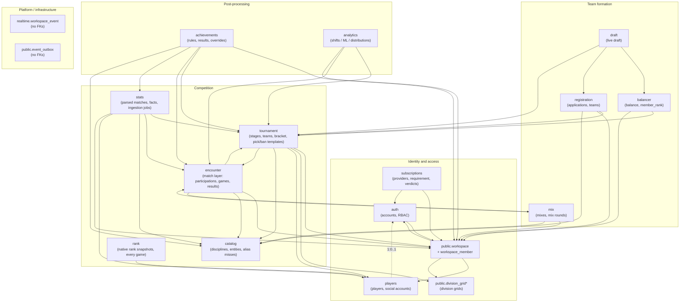

Two edges the map does not draw, because the schema no longer has them: `registration` does not
reference `players` (registration identity goes through `workspace_member`), and `analytics`
reads match data only through `tournament.player` and `encounter.encounter`, never through
`stats` directly. `encounter` and `tournament` reference each other: an encounter points at
its owning tournament, and the bracket position and advancement edges point back at the
encounter. The actor columns of `encounter` (`reporter_user_id`, `actor_user_id`) point at
`auth` and are left out like the rest.

## identity — `auth`, `players`

Login accounts, refresh tokens, OAuth connections, API keys, the grant-only RBAC catalog with
its deny overlay, the domain player, and the audit trail left when two players are merged.

RBAC is grant-only: roles grant permissions, and the single subtracting mechanism is
`auth.user_permission_deny` — a targeted denial that overrides everything a role grants,
including a superuser's implicit grant. Both `roles` and `user_permission_deny` allow a NULL
`workspace_id`, which means "everywhere": a system role, or a platform-wide ban on one
permission. API keys are scoped the other way round — always to one workspace — and store only
`secret_hash`, with their scopes in a child table rather than a JSON array so a scope can be
revoked with a `DELETE`.

`players.user` is the domain player and is independent of the account: `auth_user_id` is unique
and nullable, so a player parsed out of a match log exists long before, or instead of, anyone
logging in. Social handles (battlenet, discord, twitch, …) are consolidated in `social_account`,
deduplicated per `(user_id, provider, username_normalized)`, with a per-workspace visibility
overlay — a row in `social_account_visibility` with `workspace_id = NULL` means visible
everywhere.

Merging two players is destructive at the row level, which is why `user_merge_audit` keeps the
field policy, the identity ids that moved, the ones that were deduplicated, the affected row
counts and a preview snapshot. Its source and target FKs are nullable so the audit outlives the
rows it describes.

<!-- ERD:auto identity -->
```mermaid
erDiagram
    AUTH_API_KEY {
        bigint id PK
        timestamptz created_at
        timestamptz updated_at "nullable"
        bigint auth_user_id FK
        bigint workspace_id FK
        varchar(32) public_id UK
        varchar(128) secret_hash
        varchar(100) name
        timestamptz expires_at "nullable"
        timestamptz revoked_at "nullable"
        timestamptz last_used_at "nullable"
        boolean is_superuser
    }
    AUTH_API_KEY_SCOPE {
        bigint api_key_id PK,FK
        varchar(64) scope PK
    }
    AUTH_OAUTH_CONNECTIONS {
        bigint id PK
        timestamptz created_at
        timestamptz updated_at "nullable"
        bigint auth_user_id FK
        varchar(50) provider
        varchar(255) provider_user_id
        varchar(255) email "nullable"
        varchar(100) username
        varchar(100) display_name "nullable"
        varchar(500) avatar_url "nullable"
        text access_token "nullable"
        text refresh_token "nullable"
        timestamptz token_expires_at "nullable"
        json provider_data "nullable"
    }
    AUTH_PERMISSIONS {
        bigint id PK
        timestamptz created_at
        timestamptz updated_at "nullable"
        varchar(100) name UK
        varchar(100) resource
        varchar(50) action
        text description "nullable"
    }
    AUTH_REFRESH_TOKEN {
        bigint id PK
        timestamptz created_at
        timestamptz updated_at "nullable"
        text token UK
        bigint user_id FK
        uuid session_id
        timestamptz session_started_at
        timestamptz expires_at
        boolean is_revoked
        timestamptz revoked_at "nullable"
        varchar(500) user_agent "nullable"
        varchar(45) ip_address "nullable"
    }
    AUTH_ROLE_PERMISSIONS {
        int id PK
        int role_id FK
        int permission_id FK
        timestamptz created_at
    }
    AUTH_ROLES {
        bigint id PK
        timestamptz created_at
        timestamptz updated_at "nullable"
        varchar(100) name
        text description "nullable"
        boolean is_system
        bigint workspace_id FK "nullable"
    }
    AUTH_USER {
        bigint id PK
        timestamptz created_at
        timestamptz updated_at "nullable"
        varchar(255) email UK
        varchar(100) username UK
        varchar(255) hashed_password "nullable"
        boolean is_active
        boolean is_superuser
        boolean is_verified
        varchar(100) first_name "nullable"
        varchar(100) last_name "nullable"
    }
    AUTH_USER_PERMISSION_DENY {
        bigint id PK
        timestamptz created_at
        timestamptz updated_at "nullable"
        bigint user_id FK
        bigint permission_id FK
        bigint workspace_id FK "nullable"
        bigint created_by FK "nullable"
        text reason "nullable"
    }
    AUTH_USER_ROLES {
        int id PK
        int user_id FK
        int role_id FK
        timestamptz created_at
    }
    PLAYERS_SOCIAL_ACCOUNT {
        bigint id PK
        timestamptz created_at
        timestamptz updated_at "nullable"
        bigint user_id FK
        varchar(64) provider
        varchar(255) username
        varchar(255) username_normalized "nullable"
        varchar(500) url "nullable"
        varchar(255) display_name "nullable"
        varchar(255) provider_user_id "nullable"
        boolean is_verified
        boolean is_primary
    }
    PLAYERS_SOCIAL_ACCOUNT_VISIBILITY {
        bigint id PK
        timestamptz created_at
        timestamptz updated_at "nullable"
        bigint account_id FK
        bigint workspace_id FK "nullable"
    }
    PLAYERS_USER {
        bigint id PK
        timestamptz created_at
        timestamptz updated_at "nullable"
        varchar name UK
        varchar(500) avatar_url "nullable"
        boolean stream_visible
        bigint auth_user_id FK,UK "nullable"
    }
    PLAYERS_USER_MERGE_AUDIT {
        bigint id PK
        timestamptz created_at
        timestamptz updated_at "nullable"
        bigint source_user_id FK "nullable"
        bigint target_user_id FK "nullable"
        bigint operator_auth_user_id FK "nullable"
        json field_policy_json
        json moved_identity_ids_json
        json deduped_identity_ids_json
        json affected_counts_json
        json preview_snapshot_json
    }

    AUTH_API_KEY ||--o| AUTH_API_KEY_SCOPE : "api_key_id"
    AUTH_PERMISSIONS ||--o{ AUTH_ROLE_PERMISSIONS : "permission_id"
    AUTH_PERMISSIONS ||--o{ AUTH_USER_PERMISSION_DENY : "permission_id"
    AUTH_ROLES ||--o{ AUTH_ROLE_PERMISSIONS : "role_id"
    AUTH_ROLES ||--o{ AUTH_USER_ROLES : "role_id"
    AUTH_USER |o--o{ AUTH_USER_PERMISSION_DENY : "created_by"
    AUTH_USER |o--o{ PLAYERS_USER_MERGE_AUDIT : "operator_auth_user_id"
    AUTH_USER |o--o| PLAYERS_USER : "auth_user_id"
    AUTH_USER ||--o{ AUTH_API_KEY : "auth_user_id"
    AUTH_USER ||--o{ AUTH_OAUTH_CONNECTIONS : "auth_user_id"
    AUTH_USER ||--o{ AUTH_REFRESH_TOKEN : "user_id"
    AUTH_USER ||--o{ AUTH_USER_PERMISSION_DENY : "user_id"
    AUTH_USER ||--o{ AUTH_USER_ROLES : "user_id"
    PLAYERS_SOCIAL_ACCOUNT ||--o{ PLAYERS_SOCIAL_ACCOUNT_VISIBILITY : "account_id"
    PLAYERS_USER |o--o{ PLAYERS_USER_MERGE_AUDIT : "source_user_id"
    PLAYERS_USER |o--o{ PLAYERS_USER_MERGE_AUDIT : "target_user_id"
    PLAYERS_USER ||--o{ PLAYERS_SOCIAL_ACCOUNT : "user_id"
    PUBLIC_WORKSPACE |o--o{ AUTH_ROLES : "workspace_id"
    PUBLIC_WORKSPACE |o--o{ AUTH_USER_PERMISSION_DENY : "workspace_id"
    PUBLIC_WORKSPACE |o--o{ PLAYERS_SOCIAL_ACCOUNT_VISIBILITY : "workspace_id"
    PUBLIC_WORKSPACE ||--o{ AUTH_API_KEY : "workspace_id"
```

Composite unique keys:

- `AUTH_OAUTH_CONNECTIONS` unique on (`provider`, `provider_user_id`)
- `PLAYERS_SOCIAL_ACCOUNT` unique on (`user_id`, `provider`, `username_normalized`)
<!-- /ERD:auto -->

## tenancy — `public`

The tenant root and its membership anchor, plus workspace-level settings: branding, subdomain
and custom domain, Discord guild binding, enabled disciplines and per-discipline default grids.

`workspace` is the tenant and carries the white-label surface: `timezone` (IANA), the
`brand_*` palette behind `branding_enabled`, `subdomain` and `custom_domain` (both UNIQUE, the
domain with a verification token and timestamp), the SEO strings, and `discord_guild_id` —
UNIQUE and verified the same way, which makes it the single source of the guild snowflake for
every service that needs one. `owner_id` records who created the workspace and is deliberately
decoupled from the RBAC `owner` role: the role is mutable and may have several holders, while
ownership is an accountability fact about one account.

`workspace_member` is the identity anchor for everything tenant-scoped — rosters, registrations,
member ranks, draft entries, custom-game lineups, mix round members, achievements — and is unique
on `(workspace_id, player_id)`. It carries no denormalized role: the role is derived from RBAC,
so there is exactly one place where a permission answer comes from.

`settings` is the exception in this schema: a global key/value table (`key` UNIQUE, e.g. the
stats-service's rank-collection switch), not tenant-scoped.

<!-- ERD:auto tenancy -->
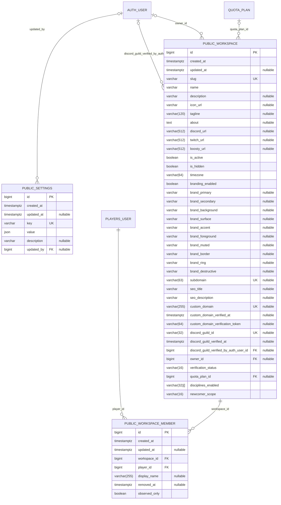

Composite unique keys:

- `PUBLIC_WORKSPACE_MEMBER` unique on (`id`, `workspace_id`)
- `PUBLIC_WORKSPACE_MEMBER` unique on (`workspace_id`, `player_id`)
<!-- /ERD:auto -->

## member_rank — `balancer`

A player's rank inside one workspace, kept in two layers that are never merged: the workspace
canon everyone inherits, and each ranking author's own book, which overrides canon for that
author alone.

The nullable `author_user_id` *is* the discriminator, and there is deliberately no `scope`
column that could disagree with it. Two partial unique indexes enforce the split: one canon row
per `(workspace_id, workspace_member_id, role_id)` where the author is NULL, one private row per
`(workspace_id, author_user_id, workspace_member_id, role_id)` where it is not. They are partial indexes rather than plain
unique constraints because Postgres treats NULLs in a composite unique key as distinct and would
happily store two canon rows for the same member and role. One table replaced three earlier
per-context rank stores, so the resolver reads both layers in a single query.

Both `member_rank` and `member_hidden_rating` reference `(role_id, dimension_id)` in the discipline's
rated module roles; hidden ratings are unique per `(workspace_member_id, role_id)`. Same-named roles
in different games are independent. The `role` hybrid exposes the catalog code. Composite role FKs are
`DEFERRABLE INITIALLY DEFERRED`, with leading role-ID
indexes. The resolver's final `native` layer is the module hook, not a core Overwatch reader.
Open slots (`flex`) have no rank key.

<!-- ERD:auto member_rank -->
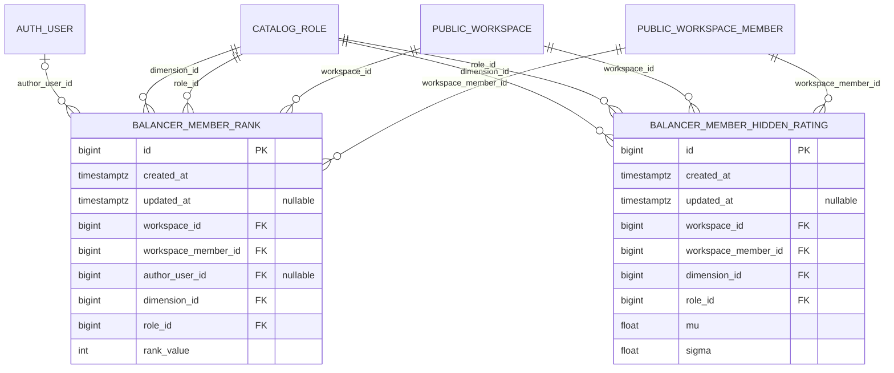

Composite unique keys:

- `BALANCER_MEMBER_HIDDEN_RATING` unique on (`workspace_member_id`, `role_id`)
<!-- /ERD:auto -->

## catalog — `catalog`

`catalog.discipline` lists the games the platform knows (`overwatch`, `lol` and `deadlock`), referenced by
tournaments, mixes and encounters. Behaviour lives in `backend/shared/disciplines/<slug>/`,
reached only through the `shared.disciplines` registry: supported catalog kinds and their labels,
character classes, catalog sync source, sides, role ontology and team-format presets. Catalog and
role support do not by themselves enable LoL gameplay.

`catalog.entity` holds `character`, `map` and `mode` rows. A module labels those core kinds
("Hero" or "Champion" for `character`) without inventing kinds. Names and slugs are unique per
discipline and kind; a map's `parent_id` is the mode it belongs to, if any, constrained to the same
discipline, and a character's class is `attrs.class`. A played match's mode is stored on the match
and the game (`stats.match.mode_entity_id`, `encounter.game.mode_id`), not read from the map: one map
can host several modes. Admin CRUD is generic by discipline and kind through
app-service; public hero/map/gamemode reads still project Overwatch-shaped responses.

App-service startup projects each module's declarations into `catalog.role_dimension` and
`catalog.role`, deactivating removed module roles rather than deleting history. Each dimension has
`single`/`multi` cardinality; exactly one per discipline is rated. Workspace sub-roles have an
immutable `parent_role_id` and `<parent>_<slug>` code, unique per workspace and dimension.
`CatalogRoleRepository` scopes reads by discipline, dimension and workspace.
Assignments hold one leaf, with its parent derived; `flex` creates no assignment. The wire is
`RoleRef {dimension, role, parent}`, where `parent` is output-only and ignored on input.
`tournament.player_role` and `encounter.team_member_role` use role/dimension ids, as do registration,
mix, draft, balancer-slot and ML-artifact references. The encounter role table's primary key is
`(team_member_id, role_id)`; `dimension_id` is a stored reference field.
Composite assignment/quota FKs into `catalog.role` are `DEFERRABLE INITIALLY DEFERRED`, not
immediate constraints.

Overwatch logs resolve canonical names or `aliases` (a JSONB array) within that discipline.
The OverFast module sync adds hero aliases from all 13 Blizzard locales; map and mode aliases
are admin-maintained because their endpoints have no locale parameter. The LoL module sync
uses Data Dragon's latest published champion and map catalog. Both dispatch through
`rpc.stats.catalog.sync`, preserve existing names and `attrs`, and fill a source parent only
where the stored `parent_id` is null. Mirrored images live under
`assets/<discipline>/<kind>/<slug>.<ext>` and existing bucket images survive a sync. An image the
source lists but answers 404 for leaves its row with no image (the site paints initials) instead
of failing the sync; any other image failure still fails it. Rows missing
from a later sync are not deleted or deactivated.

Unresolved log names land in `catalog.alias_miss`, the admin alias worklist keyed by
`(discipline, kind, raw_name)`, with an `occurrences` counter. Attaching an alias or dismissing
the miss stamps `resolved_at`; seeing the name again clears it. `last_ingest_job_id` is a
nullable FK to `stats.ingest_job`. `stats01` preserves every non-null legacy breadcrumb through
the copied job id and refuses orphan references; it never clears one to make migration pass.

`discipline01` copies the old catalog into new entity ids above every id `overwatch.*` ever
issued. It rewrites existing references, including `matches.*` in place and pick/ban ids in
`encounter.room_event.data`, through a `catalog.entity_legacy (legacy_kind, legacy_id) → entity_id`
mapping. No service reads or writes `overwatch.*`, and old hero/map/gamemode ids no longer resolve;
the gated `legacy01` drops both.

<!-- ERD:auto catalog -->
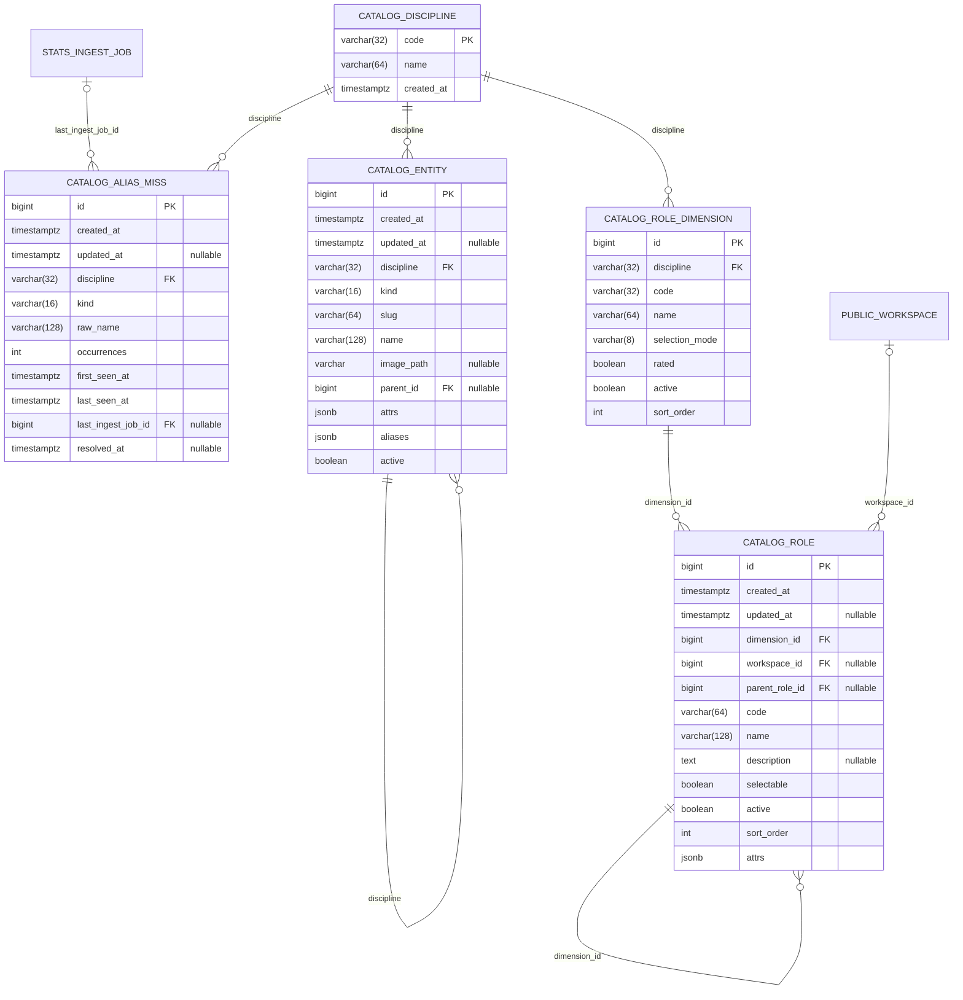

Composite unique keys:

- `CATALOG_ALIAS_MISS` unique on (`discipline`, `kind`, `raw_name`)
- `CATALOG_ENTITY` unique on (`id`, `discipline`)
- `CATALOG_ENTITY` unique on (`id`, `kind`)
- `CATALOG_ENTITY` unique on (`id`, `discipline`, `kind`)
- `CATALOG_ENTITY` unique on (`discipline`, `kind`, `name`)
- `CATALOG_ENTITY` unique on (`discipline`, `kind`, `slug`)
- `CATALOG_ROLE` unique on (`id`, `dimension_id`)
- `CATALOG_ROLE_DIMENSION` unique on (`discipline`, `code`)
- `CATALOG_ROLE_DIMENSION` unique on (`id`, `discipline`)
<!-- /ERD:auto -->

## roster — `roster`

Team formats describe starter and substitute bounds, dimension modes and role quotas against the
discipline's catalog ontology. A workspace may keep one default per discipline; creation copies it
(or the module preset) into each tournament or mix, so later template edits do not change existing events.
A tournament can edit its copy; a mix freezes its format at creation, with an explicit preset taking
precedence over a clone's format, then the workspace default, then the module preset.
`flex` is only the projected open-slot key, never a catalog role or a quota rule.
Migrated and preset formats set substitute bounds to zero; registration benches still use
`registration.form.max_substitutes`, and current validation applies to starters only.
Hard constraints cover every active dimension. Only the tournament/MOO solver has a sub-role
collision term gated by `recommended_max <= 1`; other recommendations and all mix recommendations
are post-solve advisories and equal-objective tie-breakers.

<!-- ERD:auto roster -->
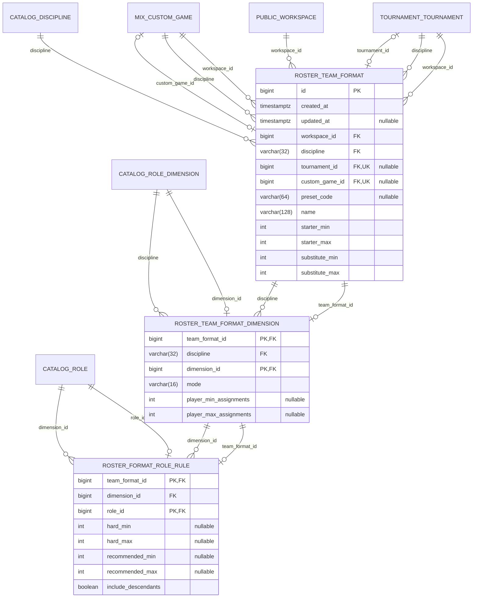

Composite unique keys:

- `ROSTER_TEAM_FORMAT` unique on (`id`, `discipline`)
<!-- /ERD:auto -->

## division_grid — `public`

Versioned rank grids belonging to a discipline: organizer rank ranges and mappings between versions
keep ranks comparable across seasons. A workspace selects defaults independently for each game.

A tier carries both the internal rank range (`rank_min`/`rank_max`) and the game's native ladder range
(`native_rank_min`/`native_rank_max`); mappings between two versions, with weighted rules per tier pair,
are what keeps ranks comparable after a season change or an Overwatch rebinding. A version is
immutable once published — a new one is forked through `created_from_version_id` — and a grid
with `workspace_id = NULL` is global.

`workspace_division_grid_default` independently selects a version for each
`(workspace_id, discipline)`. `tournament.division_grid_version_id` can pin a
same-discipline version instead of inheriting that discipline's workspace default,
so a finished tournament keeps showing the ranks it was actually played at.
Activation and deletion change only the corresponding assignment; a valid pin needs no workspace
default. `WorkspaceRead.default_division_grid_versions` exposes explicit IDs, while
`effective_division_grid_versions` exposes persisted effective versions/tiers (including matching
system fallback). Missing versions are omitted, not synthetic rows. Both maps are read-only on
workspace create/update; old scalar payloads are rejected. A game with a native ladder (Overwatch 45 tiers,
LoL 31) seeds a new grid with it and falls back to it when it has no grid of its own; a ladder-less game's
creation, clone and runtime reads without a tiered grid return 422 `division_grid_required`, never another
game's tiers.
`division_grid_import_job` covers copying a grid from another workspace;
it is idempotent per `(workspace_id, idempotency_key)`. Portable v1 imports are Overwatch; exports
write `division-grid/v2` with `discipline` and native-bound names.

<!-- ERD:auto division_grid -->
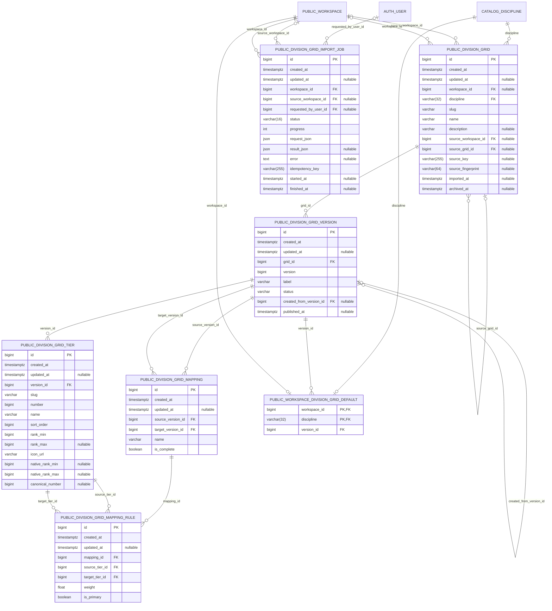

Composite unique keys:

- `PUBLIC_DIVISION_GRID` unique on (`workspace_id`, `slug`)
- `PUBLIC_DIVISION_GRID_IMPORT_JOB` unique on (`workspace_id`, `idempotency_key`)
- `PUBLIC_DIVISION_GRID_MAPPING` unique on (`source_version_id`, `target_version_id`)
- `PUBLIC_DIVISION_GRID_TIER` unique on (`version_id`, `slug`)
- `PUBLIC_DIVISION_GRID_TIER` unique on (`version_id`, `sort_order`)
- `PUBLIC_DIVISION_GRID_VERSION` unique on (`grid_id`, `version`)
<!-- /ERD:auto -->

## ranks — `rank`

Native rank telemetry of every game, one `discipline` per row: Overwatch per role from OverFast
against a linked BattleTag, League of Legends per queue (`solo`, `flex`) from the Riot API against a
linked Riot ID, Deadlock one series per account from deadlock-api against a linked Steam account
(`division` = tier name, `tier` = subrank). The snapshot time series, the per-account fetch state,
and the fetch log.

Collection is bound to the game's `social_account` (battlenet, riot, steam), not to a bare handle string,
so a re-linked or renamed account keeps its history. `rank_snapshot` is append-only and stores one
row per role (Overwatch), queue (LoL, with `lp`/`wins`/`losses`) or account (Deadlock) per capture. It keeps the native
`division`/`tier` next to `rank_value` and `mapping_version` (which mapping produced `rank_value`), so a
mapping change can be replayed instead of re-fetched. `handle` is the account's handle at capture time.

`account_state` is the scheduler, one row per social account (UNIQUE): `next_eligible_at`,
`consecutive_failures` and `priority_tier` are the backoff, `external_id` is the upstream id
(OverFast slug, Riot PUUID, Steam account id; NULL until resolved) and `region` the LoL platform. Its PK,
unique-constraint and sequence names keep the pre-`rank01` `battle_tag_state_*` names. `fetch_log`
is the attempt history, with a nullable account FK so it survives unlinking.

Core reads these only through the registry's `native_ranks` and `native_rank_rows` hooks; each
ladder lives in its module (`shared/disciplines/overwatch/ladder.py`,
`shared/disciplines/lol/ladder.py`) and each collector is that module's jobs in `stats-worker`.

<!-- ERD:auto ranks -->
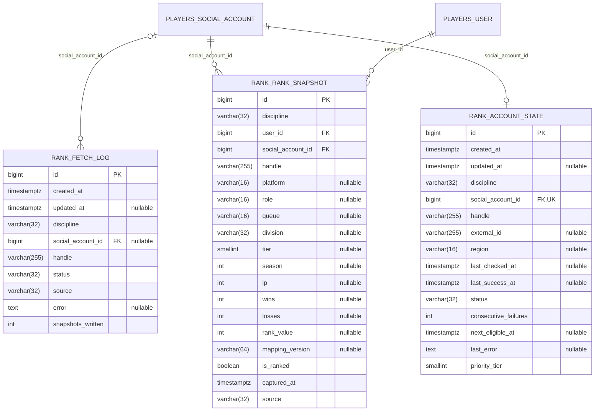
<!-- /ERD:auto -->

## tournament — `tournament`

The largest domain: the tournament itself and its lifecycle, stages and stage items, teams and
their rosters, the bracket positions and advancement edges that tie encounters into a bracket,
the pick/ban templates, standings and their computation jobs, Challonge synchronisation, scrim
rooms, and preview access. The encounters themselves are in [`encounter`](#encounter--encounter).

The structure is `tournament → stage → stage_item → stage_item_input`. A stage item is a group,
a bracket or a round-robin; the legacy `tournament.group` table is gone, and a group is a stage
item of that type. Seeding and advancement live in `stage_item_input`: a slot is filled either
by a team directly or by "position N of stage item M", which makes the bracket declarative
instead of derived from a shape.

A roster entry is `tournament.player`, anchored on `workspace_member` with a NOT NULL FK — a
roster slot cannot exist for someone who is not a member of the tenant. `related_player_id` is a
self-reference linking a substitute to the player they stand in for, and sub-roles come from the
per-workspace `player_sub_role` catalog. `tournament.team` deliberately stores no SR: team
strength is derived from the roster, never cached on the row.

The meetings themselves live in the [`encounter`](#encounter--encounter) schema, which this
schema references; what stays here is the tournament's structure around them.
`tournament.bracket_encounter` is an encounter's place in a bracket — stage, stage item and
round, one row per bracketed encounter — and `encounter_link` holds the advancement edges
explicitly: the team that finishes in position *k* of the source encounter fills a numbered slot
of the target. Both carry `tournament_id` so a composite key can check that the encounters on
both ends belong to the same tournament. `tournament.tournament` has a `discipline`
(`catalog.discipline.code`) that every encounter under it copies, and `stage.scoring_rule_id`
names the `encounter.scoring_rule` its encounters are scored by. `encounter_report_form` is the
per-tournament definition of the fields a captain's series report asks for.

Pick/ban is generic: `pick_ban_config` is the template (mode, first-pick rule, ban rotation,
resolved sequence) with its pool in `pick_ban_config_item` and `pick_ban_config_slot*`. The live
run — session, entries, submissions — belongs to the encounter and lives in the `encounter`
schema. This engine replaced the earlier map-veto tables; there is no `map_veto_config` any more.

The Challonge bridge has exactly one source of truth: `challonge_source` (per tournament, stage
or stage item) plus `challonge_participant_mapping`, `challonge_match_mapping` and
`challonge_sync_log`. No Challonge id is stored on `tournament`, `stage` or `encounter`.

Recomputation is durable: `computation_job` carries an idempotency key so a retry does not
double-run, and `recalculation_state` is one row per tournament holding a requested and a
completed generation counter — a burst of change events collapses into one recompute instead of
queueing several. `slug_redirect` keeps old URLs alive after a rename, `scrim_room` is a
tokenized link for one encounter, and `tournament_preview_access` is the allow-list for a
tournament that is still hidden.

<!-- ERD:auto tournament -->
```mermaid
erDiagram
    TOURNAMENT_BRACKET_ENCOUNTER {
        bigint encounter_id PK,FK
        bigint tournament_id FK
        bigint stage_id FK "nullable"
        bigint stage_item_id FK "nullable"
        int round
    }
    TOURNAMENT_CHALLONGE_MATCH_MAPPING {
        bigint id PK
        timestamptz created_at
        timestamptz updated_at "nullable"
        bigint source_id FK
        int challonge_match_id
        bigint encounter_id FK
    }
    TOURNAMENT_CHALLONGE_PARTICIPANT_MAPPING {
        bigint id PK
        timestamptz created_at
        timestamptz updated_at "nullable"
        bigint source_id FK
        int challonge_participant_id
        bigint team_id FK
    }
    TOURNAMENT_CHALLONGE_SOURCE {
        bigint id PK
        timestamptz created_at
        timestamptz updated_at "nullable"
        bigint tournament_id FK
        bigint stage_id FK "nullable"
        bigint stage_item_id FK "nullable"
        int challonge_tournament_id
        varchar slug "nullable"
        varchar(32) source_type
    }
    TOURNAMENT_CHALLONGE_SYNC_LOG {
        bigint id PK
        timestamptz created_at
        timestamptz updated_at "nullable"
        bigint tournament_id FK
        bigint source_id FK "nullable"
        varchar(10) direction
        varchar(32) operation "nullable"
        varchar(32) entity_type
        int entity_id "nullable"
        int challonge_id "nullable"
        varchar(16) status
        varchar(32) conflict_type "nullable"
        json payload_json "nullable"
        json before_json "nullable"
        json after_json "nullable"
        text error_message "nullable"
    }
    TOURNAMENT_COMPUTATION_JOB {
        bigint id PK
        timestamptz created_at
        timestamptz updated_at "nullable"
        varchar(16) kind
        varchar(48) operation
        bigint tournament_id FK
        bigint stage_id FK "nullable"
        bigint stage_item_id FK "nullable"
        varchar(16) status
        json payload_json
        json result_json "nullable"
        text error "nullable"
        bigint requested_by_user_id FK "nullable"
        varchar(255) idempotency_key
        int attempts
        timestamptz started_at "nullable"
        timestamptz finished_at "nullable"
    }
    TOURNAMENT_ENCOUNTER_LINK {
        bigint id PK
        timestamptz created_at
        timestamptz updated_at "nullable"
        bigint tournament_id FK
        bigint source_encounter_id FK
        int source_position
        bigint target_encounter_id FK
        int target_slot
    }
    TOURNAMENT_ENCOUNTER_REPORT_FORM {
        bigint id PK
        timestamptz created_at
        timestamptz updated_at "nullable"
        bigint tournament_id FK,UK
        json built_in_fields_json
        json custom_fields_json
    }
    TOURNAMENT_PICK_BAN_CONFIG {
        bigint id PK
        timestamptz created_at
        timestamptz updated_at "nullable"
        bigint tournament_id FK
        pickbankind kind
        bigint stage_id FK "nullable"
        int round "nullable"
        pickbanmode mode
        pickbanfirstpickrule first_pick_rule
        pickbanrotation first_ban_rotation
        json ruleset_json
    }
    TOURNAMENT_PICK_BAN_CONFIG_ITEM {
        bigint id PK
        timestamptz created_at
        timestamptz updated_at "nullable"
        bigint pick_ban_config_id FK
        int item_id
        int sort_order
    }
    TOURNAMENT_PICK_BAN_CONFIG_SLOT {
        bigint id PK
        timestamptz created_at
        timestamptz updated_at "nullable"
        bigint pick_ban_config_id FK
        int position
        int reserve_item_id "nullable"
    }
    TOURNAMENT_PICK_BAN_CONFIG_SLOT_ITEM {
        bigint id PK
        timestamptz created_at
        timestamptz updated_at "nullable"
        bigint pick_ban_config_slot_id FK
        int item_id
        int sort_order
    }
    TOURNAMENT_PLAYER {
        bigint id PK
        timestamptz created_at
        timestamptz updated_at "nullable"
        varchar name
        int rank "nullable"
        boolean is_substitution
        bigint related_player_id FK "nullable"
        bigint tournament_id FK
        boolean is_newcomer
        boolean is_newcomer_role
        bigint workspace_member_id FK
        bigint team_id FK
    }
    TOURNAMENT_PLAYER_ROLE {
        bigint player_id PK,FK
        bigint dimension_id FK
        bigint role_id PK,FK
    }
    TOURNAMENT_RECALCULATION_STATE {
        bigint tournament_id PK,FK
        bigint requested_generation
        bigint completed_generation
        timestamptz created_at
        timestamptz updated_at "nullable"
    }
    TOURNAMENT_SCRIM_ROOM {
        bigint id PK
        timestamptz created_at
        timestamptz updated_at "nullable"
        varchar(32) token UK
        varchar(255) label
        bigint workspace_id FK
        bigint tournament_id FK
        bigint stage_id FK
        bigint encounter_id FK,UK
        bigint created_by_auth_user_id FK
        timestamptz closed_at "nullable"
    }
    TOURNAMENT_SLUG_REDIRECT {
        bigint id PK
        timestamptz created_at
        timestamptz updated_at "nullable"
        varchar old_slug UK
        bigint tournament_id FK
    }
    TOURNAMENT_STAGE {
        bigint id PK
        timestamptz created_at
        timestamptz updated_at "nullable"
        bigint tournament_id FK
        bigint scoring_rule_id FK
        varchar name
        varchar description "nullable"
        stagetype stage_type
        int max_rounds
        int advance_count "nullable"
        int advance_upper_count "nullable"
        int order
        boolean is_active
        boolean is_published
        boolean is_completed
        varchar ranking_preset "nullable"
        varchar[] tiebreak_order "nullable"
        float win_points "nullable"
        float draw_points "nullable"
        float loss_points "nullable"
        float swiss_bye_points "nullable"
        int swiss_qualify_wins "nullable"
        int swiss_eliminate_losses "nullable"
        varchar(16) de_grand_final_type
        varchar(16) seed_ranking
        int best_of_default
        int best_of_final "nullable"
        int best_of_swiss_qualify "nullable"
        int best_of_swiss_eliminate "nullable"
        bigint challonge_group_id "nullable"
        jsonb bracket_template "nullable"
    }
    TOURNAMENT_STAGE_ITEM {
        bigint id PK
        timestamptz created_at
        timestamptz updated_at "nullable"
        bigint stage_id FK
        varchar name
        stageitemtype type
        int order
        int advance_count "nullable"
        int advance_upper_count "nullable"
    }
    TOURNAMENT_STAGE_ITEM_INPUT {
        bigint id PK
        timestamptz created_at
        timestamptz updated_at "nullable"
        bigint stage_item_id FK
        int slot
        stageiteminputtype input_type
        bigint team_id FK "nullable"
        bigint source_stage_item_id FK "nullable"
        int source_position "nullable"
    }
    TOURNAMENT_STAGE_ROUND_BEST_OF {
        bigint stage_id PK,FK
        int round PK
        int best_of
    }
    TOURNAMENT_STANDING {
        bigint id PK
        timestamptz created_at
        timestamptz updated_at "nullable"
        int tournament_id FK
        int team_id FK
        int stage_id FK "nullable"
        int stage_item_id FK "nullable"
        int position
        int overall_position
        int matches
        int win
        int draw
        int lose
        float points
        float buchholz "nullable"
        float full_buchholz "nullable"
        int tie_group "nullable"
        int tb "nullable"
        int score_differential "nullable"
        boolean is_pinned
        varchar(16) swiss_status "nullable"
    }
    TOURNAMENT_STANDING_PIN {
        bigint id PK
        timestamptz created_at
        timestamptz updated_at "nullable"
        bigint tournament_id FK
        bigint stage_id FK
        bigint stage_item_id FK "nullable"
        bigint team_id FK
        int position
    }
    TOURNAMENT_SWISS_BYE {
        bigint id PK
        timestamptz created_at
        timestamptz updated_at "nullable"
        bigint stage_id FK
        bigint stage_item_id FK "nullable"
        bigint team_id FK
        int round "nullable"
    }
    TOURNAMENT_SWISS_STOPPED_SCOPE {
        bigint id PK
        timestamptz created_at
        timestamptz updated_at "nullable"
        bigint stage_id FK
        bigint stage_item_id FK "nullable"
    }
    TOURNAMENT_TEAM {
        bigint id PK
        timestamptz created_at
        timestamptz updated_at "nullable"
        varchar balancer_name
        varchar name
        varchar image_url "nullable"
        bigint captain_id FK "nullable"
        bigint tournament_id FK
    }
    TOURNAMENT_TOURNAMENT {
        bigint id PK
        timestamptz created_at
        timestamptz updated_at "nullable"
        bigint workspace_id FK
        varchar(32) discipline FK
        varchar name
        varchar slug UK
        varchar description "nullable"
        text rules "nullable"
        boolean is_league
        boolean is_finished
        boolean is_hidden
        varchar team_formation
        tournamentstatus status
        timestamptz start_date "nullable"
        timestamptz end_date "nullable"
        boolean auto_transitions_enabled
        boolean allow_late_registration
        boolean discord_broadcasts_enabled
        boolean discord_dms_enabled
        boolean logs_official
        int pov_stream_delay_s
        float win_points
        float draw_points
        float loss_points
        bigint division_grid_version_id FK "nullable"
        jsonb draft_format_json "nullable"
        varchar cover_image_url "nullable"
        varchar logo_url "nullable"
    }
    TOURNAMENT_TOURNAMENT_LINK {
        bigint id PK
        timestamptz created_at
        timestamptz updated_at "nullable"
        bigint tournament_id FK
        varchar(32) kind
        varchar(128) label "nullable"
        varchar(500) url
        int sort_order
        boolean is_active
    }
    TOURNAMENT_TOURNAMENT_PHASE_SCHEDULE {
        bigint id PK
        timestamptz created_at
        timestamptz updated_at "nullable"
        bigint tournament_id FK
        tournamentstatus status
        timestamptz starts_at
        timestamptz ends_at "nullable"
    }
    TOURNAMENT_TOURNAMENT_PREVIEW_ACCESS {
        bigint id PK
        timestamptz created_at
        timestamptz updated_at "nullable"
        bigint tournament_id FK
        bigint auth_user_id FK
    }

    AUTH_USER |o--o{ TOURNAMENT_COMPUTATION_JOB : "requested_by_user_id"
    AUTH_USER ||--o{ TOURNAMENT_SCRIM_ROOM : "created_by_auth_user_id"
    AUTH_USER ||--o{ TOURNAMENT_TOURNAMENT_PREVIEW_ACCESS : "auth_user_id"
    CATALOG_DISCIPLINE ||--o{ TOURNAMENT_TOURNAMENT : "discipline"
    CATALOG_ROLE ||--o{ TOURNAMENT_PLAYER_ROLE : "dimension_id"
    CATALOG_ROLE ||--o| TOURNAMENT_PLAYER_ROLE : "role_id"
    ENCOUNTER_ENCOUNTER ||--o{ TOURNAMENT_BRACKET_ENCOUNTER : "tournament_id"
    ENCOUNTER_ENCOUNTER ||--o{ TOURNAMENT_CHALLONGE_MATCH_MAPPING : "encounter_id"
    ENCOUNTER_ENCOUNTER ||--o{ TOURNAMENT_ENCOUNTER_LINK : "source_encounter_id"
    ENCOUNTER_ENCOUNTER ||--o{ TOURNAMENT_ENCOUNTER_LINK : "target_encounter_id"
    ENCOUNTER_ENCOUNTER ||--o{ TOURNAMENT_ENCOUNTER_LINK : "tournament_id"
    ENCOUNTER_ENCOUNTER ||--o| TOURNAMENT_BRACKET_ENCOUNTER : "encounter_id"
    ENCOUNTER_ENCOUNTER ||--o| TOURNAMENT_SCRIM_ROOM : "encounter_id"
    ENCOUNTER_SCORING_RULE ||--o{ TOURNAMENT_STAGE : "scoring_rule_id"
    PLAYERS_USER |o--o{ TOURNAMENT_TEAM : "captain_id"
    PUBLIC_DIVISION_GRID_VERSION |o--o{ TOURNAMENT_TOURNAMENT : "division_grid_version_id"
    PUBLIC_WORKSPACE ||--o{ TOURNAMENT_SCRIM_ROOM : "workspace_id"
    PUBLIC_WORKSPACE ||--o{ TOURNAMENT_TOURNAMENT : "workspace_id"
    PUBLIC_WORKSPACE_MEMBER ||--o{ TOURNAMENT_PLAYER : "workspace_member_id"
    TOURNAMENT_CHALLONGE_SOURCE |o--o{ TOURNAMENT_CHALLONGE_SYNC_LOG : "source_id"
    TOURNAMENT_CHALLONGE_SOURCE ||--o{ TOURNAMENT_CHALLONGE_MATCH_MAPPING : "source_id"
    TOURNAMENT_CHALLONGE_SOURCE ||--o{ TOURNAMENT_CHALLONGE_PARTICIPANT_MAPPING : "source_id"
    TOURNAMENT_PICK_BAN_CONFIG ||--o{ TOURNAMENT_PICK_BAN_CONFIG_ITEM : "pick_ban_config_id"
    TOURNAMENT_PICK_BAN_CONFIG ||--o{ TOURNAMENT_PICK_BAN_CONFIG_SLOT : "pick_ban_config_id"
    TOURNAMENT_PICK_BAN_CONFIG_SLOT ||--o{ TOURNAMENT_PICK_BAN_CONFIG_SLOT_ITEM : "pick_ban_config_slot_id"
    TOURNAMENT_PLAYER |o--o{ TOURNAMENT_PLAYER : "related_player_id"
    TOURNAMENT_PLAYER ||--o| TOURNAMENT_PLAYER_ROLE : "player_id"
    TOURNAMENT_STAGE |o--o{ TOURNAMENT_BRACKET_ENCOUNTER : "stage_id"
    TOURNAMENT_STAGE |o--o{ TOURNAMENT_CHALLONGE_SOURCE : "stage_id"
    TOURNAMENT_STAGE |o--o{ TOURNAMENT_COMPUTATION_JOB : "stage_id"
    TOURNAMENT_STAGE |o--o{ TOURNAMENT_PICK_BAN_CONFIG : "stage_id"
    TOURNAMENT_STAGE |o--o{ TOURNAMENT_STANDING : "stage_id"
    TOURNAMENT_STAGE ||--o{ TOURNAMENT_BRACKET_ENCOUNTER : "tournament_id"
    TOURNAMENT_STAGE ||--o{ TOURNAMENT_SCRIM_ROOM : "stage_id"
    TOURNAMENT_STAGE ||--o{ TOURNAMENT_STAGE_ITEM : "stage_id"
    TOURNAMENT_STAGE ||--o{ TOURNAMENT_STANDING_PIN : "stage_id"
    TOURNAMENT_STAGE ||--o{ TOURNAMENT_SWISS_BYE : "stage_id"
    TOURNAMENT_STAGE ||--o{ TOURNAMENT_SWISS_STOPPED_SCOPE : "stage_id"
    TOURNAMENT_STAGE ||--o| TOURNAMENT_STAGE_ROUND_BEST_OF : "stage_id"
    TOURNAMENT_STAGE_ITEM |o--o{ TOURNAMENT_BRACKET_ENCOUNTER : "stage_id"
    TOURNAMENT_STAGE_ITEM |o--o{ TOURNAMENT_BRACKET_ENCOUNTER : "stage_item_id"
    TOURNAMENT_STAGE_ITEM |o--o{ TOURNAMENT_CHALLONGE_SOURCE : "stage_item_id"
    TOURNAMENT_STAGE_ITEM |o--o{ TOURNAMENT_COMPUTATION_JOB : "stage_item_id"
    TOURNAMENT_STAGE_ITEM |o--o{ TOURNAMENT_STAGE_ITEM_INPUT : "source_stage_item_id"
    TOURNAMENT_STAGE_ITEM |o--o{ TOURNAMENT_STANDING : "stage_item_id"
    TOURNAMENT_STAGE_ITEM |o--o{ TOURNAMENT_STANDING_PIN : "stage_item_id"
    TOURNAMENT_STAGE_ITEM |o--o{ TOURNAMENT_SWISS_BYE : "stage_item_id"
    TOURNAMENT_STAGE_ITEM |o--o{ TOURNAMENT_SWISS_STOPPED_SCOPE : "stage_item_id"
    TOURNAMENT_STAGE_ITEM ||--o{ TOURNAMENT_STAGE_ITEM_INPUT : "stage_item_id"
    TOURNAMENT_TEAM |o--o{ TOURNAMENT_STAGE_ITEM_INPUT : "team_id"
    TOURNAMENT_TEAM ||--o{ TOURNAMENT_CHALLONGE_PARTICIPANT_MAPPING : "team_id"
    TOURNAMENT_TEAM ||--o{ TOURNAMENT_PLAYER : "team_id"
    TOURNAMENT_TEAM ||--o{ TOURNAMENT_STANDING : "team_id"
    TOURNAMENT_TEAM ||--o{ TOURNAMENT_STANDING_PIN : "team_id"
    TOURNAMENT_TEAM ||--o{ TOURNAMENT_SWISS_BYE : "team_id"
    TOURNAMENT_TOURNAMENT ||--o{ TOURNAMENT_CHALLONGE_SOURCE : "tournament_id"
    TOURNAMENT_TOURNAMENT ||--o{ TOURNAMENT_CHALLONGE_SYNC_LOG : "tournament_id"
    TOURNAMENT_TOURNAMENT ||--o{ TOURNAMENT_COMPUTATION_JOB : "tournament_id"
    TOURNAMENT_TOURNAMENT ||--o{ TOURNAMENT_PICK_BAN_CONFIG : "tournament_id"
    TOURNAMENT_TOURNAMENT ||--o{ TOURNAMENT_PLAYER : "tournament_id"
    TOURNAMENT_TOURNAMENT ||--o{ TOURNAMENT_SCRIM_ROOM : "tournament_id"
    TOURNAMENT_TOURNAMENT ||--o{ TOURNAMENT_SLUG_REDIRECT : "tournament_id"
    TOURNAMENT_TOURNAMENT ||--o{ TOURNAMENT_STAGE : "tournament_id"
    TOURNAMENT_TOURNAMENT ||--o{ TOURNAMENT_STANDING : "tournament_id"
    TOURNAMENT_TOURNAMENT ||--o{ TOURNAMENT_STANDING_PIN : "tournament_id"
    TOURNAMENT_TOURNAMENT ||--o{ TOURNAMENT_TEAM : "tournament_id"
    TOURNAMENT_TOURNAMENT ||--o{ TOURNAMENT_TOURNAMENT_LINK : "tournament_id"
    TOURNAMENT_TOURNAMENT ||--o{ TOURNAMENT_TOURNAMENT_PHASE_SCHEDULE : "tournament_id"
    TOURNAMENT_TOURNAMENT ||--o{ TOURNAMENT_TOURNAMENT_PREVIEW_ACCESS : "tournament_id"
    TOURNAMENT_TOURNAMENT ||--o| TOURNAMENT_ENCOUNTER_REPORT_FORM : "tournament_id"
    TOURNAMENT_TOURNAMENT ||--o| TOURNAMENT_RECALCULATION_STATE : "tournament_id"
```

Composite unique keys:

- `TOURNAMENT_CHALLONGE_MATCH_MAPPING` unique on (`source_id`, `encounter_id`)
- `TOURNAMENT_CHALLONGE_MATCH_MAPPING` unique on (`source_id`, `challonge_match_id`)
- `TOURNAMENT_CHALLONGE_PARTICIPANT_MAPPING` unique on (`source_id`, `challonge_participant_id`)
- `TOURNAMENT_CHALLONGE_SOURCE` unique on (`tournament_id`, `challonge_tournament_id`)
- `TOURNAMENT_ENCOUNTER_LINK` unique on (`source_encounter_id`, `source_position`)
- `TOURNAMENT_ENCOUNTER_LINK` unique on (`target_encounter_id`, `target_slot`)
- `TOURNAMENT_PICK_BAN_CONFIG_ITEM` unique on (`pick_ban_config_id`, `item_id`)
- `TOURNAMENT_PICK_BAN_CONFIG_SLOT` unique on (`pick_ban_config_id`, `position`)
- `TOURNAMENT_PICK_BAN_CONFIG_SLOT_ITEM` unique on (`pick_ban_config_slot_id`, `item_id`)
- `TOURNAMENT_STAGE` unique on (`id`, `tournament_id`)
- `TOURNAMENT_STAGE_ITEM` unique on (`id`, `stage_id`)
- `TOURNAMENT_STAGE_ITEM_INPUT` unique on (`stage_item_id`, `slot`)
- `TOURNAMENT_TEAM` unique on (`id`, `tournament_id`)
- `TOURNAMENT_TOURNAMENT` unique on (`id`, `workspace_id`, `discipline`)
- `TOURNAMENT_TOURNAMENT_LINK` unique on (`tournament_id`, `kind`, `url`)
- `TOURNAMENT_TOURNAMENT_PHASE_SCHEDULE` unique on (`tournament_id`, `status`)
- `TOURNAMENT_TOURNAMENT_PREVIEW_ACCESS` unique on (`tournament_id`, `auth_user_id`)
<!-- /ERD:auto -->

## encounter — `encounter`

The game-neutral match layer: an encounter seats `slot_count` immutable participations
(`encounter.team`) with their roster snapshots, games and per-participation game results, the
claims and series reports those results are decided from, one scoring rule per stage or
encounter, the result journal, and the pick/ban room that runs before the first game.

`encounter.encounter` is the old `tournament.encounter` moved with its ids. It knows its owner —
exactly one of `tournament_id` (a tournament round) or `custom_game_id` (a recorded round of a
pickup mix), enforced by `ck_encounter_owner`; each owner is tied to `workspace_id` and
`discipline` by its own composite foreign key (`fk_encounter_owner`, `fk_encounter_custom_game`).
It also knows how many slots it seats and how many games it plays (`best_of`), and the state of
its result: `result_status`,
`result_source` (`games`, `series_claim`, `admin`, `import`, `host`; NULL while nothing official
exists) and `result_version`. There is no `format`, no home/away and no bracket position — a duel
is `slot_count = 2`, and the bracket position is a `tournament.bracket_encounter` row that mix
rounds and scrims simply do not have. A mix round is a Bo1 encounter with source `host`; what only
the balancer reads about it is in `mix.round` and `mix.round_member` (see
[mix](#mix--mix)).

A participation is append-only: replacing the occupant of a slot writes a new `team` row and
sets the old one `active = false`, and nothing reactivates it. `team_id` is the source
`tournament.team` and is set to NULL if that team is deleted; `name` is the snapshot that
survives. Two partial unique indexes allow one active occupant per slot and one active seat per
source team, and `uq_team_member_active_member` one active seat per workspace member per encounter. The
`team_member` rows carry an `active` copy of their participation's, kept in step by an
`ON UPDATE CASCADE` composite key.

`game` is one position, with the map, the mode played (`mode_id`) and the accepted result; a cancelled game keeps its
position as history and a repeated position is a new row. `game_team` is one row per
participation per game: raw score, placement, the organizer's column values, the side it
started on and the replay code. Claims mirror that shape: `game_claim` is one participation's
claim about one game (with a `basis_version`), `game_claim_result` its numbers per participation,
and the composite keys stop a claim from naming a participation that is not in the game.
`team_report` / `team_report_result` do the same for a whole-series report.

`scoring_rule` holds the preset, columns, placement points and the two formulas (`game_formula`,
`end_formula`) an encounter is scored by; the encounter may only point at a rule of its own
workspace. `result_audit` is the version sequence of the encounter — one row per result change,
unique on `(encounter_id, result_version)`, with `before` / `after` snapshots — and `room_event`
the ordered story of the pre-game room. The pick/ban session, entry and submission tables moved
here from `tournament`; the templates they are started from (`pick_ban_config*`) stay in
`tournament`.

<!-- ERD:auto encounter -->
```mermaid
erDiagram
    ENCOUNTER_ENCOUNTER {
        bigint id PK
        timestamptz created_at
        timestamptz updated_at "nullable"
        bigint workspace_id FK
        varchar(32) discipline FK
        bigint tournament_id FK "nullable"
        bigint custom_game_id FK "nullable"
        bigint scoring_rule_id FK
        varchar name
        int slot_count
        int best_of
        encounterstatus status
        encounterresultstatus result_status
        varchar(16) result_source "nullable"
        bigint result_version
        int current_game_position "nullable"
        float closeness "nullable"
        timestamptz scheduled_at "nullable"
        timestamptz started_at "nullable"
        timestamptz ended_at "nullable"
        timestamptz confirmed_at "nullable"
    }
    ENCOUNTER_GAME {
        bigint id PK
        timestamptz created_at
        timestamptz updated_at "nullable"
        bigint encounter_id FK
        int position
        bigint map_id FK "nullable"
        varchar(16) map_kind FK
        bigint mode_id FK "nullable"
        varchar(16) mode_kind FK
        encountergamestate state
        encountergameresultsource result_source "nullable"
        int result_version
        timestamptz confirmed_at "nullable"
    }
    ENCOUNTER_GAME_CLAIM {
        bigint id PK
        timestamptz created_at
        timestamptz updated_at "nullable"
        bigint encounter_id FK
        bigint game_id FK
        bigint claimant_team_id FK
        bigint reporter_user_id FK "nullable"
        int basis_version
    }
    ENCOUNTER_GAME_CLAIM_RESULT {
        bigint claim_id PK,FK
        bigint game_id FK
        bigint encounter_team_id PK,FK
        int score "nullable"
        int placement "nullable"
        jsonb column_values
    }
    ENCOUNTER_GAME_TEAM {
        bigint game_id PK,FK
        bigint encounter_id FK
        bigint encounter_team_id PK,FK
        int score "nullable"
        int placement "nullable"
        jsonb column_values
        varchar(16) starting_side "nullable"
        varchar(32) replay_code "nullable"
    }
    ENCOUNTER_PICK_BAN_ENTRY {
        bigint id PK
        timestamptz created_at
        timestamptz updated_at "nullable"
        bigint session_id FK
        bigint encounter_id FK
        int item_id
        int order
        int action_index "nullable"
        int round "nullable"
        pickbanactor picked_by_kind "nullable"
        bigint picked_by_team_id FK "nullable"
        bigint picked_for_member_id FK "nullable"
        pickbanentrystatus status
        pickbanactor protected_by_kind "nullable"
        bigint protected_by_team_id FK "nullable"
        int carried_from_round "nullable"
    }
    ENCOUNTER_PICK_BAN_SESSION {
        bigint id PK
        timestamptz created_at
        timestamptz updated_at "nullable"
        bigint encounter_id FK
        pickbankind kind
        json pool_json
        bigint first_team_id FK "nullable"
        pickbanseedsource seed_source
        json resolved_sequence_json
        json slot_reserves_json "nullable"
        json ruleset_json
        pickbansessionstatus status
        boolean awaiting_choice
        bigint pending_chooser_team_id FK "nullable"
        bigint undo_requested_by_team_id FK "nullable"
        int undo_target_index "nullable"
        timestamptz started_at "nullable"
        timestamptz current_step_started_at "nullable"
        timestamptz paused_at "nullable"
    }
    ENCOUNTER_PICK_BAN_SUBMISSION {
        bigint id PK
        timestamptz created_at
        timestamptz updated_at "nullable"
        bigint session_id FK
        bigint encounter_id FK
        int step_index
        bigint encounter_team_id FK "nullable"
        bigint team_member_id FK "nullable"
        int attempt
        varchar(16) state
        json items_json
        timestamptz locked_at "nullable"
        timestamptz revealed_at "nullable"
    }
    ENCOUNTER_READINESS {
        bigint id PK
        timestamptz created_at
        timestamptz updated_at "nullable"
        bigint encounter_id FK
        bigint encounter_team_id FK
        bigint ready_user_id FK "nullable"
    }
    ENCOUNTER_RESULT_AUDIT {
        bigint id PK
        timestamptz created_at
        timestamptz updated_at "nullable"
        bigint encounter_id FK
        bigint result_version
        varchar(16) snapshot_scope
        bigint game_id FK "nullable"
        int game_result_version "nullable"
        bigint actor_user_id FK "nullable"
        encounterresultauditaction action
        encounterresultstatus from_result_status "nullable"
        encounterresultstatus to_result_status
        jsonb before "nullable"
        jsonb after
        bigint adopted_team_id FK "nullable"
        text reason "nullable"
        varchar(32) source
    }
    ENCOUNTER_ROOM_EVENT {
        bigint id PK
        timestamptz created_at
        timestamptz updated_at "nullable"
        bigint encounter_id FK
        varchar(8) kind "nullable"
        varchar(64) action
        varchar(16) source
        bigint encounter_team_id FK "nullable"
        bigint actor_auth_user_id FK "nullable"
        text reason "nullable"
        json data
    }
    ENCOUNTER_SCORING_RULE {
        bigint id PK
        timestamptz created_at
        timestamptz updated_at "nullable"
        bigint workspace_id FK
        varchar(16) preset
        jsonb columns
        float[] placement_points
        varchar(500) game_formula
        varchar(500) end_formula
    }
    ENCOUNTER_TEAM {
        bigint id PK
        timestamptz created_at
        timestamptz updated_at "nullable"
        bigint encounter_id FK
        bigint tournament_id FK "nullable"
        int slot
        bigint team_id FK "nullable"
        varchar(255) name
        int seed "nullable"
        boolean active
        float score
        int placement "nullable"
    }
    ENCOUNTER_TEAM_MEMBER {
        bigint id PK
        timestamptz created_at
        timestamptz updated_at "nullable"
        bigint encounter_id FK
        bigint encounter_team_id FK
        boolean active FK
        bigint workspace_member_id FK
        varchar(255) display_name_snapshot
        int rank "nullable"
        boolean is_substitute
        boolean is_captain
    }
    ENCOUNTER_TEAM_MEMBER_ROLE {
        bigint team_member_id PK,FK
        bigint dimension_id FK
        bigint role_id PK,FK
    }
    ENCOUNTER_TEAM_REPORT {
        bigint id PK
        timestamptz created_at
        timestamptz updated_at "nullable"
        bigint encounter_id FK
        bigint encounter_team_id FK
        bigint reporter_user_id FK "nullable"
        int games_played "nullable"
        bigint basis_version
        int closeness "nullable"
        text comment "nullable"
        json custom_fields_json
    }
    ENCOUNTER_TEAM_REPORT_RESULT {
        bigint report_id PK,FK
        bigint encounter_id FK
        bigint encounter_team_id PK,FK
        float score
        int placement "nullable"
        int wins "nullable"
    }

    AUTH_USER |o--o{ ENCOUNTER_ROOM_EVENT : "actor_auth_user_id"
    CATALOG_ENTITY |o--o{ ENCOUNTER_GAME : "map_id"
    CATALOG_ENTITY |o--o{ ENCOUNTER_GAME : "mode_id"
    CATALOG_ENTITY ||--o{ ENCOUNTER_GAME : "map_kind"
    CATALOG_ENTITY ||--o{ ENCOUNTER_GAME : "mode_kind"
    CATALOG_ROLE ||--o{ ENCOUNTER_TEAM_MEMBER_ROLE : "dimension_id"
    CATALOG_ROLE ||--o| ENCOUNTER_TEAM_MEMBER_ROLE : "role_id"
    ENCOUNTER_ENCOUNTER |o--o{ ENCOUNTER_TEAM : "tournament_id"
    ENCOUNTER_ENCOUNTER ||--o{ ENCOUNTER_GAME : "encounter_id"
    ENCOUNTER_ENCOUNTER ||--o{ ENCOUNTER_GAME_CLAIM : "encounter_id"
    ENCOUNTER_ENCOUNTER ||--o{ ENCOUNTER_GAME_TEAM : "encounter_id"
    ENCOUNTER_ENCOUNTER ||--o{ ENCOUNTER_PICK_BAN_SESSION : "encounter_id"
    ENCOUNTER_ENCOUNTER ||--o{ ENCOUNTER_READINESS : "encounter_id"
    ENCOUNTER_ENCOUNTER ||--o{ ENCOUNTER_RESULT_AUDIT : "encounter_id"
    ENCOUNTER_ENCOUNTER ||--o{ ENCOUNTER_ROOM_EVENT : "encounter_id"
    ENCOUNTER_ENCOUNTER ||--o{ ENCOUNTER_TEAM : "encounter_id"
    ENCOUNTER_ENCOUNTER ||--o{ ENCOUNTER_TEAM_MEMBER : "encounter_id"
    ENCOUNTER_ENCOUNTER ||--o{ ENCOUNTER_TEAM_REPORT : "encounter_id"
    ENCOUNTER_GAME |o--o{ ENCOUNTER_RESULT_AUDIT : "game_id"
    ENCOUNTER_GAME ||--o{ ENCOUNTER_GAME_CLAIM : "encounter_id"
    ENCOUNTER_GAME ||--o{ ENCOUNTER_GAME_CLAIM : "game_id"
    ENCOUNTER_GAME ||--o{ ENCOUNTER_GAME_TEAM : "encounter_id"
    ENCOUNTER_GAME ||--o{ ENCOUNTER_RESULT_AUDIT : "encounter_id"
    ENCOUNTER_GAME ||--o| ENCOUNTER_GAME_TEAM : "game_id"
    ENCOUNTER_GAME_CLAIM ||--o{ ENCOUNTER_GAME_CLAIM_RESULT : "game_id"
    ENCOUNTER_GAME_CLAIM ||--o| ENCOUNTER_GAME_CLAIM_RESULT : "claim_id"
    ENCOUNTER_GAME_TEAM ||--o{ ENCOUNTER_GAME_CLAIM : "claimant_team_id"
    ENCOUNTER_GAME_TEAM ||--o{ ENCOUNTER_GAME_CLAIM : "game_id"
    ENCOUNTER_GAME_TEAM ||--o{ ENCOUNTER_GAME_CLAIM_RESULT : "game_id"
    ENCOUNTER_GAME_TEAM ||--o| ENCOUNTER_GAME_CLAIM_RESULT : "encounter_team_id"
    ENCOUNTER_PICK_BAN_SESSION ||--o{ ENCOUNTER_PICK_BAN_ENTRY : "encounter_id"
    ENCOUNTER_PICK_BAN_SESSION ||--o{ ENCOUNTER_PICK_BAN_ENTRY : "session_id"
    ENCOUNTER_PICK_BAN_SESSION ||--o{ ENCOUNTER_PICK_BAN_SUBMISSION : "encounter_id"
    ENCOUNTER_PICK_BAN_SESSION ||--o{ ENCOUNTER_PICK_BAN_SUBMISSION : "session_id"
    ENCOUNTER_SCORING_RULE ||--o{ ENCOUNTER_ENCOUNTER : "scoring_rule_id"
    ENCOUNTER_SCORING_RULE ||--o{ ENCOUNTER_ENCOUNTER : "workspace_id"
    ENCOUNTER_TEAM |o--o{ ENCOUNTER_PICK_BAN_ENTRY : "picked_by_team_id"
    ENCOUNTER_TEAM |o--o{ ENCOUNTER_PICK_BAN_ENTRY : "protected_by_team_id"
    ENCOUNTER_TEAM |o--o{ ENCOUNTER_PICK_BAN_SESSION : "first_team_id"
    ENCOUNTER_TEAM |o--o{ ENCOUNTER_PICK_BAN_SESSION : "pending_chooser_team_id"
    ENCOUNTER_TEAM |o--o{ ENCOUNTER_PICK_BAN_SESSION : "undo_requested_by_team_id"
    ENCOUNTER_TEAM |o--o{ ENCOUNTER_PICK_BAN_SUBMISSION : "encounter_team_id"
    ENCOUNTER_TEAM |o--o{ ENCOUNTER_RESULT_AUDIT : "adopted_team_id"
    ENCOUNTER_TEAM |o--o{ ENCOUNTER_ROOM_EVENT : "encounter_team_id"
    ENCOUNTER_TEAM ||--o{ ENCOUNTER_GAME_TEAM : "encounter_id"
    ENCOUNTER_TEAM ||--o{ ENCOUNTER_PICK_BAN_ENTRY : "encounter_id"
    ENCOUNTER_TEAM ||--o{ ENCOUNTER_PICK_BAN_SESSION : "encounter_id"
    ENCOUNTER_TEAM ||--o{ ENCOUNTER_PICK_BAN_SUBMISSION : "encounter_id"
    ENCOUNTER_TEAM ||--o{ ENCOUNTER_READINESS : "encounter_id"
    ENCOUNTER_TEAM ||--o{ ENCOUNTER_READINESS : "encounter_team_id"
    ENCOUNTER_TEAM ||--o{ ENCOUNTER_RESULT_AUDIT : "encounter_id"
    ENCOUNTER_TEAM ||--o{ ENCOUNTER_ROOM_EVENT : "encounter_id"
    ENCOUNTER_TEAM ||--o{ ENCOUNTER_TEAM_MEMBER : "active"
    ENCOUNTER_TEAM ||--o{ ENCOUNTER_TEAM_MEMBER : "encounter_id"
    ENCOUNTER_TEAM ||--o{ ENCOUNTER_TEAM_MEMBER : "encounter_team_id"
    ENCOUNTER_TEAM ||--o{ ENCOUNTER_TEAM_REPORT : "encounter_id"
    ENCOUNTER_TEAM ||--o{ ENCOUNTER_TEAM_REPORT : "encounter_team_id"
    ENCOUNTER_TEAM ||--o{ ENCOUNTER_TEAM_REPORT_RESULT : "encounter_id"
    ENCOUNTER_TEAM ||--o| ENCOUNTER_GAME_TEAM : "encounter_team_id"
    ENCOUNTER_TEAM ||--o| ENCOUNTER_TEAM_REPORT_RESULT : "encounter_team_id"
    ENCOUNTER_TEAM_MEMBER |o--o{ ENCOUNTER_PICK_BAN_ENTRY : "picked_for_member_id"
    ENCOUNTER_TEAM_MEMBER |o--o{ ENCOUNTER_PICK_BAN_SUBMISSION : "team_member_id"
    ENCOUNTER_TEAM_MEMBER ||--o| ENCOUNTER_TEAM_MEMBER_ROLE : "team_member_id"
    ENCOUNTER_TEAM_REPORT ||--o{ ENCOUNTER_TEAM_REPORT_RESULT : "encounter_id"
    ENCOUNTER_TEAM_REPORT ||--o| ENCOUNTER_TEAM_REPORT_RESULT : "report_id"
    MIX_CUSTOM_GAME |o--o{ ENCOUNTER_ENCOUNTER : "custom_game_id"
    MIX_CUSTOM_GAME ||--o{ ENCOUNTER_ENCOUNTER : "discipline"
    MIX_CUSTOM_GAME ||--o{ ENCOUNTER_ENCOUNTER : "workspace_id"
    PLAYERS_USER |o--o{ ENCOUNTER_GAME_CLAIM : "reporter_user_id"
    PLAYERS_USER |o--o{ ENCOUNTER_READINESS : "ready_user_id"
    PLAYERS_USER |o--o{ ENCOUNTER_RESULT_AUDIT : "actor_user_id"
    PLAYERS_USER |o--o{ ENCOUNTER_TEAM_REPORT : "reporter_user_id"
    PUBLIC_WORKSPACE ||--o{ ENCOUNTER_SCORING_RULE : "workspace_id"
    PUBLIC_WORKSPACE_MEMBER ||--o{ ENCOUNTER_TEAM_MEMBER : "workspace_member_id"
    TOURNAMENT_TEAM |o--o{ ENCOUNTER_TEAM : "team_id"
    TOURNAMENT_TEAM |o--o{ ENCOUNTER_TEAM : "tournament_id"
    TOURNAMENT_TOURNAMENT |o--o{ ENCOUNTER_ENCOUNTER : "tournament_id"
    TOURNAMENT_TOURNAMENT ||--o{ ENCOUNTER_ENCOUNTER : "discipline"
    TOURNAMENT_TOURNAMENT ||--o{ ENCOUNTER_ENCOUNTER : "workspace_id"
```

Composite unique keys:

- `ENCOUNTER_ENCOUNTER` unique on (`id`, `tournament_id`)
- `ENCOUNTER_GAME` unique on (`id`, `encounter_id`)
- `ENCOUNTER_GAME_CLAIM` unique on (`game_id`, `claimant_team_id`)
- `ENCOUNTER_GAME_CLAIM` unique on (`id`, `game_id`)
- `ENCOUNTER_PICK_BAN_SESSION` unique on (`encounter_id`, `kind`)
- `ENCOUNTER_PICK_BAN_SESSION` unique on (`id`, `encounter_id`)
- `ENCOUNTER_READINESS` unique on (`encounter_id`, `encounter_team_id`)
- `ENCOUNTER_RESULT_AUDIT` unique on (`encounter_id`, `result_version`)
- `ENCOUNTER_SCORING_RULE` unique on (`id`, `workspace_id`)
- `ENCOUNTER_TEAM` unique on (`id`, `encounter_id`)
- `ENCOUNTER_TEAM` unique on (`id`, `encounter_id`, `active`)
- `ENCOUNTER_TEAM_MEMBER` unique on (`encounter_team_id`, `workspace_member_id`)
- `ENCOUNTER_TEAM_REPORT` unique on (`encounter_id`, `encounter_team_id`)
- `ENCOUNTER_TEAM_REPORT` unique on (`id`, `encounter_id`)
<!-- /ERD:auto -->

## registration — `registration`

Registration forms and their fields, player and team applications, roles and top-hero
preferences, team invites, and the Google Sheets import binding.

`registration` is the application. `workspace_member_id` is its only identity anchor and is
nullable, because a form can be submitted before membership exists; the earlier `user_id` column
was dropped rather than kept alongside. The registrant's accounts live in `identity`,
one row per handle: `position` 0 is a provider's primary, Battle.net smurfs follow at 1..n.
Live entries are deduplicated per tournament on the primary handle of each game provider (checked
in the application, since the handles sit in that child table), and deletion is soft
(`deleted_at` / `deleted_by`), which both preserves the audit and frees the handle for reuse.
Role preferences and top characters are normalized into
`role` and `role_entity` — a character is unique both per priority and per
role, so a top-three cannot contain the same hero twice or two heroes in one slot.

`status` is a per-workspace catalog (`workspace_id = NULL` for built-in rows) whose
entries carry behaviour, not just a label: `excludes_from_balancer` and `excludes_from_ready`
mean an organizer can add a status without a code change.

Team registration adds `team` (with an exported-team link back into `tournament`)
and `team_invite`, which stores only `token_sha256` and keeps the full lifecycle on
the row — invited, revoked, revoked by organizer, accepted, and which registration accepted it.
The Google Sheets import is a feed per tournament and a binding per row, unique on
`(feed_id, source_record_key)` with a `row_hash`, so a re-sync only touches rows that changed.

<!-- ERD:auto registration -->
```mermaid
erDiagram
    REGISTRATION_FORM {
        bigint id PK
        timestamptz created_at
        timestamptz updated_at "nullable"
        bigint tournament_id FK,UK
        bigint workspace_id FK
        boolean is_open
        boolean auto_approve
        bigint current_version_id FK "nullable"
        boolean require_open_profile
        varchar(8) open_profile_scope
        boolean show_ranks
        boolean hide_registrations
        int max_participants "nullable"
        int max_substitutes
        boolean require_subscription
        varchar(16) subscription_stage
        varchar(16) subscription_scope
        int team_rank_min "nullable"
        int team_rank_max "nullable"
        int team_max_rank_spread "nullable"
        boolean team_unique_identity
        boolean team_require_discord_guild
    }
    REGISTRATION_FORM_TEMPLATE {
        bigint id PK
        timestamptz created_at
        timestamptz updated_at "nullable"
        bigint workspace_id FK
        varchar(32) discipline FK
        varchar(64) name
        json schema_json
        bigint created_by FK "nullable"
    }
    REGISTRATION_FORM_VERSION {
        bigint id PK
        timestamptz created_at
        timestamptz updated_at "nullable"
        bigint form_id FK
        int number
        json schema_json
        bigint created_by FK "nullable"
    }
    REGISTRATION_GOOGLE_SHEET_BINDING {
        bigint id PK
        timestamptz created_at
        timestamptz updated_at "nullable"
        bigint feed_id FK
        bigint registration_id FK,UK
        varchar(255) source_record_key
        json raw_row_json "nullable"
        json parsed_fields_json "nullable"
        varchar(128) row_hash "nullable"
        timestamptz last_seen_at "nullable"
    }
    REGISTRATION_GOOGLE_SHEET_FEED {
        bigint id PK
        timestamptz created_at
        timestamptz updated_at "nullable"
        bigint tournament_id FK,UK
        text source_url
        varchar(255) sheet_id
        varchar(64) gid "nullable"
        varchar(255) title "nullable"
        boolean auto_sync_enabled
        int auto_sync_interval_seconds
        json header_row_json "nullable"
        json mapping_config_json "nullable"
        json value_mapping_json "nullable"
        timestamptz last_synced_at "nullable"
        varchar(32) last_sync_status "nullable"
        text last_error "nullable"
    }
    REGISTRATION_IDENTITY {
        bigint id PK
        timestamptz created_at
        timestamptz updated_at "nullable"
        bigint registration_id FK
        varchar(32) provider
        int position
        varchar(255) handle
        varchar(255) handle_normalized
    }
    REGISTRATION_REGISTRATION {
        bigint id PK
        timestamptz created_at
        timestamptz updated_at "nullable"
        bigint tournament_id FK
        bigint workspace_member_id FK "nullable"
        varchar(255) display_name "nullable"
        boolean stream_pov
        boolean is_reserve
        bigint form_version_id FK "nullable"
        text public_notes "nullable"
        text organizer_notes "nullable"
        varchar(64) exclude_reason "nullable"
        text admin_notes "nullable"
        json custom_fields_json "nullable"
        varchar(32) status
        varchar(32) balancer_status
        boolean checked_in
        timestamptz checked_in_at "nullable"
        bigint checked_in_by FK "nullable"
        timestamptz submitted_at
        timestamptz reviewed_at "nullable"
        bigint reviewed_by FK "nullable"
        timestamptz deleted_at "nullable"
        bigint deleted_by FK "nullable"
        timestamptz balancer_profile_overridden_at "nullable"
        bigint registration_team_id FK "nullable"
        varchar(16) team_slot_code "nullable"
        boolean is_substitute
        boolean is_team_manager
    }
    REGISTRATION_ROLE {
        bigint id PK
        timestamptz created_at
        timestamptz updated_at "nullable"
        bigint registration_id FK
        bigint dimension_id FK
        bigint role_id FK
        boolean is_primary
        int priority
        int rank_value "nullable"
        boolean is_active
    }
    REGISTRATION_ROLE_ENTITY {
        bigint id PK
        timestamptz created_at
        timestamptz updated_at "nullable"
        bigint role_id FK
        bigint entity_id FK
        varchar(16) entity_kind FK
        int priority
    }
    REGISTRATION_STATUS {
        bigint id PK
        timestamptz created_at
        timestamptz updated_at "nullable"
        bigint workspace_id FK "nullable"
        varchar(32) scope
        varchar(32) slug
        varchar(16) kind
        varchar(128) icon_slug "nullable"
        varchar(32) icon_color "nullable"
        varchar(64) name
        text description "nullable"
        boolean excludes_from_balancer
        boolean excludes_from_ready
    }
    REGISTRATION_TEAM {
        bigint id PK
        timestamptz created_at
        timestamptz updated_at "nullable"
        bigint tournament_id FK
        bigint workspace_id FK
        varchar(255) name
        varchar(255) name_normalized
        varchar(255) image_url "nullable"
        bigint captain_registration_id FK "nullable"
        varchar(16) status
        bigint exported_team_id FK "nullable"
        timestamptz exported_at "nullable"
        varchar(32) export_status "nullable"
        text export_error "nullable"
        timestamptz deleted_at "nullable"
        bigint deleted_by FK "nullable"
        timestamptz invite_cap_reset_at "nullable"
        bigint invite_cap_reset_by FK "nullable"
        varchar(16) admission
        text rejection_reason "nullable"
        text organizer_notes "nullable"
        timestamptz roster_locked_at "nullable"
        bigint roster_locked_by FK "nullable"
        timestamptz subscription_covered_at "nullable"
        bigint subscription_covered_by FK "nullable"
        varchar(32) subscription_provider "nullable"
        int subscription_tier_rank "nullable"
        timestamptz subscription_expires_at "nullable"
    }
    REGISTRATION_TEAM_INVITE {
        bigint id PK
        timestamptz created_at
        timestamptz updated_at "nullable"
        bigint team_id FK
        varchar(16) slot_code
        boolean is_substitute
        bigint target_auth_user_id FK "nullable"
        varchar(64) token_sha256 "nullable"
        timestamptz expires_at "nullable"
        varchar(16) state
        bigint invited_by FK "nullable"
        timestamptz invited_at
        bigint revoked_by FK "nullable"
        timestamptz revoked_at "nullable"
        boolean revoked_by_organizer
        timestamptz accepted_at "nullable"
        bigint accepted_registration_id FK "nullable"
    }

    AUTH_USER |o--o{ REGISTRATION_FORM_TEMPLATE : "created_by"
    AUTH_USER |o--o{ REGISTRATION_FORM_VERSION : "created_by"
    AUTH_USER |o--o{ REGISTRATION_REGISTRATION : "checked_in_by"
    AUTH_USER |o--o{ REGISTRATION_REGISTRATION : "deleted_by"
    AUTH_USER |o--o{ REGISTRATION_REGISTRATION : "reviewed_by"
    AUTH_USER |o--o{ REGISTRATION_TEAM : "deleted_by"
    AUTH_USER |o--o{ REGISTRATION_TEAM : "invite_cap_reset_by"
    AUTH_USER |o--o{ REGISTRATION_TEAM : "roster_locked_by"
    AUTH_USER |o--o{ REGISTRATION_TEAM : "subscription_covered_by"
    AUTH_USER |o--o{ REGISTRATION_TEAM_INVITE : "invited_by"
    AUTH_USER |o--o{ REGISTRATION_TEAM_INVITE : "revoked_by"
    AUTH_USER |o--o{ REGISTRATION_TEAM_INVITE : "target_auth_user_id"
    CATALOG_DISCIPLINE ||--o{ REGISTRATION_FORM_TEMPLATE : "discipline"
    CATALOG_ENTITY ||--o{ REGISTRATION_ROLE_ENTITY : "entity_id"
    CATALOG_ENTITY ||--o{ REGISTRATION_ROLE_ENTITY : "entity_kind"
    CATALOG_ROLE ||--o{ REGISTRATION_ROLE : "dimension_id"
    CATALOG_ROLE ||--o{ REGISTRATION_ROLE : "role_id"
    PUBLIC_WORKSPACE |o--o{ REGISTRATION_STATUS : "workspace_id"
    PUBLIC_WORKSPACE ||--o{ REGISTRATION_FORM : "workspace_id"
    PUBLIC_WORKSPACE ||--o{ REGISTRATION_FORM_TEMPLATE : "workspace_id"
    PUBLIC_WORKSPACE ||--o{ REGISTRATION_TEAM : "workspace_id"
    PUBLIC_WORKSPACE_MEMBER |o--o{ REGISTRATION_REGISTRATION : "workspace_member_id"
    REGISTRATION_FORM ||--o{ REGISTRATION_FORM_VERSION : "form_id"
    REGISTRATION_FORM_VERSION |o--o{ REGISTRATION_FORM : "current_version_id"
    REGISTRATION_FORM_VERSION |o--o{ REGISTRATION_REGISTRATION : "form_version_id"
    REGISTRATION_GOOGLE_SHEET_FEED ||--o{ REGISTRATION_GOOGLE_SHEET_BINDING : "feed_id"
    REGISTRATION_REGISTRATION |o--o{ REGISTRATION_TEAM : "captain_registration_id"
    REGISTRATION_REGISTRATION |o--o{ REGISTRATION_TEAM_INVITE : "accepted_registration_id"
    REGISTRATION_REGISTRATION ||--o{ REGISTRATION_IDENTITY : "registration_id"
    REGISTRATION_REGISTRATION ||--o{ REGISTRATION_ROLE : "registration_id"
    REGISTRATION_REGISTRATION ||--o| REGISTRATION_GOOGLE_SHEET_BINDING : "registration_id"
    REGISTRATION_ROLE ||--o{ REGISTRATION_ROLE_ENTITY : "role_id"
    REGISTRATION_TEAM |o--o{ REGISTRATION_REGISTRATION : "registration_team_id"
    REGISTRATION_TEAM ||--o{ REGISTRATION_TEAM_INVITE : "team_id"
    TOURNAMENT_TEAM |o--o{ REGISTRATION_TEAM : "exported_team_id"
    TOURNAMENT_TOURNAMENT ||--o{ REGISTRATION_REGISTRATION : "tournament_id"
    TOURNAMENT_TOURNAMENT ||--o{ REGISTRATION_TEAM : "tournament_id"
    TOURNAMENT_TOURNAMENT ||--o| REGISTRATION_FORM : "tournament_id"
    TOURNAMENT_TOURNAMENT ||--o| REGISTRATION_GOOGLE_SHEET_FEED : "tournament_id"
```

Composite unique keys:

- `REGISTRATION_FORM_VERSION` unique on (`form_id`, `number`)
- `REGISTRATION_GOOGLE_SHEET_BINDING` unique on (`feed_id`, `source_record_key`)
- `REGISTRATION_IDENTITY` unique on (`registration_id`, `provider`, `handle_normalized`)
- `REGISTRATION_IDENTITY` unique on (`registration_id`, `provider`, `position`)
- `REGISTRATION_ROLE` unique on (`registration_id`, `role_id`)
- `REGISTRATION_ROLE_ENTITY` unique on (`role_id`, `entity_id`)
- `REGISTRATION_ROLE_ENTITY` unique on (`role_id`, `priority`)
- `REGISTRATION_STATUS` unique on (`workspace_id`, `scope`, `slug`, `kind`)
<!-- /ERD:auto -->

## balancer — `balancer`

Balancing runs and their resulting teams, and the balancer's configuration. The live draft that
can start from a saved balance is its own schema, [draft](#draft--draft).

There is at most one `balance` per tournament. The chosen result is stored twice on purpose: as
`result_json` for replay, and normalized into `balance_variant` → `team` → `team_slot` for
querying. A slot identifies its player by normalized battle tag rather than by member id,
because the balancer works on the registration snapshot as it was submitted. `exported_team_id`
is the boundary where balancing output becomes tournament truth — until it is set, nothing in
`tournament` has been touched.

Configuration exists at two levels — `workspace_config` as the default and `tournament_config`
as the override — each unique on its scope.

<!-- ERD:auto balancer -->
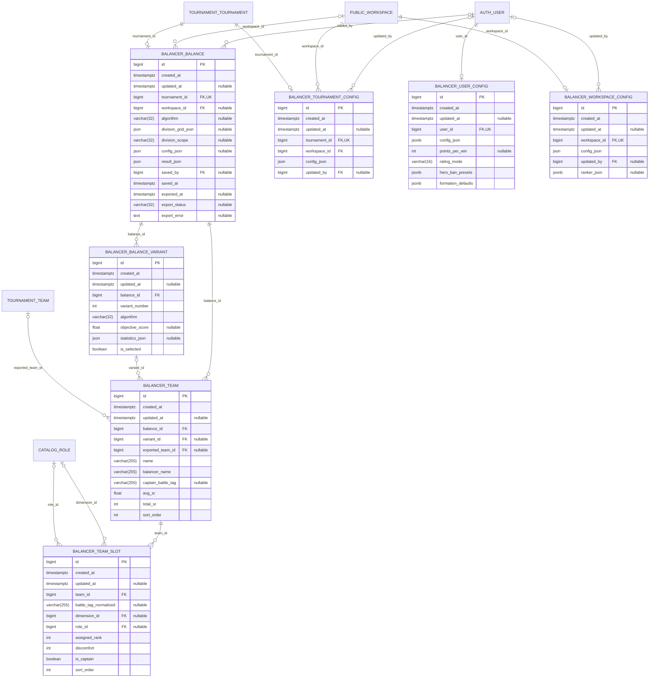

Composite unique keys:

- `BALANCER_BALANCE_VARIANT` unique on (`balance_id`, `variant_number`)
<!-- /ERD:auto -->

## draft — `draft`

The live snake draft: sessions, captains' teams, the player pool, the pick sequence, and the
audit trail.

The draft has a server-authoritative clock: one session per tournament, its
pool taken either from a saved balance (`source_balance_id`) or built directly, and `version`
columns on the session and on each pick as the optimistic lock. Session and pick reference each
other (`current_pick_id` ↔ `session_id`), which is why the FK is declared with `use_alter`.

`player` is unique on `(session_id, registration_id)`: a pool entry *is* a registration,
so roles, ranks and top heroes are read from the registration tables instead of being copied
into draft-local child tables, which is what the earlier model did. Captain, drafted player and
pick actor all resolve through `workspace_member`; `captain_auth_user_id` exists separately only
as the "this is me" signal for the live UI. `audit_event` is the append-only trail of what
the session did and who caused it.

<!-- ERD:auto draft -->
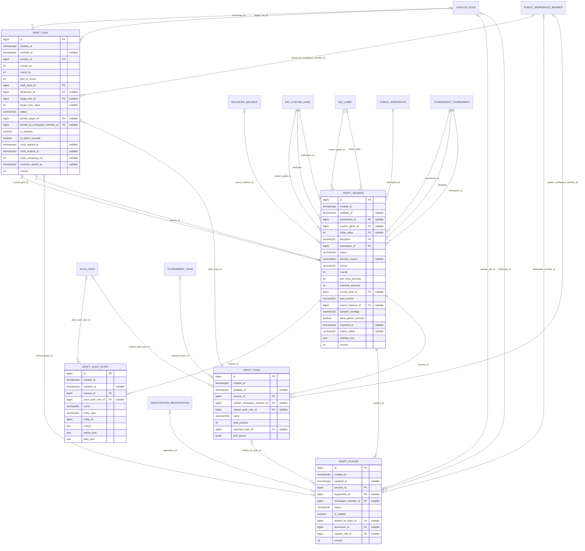

Composite unique keys:

- `DRAFT_PICK` unique on (`session_id`, `overall_no`)
- `DRAFT_PLAYER` unique on (`session_id`, `registration_id`)
- `DRAFT_TEAM` unique on (`session_id`, `draft_position`)
<!-- /ERD:auto -->

## mix — `mix`

Workspace custom games ("mixes"): the game, its host and co-hosts, the lineup, per-player role
and must-play constraints. Each mix owns a frozen team format in `roster.team_format`.

Host and co-hosts are accounts (`auth.user`), while the lineup is workspace members: hosting is
an act, playing is a membership. `participation` separates a player who must be in the game from
the pool that fills the remaining slots and from the benched. Team slots are projected from the mix's
format; solver weights and rating knobs belong to the host's `balancer.user_config`. Per-lobby balance
results remain versioned JSON on `lobby`, so a re-balance is a new version rather than an
in-place overwrite. The child tables use composite primary keys rather than surrogate ids.

Recorded rounds of a mix are not stored here: each is an `encounter.encounter` owned by the game
(`custom_game_id`), and `round` / `round_member` hold only the balancer's own facts about
it — the lobby it was played in, the points-per-win it applied, and per member whether they were
seated (with the rank delta frozen at record time) or busy in another lobby. `discipline` and
`scoring_rule_id` on the game give those encounters their game and their `wins` rule.

<!-- ERD:auto mix -->
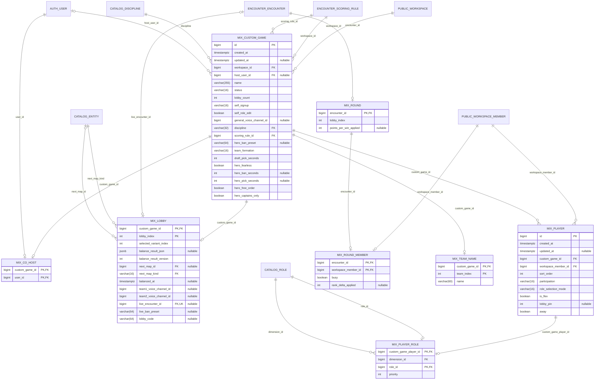

Composite unique keys:

- `MIX_CUSTOM_GAME` unique on (`id`, `workspace_id`, `discipline`)
- `MIX_PLAYER` unique on (`custom_game_id`, `workspace_member_id`)
- `MIX_PLAYER_ROLE` unique on (`custom_game_player_id`, `priority`)
<!-- /ERD:auto -->

## stats — `stats`

Native observations and ingestion provenance share this package. `match` belongs to one
`encounter.game`, workspace and discipline; the game's position is authoritative. `mode_entity_id` is the
match's own mode (the document's `mode`, else its map's catalog parent): reads use it, never the map's parent.
`match_team.source_position` preserves the log's team order, independently of the encounter
slots used by public home/away responses. Observed scores are team facts, not substitutions
for official `encounter.game_team.score` results.

`match_player` anchors every statistics player and non-null event endpoint on a real
`workspace_member`, including removed historical members and event-only participants.
The imported handle snapshot comes from the correctly scoped tournament roster, then the
primary game-provider identity; a site display name is not a missing-handle fallback.

`fact` stores one numeric observation per natural key, with NULL-equal uniqueness.
Segment zero means the whole match; positive rounds have `segment` rows. Character and
team facts retain their own grain. `event` preserves nullable endpoints, equal-time
multiplicity and type-specific payloads, with discipline-local smallint vocabulary ids.
`stat_baseline` stores discipline/formula/role/rank-bucket/stat aggregates.
`stats.mv_entity_global_stats` is a separately refreshed materialized view, not an ORM table.

`ingest_job` retains exact raw references and SHA-256 hashes of actual stored bytes.
New uploads are content-keyed; imported external ids preserve distinct historical jobs.
`awaiting_link` is neither failure nor completion: an administrator must select an eligible
game before retry. An active claim is identified by its attempt and start timestamp.
Linked match provenance is retained; deleting an eligible orphan records its native
owner effects in the same transaction. `discord_channel` lives in this schema (not
`log_processing`): a tournament's match-log channel, written only by discord-service through
`rpc.discord.channel.*`, unique per channel and per tournament. `last_scanned_message_id` is the
newest message the bot has already walked past, so a reconnect rescans from there; `NULL` (or a
manual backfill) walks the history.

`match_fetch` is a pending "import this match by its external id" request, one per
`(source_kind, external_id, hint_encounter_game_id)`: the stats worker retries it (`pending`,
`attempts`, `next_attempt_at`, `last_error`) until the discipline's fetcher serves the bytes, then
stores them like an upload and points `ingest_job_id` at the normal ingest job (`done`), or gives
up 24 h after the request (`failed`).

<!-- ERD:auto stats -->
```mermaid
erDiagram
    STATS_DISCORD_CHANNEL {
        bigint id PK
        timestamptz created_at
        timestamptz updated_at "nullable"
        bigint tournament_id FK,UK
        bigint channel_id UK
        varchar(100) channel_name "nullable"
        boolean is_active
        bigint last_scanned_message_id "nullable"
    }
    STATS_EVENT {
        bigint id PK
        bigint match_id FK
        smallint segment
        float8 t
        smallint type_id FK
        bigint actor_member_id FK "nullable"
        bigint actor_team_id FK "nullable"
        bigint target_member_id FK "nullable"
        bigint target_team_id FK "nullable"
        bigint entity_id FK "nullable"
        bigint related_entity_id FK "nullable"
        varchar(16) entity_kind FK
        jsonb data "nullable"
    }
    STATS_EVENT_TYPE {
        smallint id PK
        varchar(32) discipline FK
        varchar(64) code
        varchar(128) name
        boolean active
    }
    STATS_FACT {
        bigint match_id FK
        smallint segment
        bigint encounter_team_id FK
        bigint workspace_member_id FK "nullable"
        bigint entity_id FK "nullable"
        varchar(16) entity_kind FK
        smallint stat_id FK
        float8 value
    }
    STATS_INGEST_JOB {
        bigint id PK
        timestamptz created_at
        timestamptz updated_at "nullable"
        bigint workspace_id FK
        varchar(32) discipline FK
        varchar(32) source_kind
        varchar(128) external_id "nullable"
        char(64) content_hash "nullable"
        ck_ingest_job_raw_status raw_status
        varchar(500) filename "nullable"
        varchar(512) raw_ref
        varchar(512) document_ref "nullable"
        ck_ingest_job_status status
        int attempts
        text error_message "nullable"
        bigint uploader_user_id FK "nullable"
        bigint api_key_id FK "nullable"
        bigint hint_tournament_id FK "nullable"
        bigint hint_encounter_id FK "nullable"
        bigint hint_encounter_game_id FK "nullable"
        timestamptz started_at "nullable"
        timestamptz finished_at "nullable"
    }
    STATS_MATCH {
        bigint id PK
        timestamptz created_at
        timestamptz updated_at "nullable"
        bigint workspace_id FK
        varchar(32) discipline FK
        bigint encounter_id FK
        bigint encounter_game_id FK,UK "nullable"
        int source_map_index "nullable"
        bigint ingest_job_id FK "nullable"
        int revision
        timestamptz played_at "nullable"
        float8 duration_s "nullable"
        bigint map_entity_id FK
        varchar(16) map_kind FK
        bigint mode_entity_id FK "nullable"
        varchar(16) mode_kind FK
    }
    STATS_MATCH_FETCH {
        bigint id PK
        timestamptz created_at
        timestamptz updated_at "nullable"
        bigint workspace_id FK
        varchar(32) discipline FK
        varchar(32) source_kind
        varchar(128) external_id
        bigint hint_tournament_id FK
        bigint hint_encounter_id FK
        bigint hint_encounter_game_id FK
        bigint requested_by_user_id FK "nullable"
        ck_match_fetch_status status
        int attempts
        timestamptz next_attempt_at
        text last_error "nullable"
        bigint ingest_job_id FK "nullable"
    }
    STATS_MATCH_PLAYER {
        bigint match_id PK,FK
        bigint encounter_team_id FK
        bigint workspace_member_id PK,FK
        varchar(255) handle_snapshot
        bigint observed_role_id FK "nullable"
    }
    STATS_MATCH_TEAM {
        bigint match_id PK,FK
        bigint encounter_id FK
        bigint encounter_team_id PK,FK
        int source_position
    }
    STATS_SEGMENT {
        bigint match_id PK,FK
        smallint segment PK
        varchar(16) kind
        jsonb attrs
    }
    STATS_STAT_BASELINE {
        bigint id PK
        varchar(64) formula_version
        bigint role_id FK
        smallint rank_bucket
        smallint stat_id FK
        float8 mean
        float8 std
        jsonb meta "nullable"
        timestamptz computed_at
    }
    STATS_STAT_DEF {
        smallint id PK
        varchar(32) discipline FK
        varchar(64) code
        varchar(128) name
        varchar(16) value_format
        varchar(8) aggregation
        varchar(32) stat_group "nullable"
        boolean active
        int sort_order
    }

    AUTH_API_KEY |o--o{ STATS_INGEST_JOB : "api_key_id"
    AUTH_USER |o--o{ STATS_MATCH_FETCH : "requested_by_user_id"
    CATALOG_DISCIPLINE ||--o{ STATS_EVENT_TYPE : "discipline"
    CATALOG_DISCIPLINE ||--o{ STATS_INGEST_JOB : "discipline"
    CATALOG_DISCIPLINE ||--o{ STATS_MATCH_FETCH : "discipline"
    CATALOG_DISCIPLINE ||--o{ STATS_STAT_DEF : "discipline"
    CATALOG_ENTITY |o--o{ STATS_EVENT : "entity_id"
    CATALOG_ENTITY |o--o{ STATS_EVENT : "related_entity_id"
    CATALOG_ENTITY |o--o{ STATS_FACT : "entity_id"
    CATALOG_ENTITY |o--o{ STATS_MATCH : "mode_entity_id"
    CATALOG_ENTITY ||--o{ STATS_EVENT : "entity_kind"
    CATALOG_ENTITY ||--o{ STATS_FACT : "entity_kind"
    CATALOG_ENTITY ||--o{ STATS_MATCH : "discipline"
    CATALOG_ENTITY ||--o{ STATS_MATCH : "map_entity_id"
    CATALOG_ENTITY ||--o{ STATS_MATCH : "map_kind"
    CATALOG_ENTITY ||--o{ STATS_MATCH : "mode_kind"
    CATALOG_ROLE |o--o{ STATS_MATCH_PLAYER : "observed_role_id"
    CATALOG_ROLE ||--o{ STATS_STAT_BASELINE : "role_id"
    ENCOUNTER_ENCOUNTER |o--o{ STATS_INGEST_JOB : "hint_encounter_id"
    ENCOUNTER_ENCOUNTER ||--o{ STATS_MATCH : "encounter_id"
    ENCOUNTER_ENCOUNTER ||--o{ STATS_MATCH_FETCH : "hint_encounter_id"
    ENCOUNTER_GAME |o--o{ STATS_INGEST_JOB : "hint_encounter_game_id"
    ENCOUNTER_GAME |o--o| STATS_MATCH : "encounter_game_id"
    ENCOUNTER_GAME ||--o{ STATS_MATCH_FETCH : "hint_encounter_game_id"
    ENCOUNTER_TEAM ||--o{ STATS_MATCH_TEAM : "encounter_id"
    ENCOUNTER_TEAM ||--o| STATS_MATCH_TEAM : "encounter_team_id"
    PLAYERS_USER |o--o{ STATS_INGEST_JOB : "uploader_user_id"
    PUBLIC_WORKSPACE ||--o{ STATS_INGEST_JOB : "workspace_id"
    PUBLIC_WORKSPACE ||--o{ STATS_MATCH : "workspace_id"
    PUBLIC_WORKSPACE ||--o{ STATS_MATCH_FETCH : "workspace_id"
    PUBLIC_WORKSPACE_MEMBER ||--o| STATS_MATCH_PLAYER : "workspace_member_id"
    STATS_EVENT_TYPE ||--o{ STATS_EVENT : "type_id"
    STATS_INGEST_JOB |o--o{ STATS_MATCH : "ingest_job_id"
    STATS_INGEST_JOB |o--o{ STATS_MATCH_FETCH : "ingest_job_id"
    STATS_MATCH ||--o{ STATS_EVENT : "match_id"
    STATS_MATCH ||--o{ STATS_MATCH_TEAM : "encounter_id"
    STATS_MATCH ||--o| STATS_MATCH_TEAM : "match_id"
    STATS_MATCH ||--o| STATS_SEGMENT : "match_id"
    STATS_MATCH_PLAYER |o--o{ STATS_EVENT : "actor_member_id"
    STATS_MATCH_PLAYER |o--o{ STATS_EVENT : "target_member_id"
    STATS_MATCH_PLAYER |o--o{ STATS_FACT : "workspace_member_id"
    STATS_MATCH_PLAYER ||--o{ STATS_EVENT : "match_id"
    STATS_MATCH_PLAYER ||--o{ STATS_FACT : "match_id"
    STATS_MATCH_TEAM |o--o{ STATS_EVENT : "actor_team_id"
    STATS_MATCH_TEAM |o--o{ STATS_EVENT : "target_team_id"
    STATS_MATCH_TEAM ||--o{ STATS_EVENT : "match_id"
    STATS_MATCH_TEAM ||--o{ STATS_FACT : "encounter_team_id"
    STATS_MATCH_TEAM ||--o{ STATS_FACT : "match_id"
    STATS_MATCH_TEAM ||--o{ STATS_MATCH_PLAYER : "encounter_team_id"
    STATS_MATCH_TEAM ||--o| STATS_MATCH_PLAYER : "match_id"
    STATS_STAT_DEF ||--o{ STATS_FACT : "stat_id"
    STATS_STAT_DEF ||--o{ STATS_STAT_BASELINE : "stat_id"
    TOURNAMENT_TOURNAMENT |o--o{ STATS_INGEST_JOB : "hint_tournament_id"
    TOURNAMENT_TOURNAMENT ||--o{ STATS_MATCH_FETCH : "hint_tournament_id"
    TOURNAMENT_TOURNAMENT ||--o| STATS_DISCORD_CHANNEL : "tournament_id"
```

Composite unique keys:

- `STATS_EVENT_TYPE` unique on (`discipline`, `code`)
- `STATS_FACT` unique on (`match_id`, `segment`, `encounter_team_id`, `workspace_member_id`, `entity_id`, `stat_id`)
- `STATS_MATCH` unique on (`id`, `encounter_id`)
- `STATS_MATCH_FETCH` unique on (`source_kind`, `external_id`, `hint_encounter_game_id`)
- `STATS_MATCH_TEAM` unique on (`match_id`, `source_position`)
- `STATS_STAT_BASELINE` unique on (`formula_version`, `role_id`, `rank_bucket`, `stat_id`)
- `STATS_STAT_DEF` unique on (`discipline`, `code`)
<!-- /ERD:auto -->

## achievements — `achievements`

The declarative achievement engine: a rule as a JSON condition tree, the evaluation results it
produces, the manual grant/revoke overlay, and the evaluation runs.

A rule is data, not code: `condition_tree` is the JSON condition, `scope` and `grain` say what
it is evaluated over, `depends_on` lets one rule build on another, and `rule_version` makes a
result produced by an older version of the same rule distinguishable. Rules are per workspace
(`workspace_id, slug` unique), optionally tied to a hero.

`evaluation_result` is unique on `(rule, member, tournament, match)`, which is what makes
re-evaluation idempotent — a run inserts or does nothing. `override` is a separate manual
grant/revoke overlay precisely so that a re-evaluation can never erase an admin's decision.
`evaluation_run` is the run audit, and results point back at it by `run_id`.

Recipients are `workspace_member`, not players: an achievement is earned inside one tenant. The
earlier `achievements.achievement` and `achievements.user` tables are gone — the rule engine
replaced them.

<!-- ERD:auto achievements -->
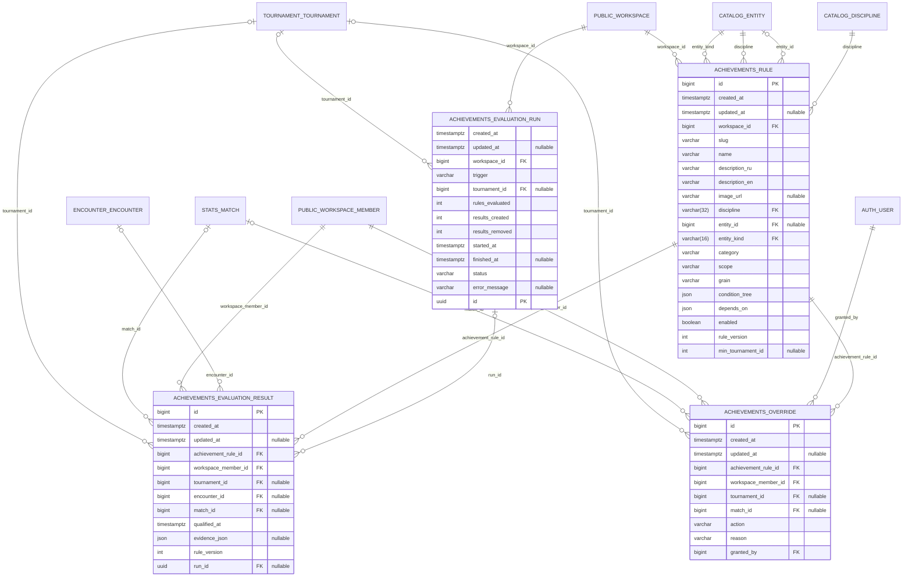

Composite unique keys:

- `ACHIEVEMENTS_EVALUATION_RESULT` unique on (`achievement_rule_id`, `workspace_member_id`, `tournament_id`, `encounter_id`, `match_id`)
- `ACHIEVEMENTS_RULE` unique on (`workspace_id`, `slug`)
<!-- /ERD:auto -->

## analytics — `analytics`

Signals computed on top of tournament results and match logs: rating shifts, per-player
performance, placement distributions, encounter quality and player anomalies with their reviewer
verdicts, the ML model registry, and the job table that tracks long-running compute.

`algorithms` is the registry every derived number points at, which is why practically every
unique key in this schema includes `algorithm_id`: two algorithms may hold different opinions
about the same `(tournament, player)` at the same time, and neither overwrites the other.

Everything here is anchored on `tournament.player` — the roster slot — rather than on a player
or a member, so a number always belongs to one participation in one tournament and never leaks
across tournaments. Nothing in `analytics` references `stats` directly; match data is reached
through the encounter.

`standings_distribution` is the only source of placement predictions: a Monte Carlo distribution
per `(tournament, team, algorithm)` with mean, median, p10/p90, top-1/3/8 probabilities and the
full histogram. A scalar "predicted place" is the rounded mean, derived at read time; the older
scalar predictions table was dropped rather than kept in sync.

`player_anomaly` flags a suspicious performance and `anomaly_feedback` records the reviewer's
verdict, unique per `(tournament, player, kind)` — a reviewed anomaly stays reviewed instead of
being raised again on every recompute. `job` is the single recomputation tracker for both
ordinary compute and ML training.

<!-- ERD:auto analytics -->
```mermaid
erDiagram
    ANALYTICS_ALGORITHMS {
        bigint id PK
        timestamptz created_at
        timestamptz updated_at "nullable"
        varchar name UK
        boolean produces_shifts
    }
    ANALYTICS_ANOMALY_FEEDBACK {
        bigint id PK
        timestamptz created_at
        timestamptz updated_at "nullable"
        bigint tournament_id FK
        bigint player_id FK
        varchar(32) kind
        varchar(16) verdict
        bigint reviewer_user_id FK "nullable"
        text note "nullable"
    }
    ANALYTICS_JOB {
        bigint id PK
        timestamptz created_at
        timestamptz updated_at "nullable"
        bigint workspace_id FK "nullable"
        bigint tournament_id FK
        bigint requested_by_user_id FK "nullable"
        varchar(16) kind
        varchar(16) status
        json algorithms "nullable"
        json training_workspace_ids "nullable"
        json progress
        text error "nullable"
        timestamptz started_at "nullable"
        timestamptz finished_at "nullable"
    }
    ANALYTICS_MATCH_QUALITY {
        bigint id PK
        timestamptz created_at
        timestamptz updated_at "nullable"
        bigint encounter_id FK
        bigint algorithm_id FK
        float competitiveness
        float predictability
        float skill_balance
        float quality_score
    }
    ANALYTICS_ML_MODEL_ARTIFACT {
        bigint id PK
        timestamptz created_at
        timestamptz updated_at "nullable"
        bigint algorithm_id FK
        varchar(32) model_kind
        bigint dimension_id FK "nullable"
        bigint role_id FK "nullable"
        varchar(32) version
        text storage_uri
        varchar(32) feature_version
        bigint training_cutoff_tournament_id FK "nullable"
        json metrics "nullable"
        json feature_importance "nullable"
        boolean is_active
    }
    ANALYTICS_PERFORMANCE {
        bigint id PK
        timestamptz created_at
        timestamptz updated_at "nullable"
        bigint tournament_id FK
        bigint player_id FK
        bigint algorithm_id FK
        float impact_score
        float raw_value
        float confidence
        float log_coverage
        float local_mean
        float local_std
        float local_residual
        float local_zscore
        float local_percentile
        int local_reference_n
        int local_band_min_div "nullable"
        int local_band_max_div "nullable"
        json contributions "nullable"
        float base_value "nullable"
    }
    ANALYTICS_PLAYER_ANOMALY {
        bigint id PK
        timestamptz created_at
        timestamptz updated_at "nullable"
        bigint tournament_id FK
        bigint player_id FK
        varchar(32) kind
        float score
        float confidence
        json reasons
        json evidence "nullable"
        bigint source_encounter_id FK "nullable"
    }
    ANALYTICS_PLAYER_SHIFT {
        bigint id PK
        timestamptz created_at
        timestamptz updated_at "nullable"
        bigint tournament_id FK
        bigint player_id FK
        int wins
        int losses
        int shift_one "nullable"
        int shift_two "nullable"
        int shift "nullable"
    }
    ANALYTICS_SHIFTS {
        bigint id PK
        timestamptz created_at
        timestamptz updated_at "nullable"
        bigint tournament_id FK
        bigint algorithm_id FK
        bigint player_id FK
        float shift
        float shift_sd "nullable"
        float effective_evidence
        int sample_tournaments
        int sample_matches
        float log_coverage
    }
    ANALYTICS_STANDINGS_DISTRIBUTION {
        bigint id PK
        timestamptz created_at
        timestamptz updated_at "nullable"
        bigint tournament_id FK
        bigint team_id FK
        bigint algorithm_id FK
        float mean_position
        float median_position
        float p10_position
        float p90_position
        float prob_top1
        float prob_top3
        float prob_top8
        json position_histogram
    }

    ANALYTICS_ALGORITHMS ||--o{ ANALYTICS_MATCH_QUALITY : "algorithm_id"
    ANALYTICS_ALGORITHMS ||--o{ ANALYTICS_ML_MODEL_ARTIFACT : "algorithm_id"
    ANALYTICS_ALGORITHMS ||--o{ ANALYTICS_PERFORMANCE : "algorithm_id"
    ANALYTICS_ALGORITHMS ||--o{ ANALYTICS_SHIFTS : "algorithm_id"
    ANALYTICS_ALGORITHMS ||--o{ ANALYTICS_STANDINGS_DISTRIBUTION : "algorithm_id"
    AUTH_USER |o--o{ ANALYTICS_ANOMALY_FEEDBACK : "reviewer_user_id"
    AUTH_USER |o--o{ ANALYTICS_JOB : "requested_by_user_id"
    CATALOG_ROLE |o--o{ ANALYTICS_ML_MODEL_ARTIFACT : "dimension_id"
    CATALOG_ROLE |o--o{ ANALYTICS_ML_MODEL_ARTIFACT : "role_id"
    ENCOUNTER_ENCOUNTER |o--o{ ANALYTICS_PLAYER_ANOMALY : "source_encounter_id"
    ENCOUNTER_ENCOUNTER ||--o{ ANALYTICS_MATCH_QUALITY : "encounter_id"
    PUBLIC_WORKSPACE |o--o{ ANALYTICS_JOB : "workspace_id"
    TOURNAMENT_PLAYER ||--o{ ANALYTICS_ANOMALY_FEEDBACK : "player_id"
    TOURNAMENT_PLAYER ||--o{ ANALYTICS_PERFORMANCE : "player_id"
    TOURNAMENT_PLAYER ||--o{ ANALYTICS_PLAYER_ANOMALY : "player_id"
    TOURNAMENT_PLAYER ||--o{ ANALYTICS_PLAYER_SHIFT : "player_id"
    TOURNAMENT_PLAYER ||--o{ ANALYTICS_SHIFTS : "player_id"
    TOURNAMENT_TEAM ||--o{ ANALYTICS_STANDINGS_DISTRIBUTION : "team_id"
    TOURNAMENT_TOURNAMENT |o--o{ ANALYTICS_ML_MODEL_ARTIFACT : "training_cutoff_tournament_id"
    TOURNAMENT_TOURNAMENT ||--o{ ANALYTICS_ANOMALY_FEEDBACK : "tournament_id"
    TOURNAMENT_TOURNAMENT ||--o{ ANALYTICS_JOB : "tournament_id"
    TOURNAMENT_TOURNAMENT ||--o{ ANALYTICS_PERFORMANCE : "tournament_id"
    TOURNAMENT_TOURNAMENT ||--o{ ANALYTICS_PLAYER_ANOMALY : "tournament_id"
    TOURNAMENT_TOURNAMENT ||--o{ ANALYTICS_PLAYER_SHIFT : "tournament_id"
    TOURNAMENT_TOURNAMENT ||--o{ ANALYTICS_SHIFTS : "tournament_id"
    TOURNAMENT_TOURNAMENT ||--o{ ANALYTICS_STANDINGS_DISTRIBUTION : "tournament_id"
```

Composite unique keys:

- `ANALYTICS_ANOMALY_FEEDBACK` unique on (`tournament_id`, `player_id`, `kind`)
- `ANALYTICS_MATCH_QUALITY` unique on (`encounter_id`, `algorithm_id`)
- `ANALYTICS_ML_MODEL_ARTIFACT` unique on (`algorithm_id`, `model_kind`, `role_id`, `version`)
- `ANALYTICS_PERFORMANCE` unique on (`tournament_id`, `player_id`, `algorithm_id`)
- `ANALYTICS_PLAYER_ANOMALY` unique on (`tournament_id`, `player_id`, `kind`, `source_encounter_id`)
- `ANALYTICS_PLAYER_SHIFT` unique on (`tournament_id`, `player_id`)
- `ANALYTICS_SHIFTS` unique on (`tournament_id`, `player_id`, `algorithm_id`)
- `ANALYTICS_STANDINGS_DISTRIBUTION` unique on (`tournament_id`, `team_id`, `algorithm_id`)
<!-- /ERD:auto -->

## subscriptions — `subscriptions`

Subscription checks used as an admission condition for registration and check-in: how a
workspace verifies a subscription with a provider, what a tournament requires, the resulting
entitlement, and the check log.

`provider_config` describes how a workspace verifies a subscription with one provider, unique
per `(workspace, provider)`. `enabled` is false by default: creating a config does not turn the
check on. The Discord guild snowflake is not stored in `config_json` — it is injected from
`workspace.discord_guild_id`, which is the single source for it.

The eligibility rule lives on the workspace, not on the registration form: one `requirement` row
is shared by every tournament in the workspace, and the per-tournament decision is the
`require_subscription` toggle on `registration.form`. It is a table rather than a column
because presets were intended from the start — more rows plus a nullable FK on the form is a
purely additive change, while a column on `workspace` would have needed a data migration.
`(workspace_id, name)` is unique, with a partial unique index pinning a single default row.

`entitlement` is the last known verdict per `(workspace, auth_user, provider)`. `state` has three
values — `active`, `inactive`, `unknown` — and `unknown` is fail-open: a provider outage must
never lock people out. Verdicts compose under three-valued logic, so a block only happens when
the answer is certain. `check_log` is the append-only history of live provider calls, mirroring
`rank.fetch_log`; both its workspace and its user FK are nullable so the history
outlives account deletion.

<!-- ERD:auto subscriptions -->
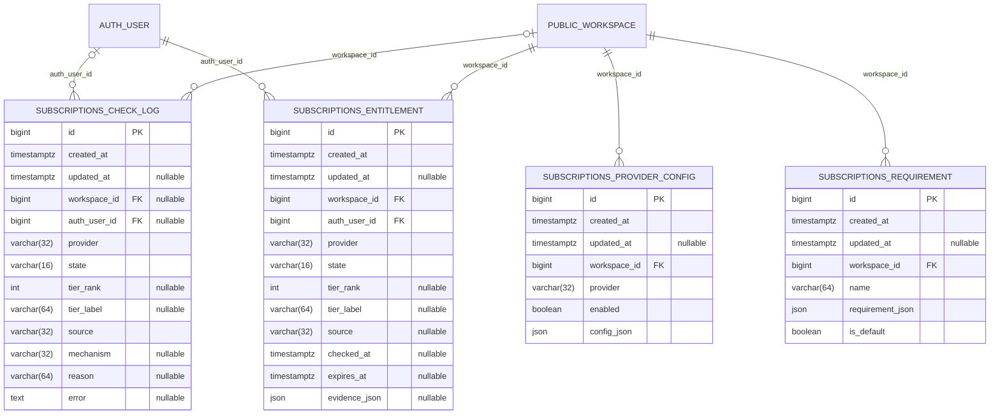

Composite unique keys:

- `SUBSCRIPTIONS_ENTITLEMENT` unique on (`workspace_id`, `auth_user_id`, `provider`)
- `SUBSCRIPTIONS_PROVIDER_CONFIG` unique on (`workspace_id`, `provider`)
- `SUBSCRIPTIONS_REQUIREMENT` unique on (`workspace_id`, `name`)
<!-- /ERD:auto -->

## preferences — `players`, `tournament`

Per-account preferences: favourite players, and saved encounter views.

Both tables key on `auth_user_id`, not on `workspace_member`: a preference belongs to the logged-in
account and follows it everywhere. `favorite_player` therefore points straight at `players.user` —
the one place where the tenant-scoped anchor is deliberately not used — while a saved encounter
view is workspace-scoped and unique per `(workspace, user, name)`.

<!-- ERD:auto preferences -->
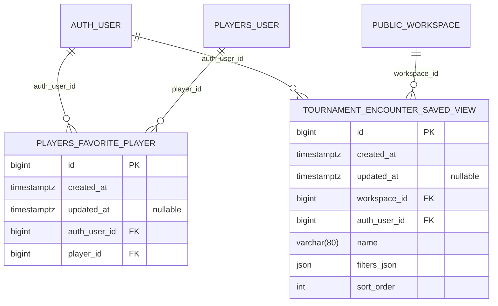

Composite unique keys:

- `PLAYERS_FAVORITE_PLAYER` unique on (`auth_user_id`, `player_id`)
- `TOURNAMENT_ENCOUNTER_SAVED_VIEW` unique on (`workspace_id`, `auth_user_id`, `name`)
<!-- /ERD:auto -->

## platform — `public`, `realtime`

Cross-domain infrastructure: the transactional outbox, the realtime event journal the gateway
replays from, the platform audit log, and the notification inbox.

These tables carry `workspace_id`, `tournament_id` and actor ids as plain `BigInteger`
with **no foreign keys**, which is why they appear unconnected on the diagram. That is the
point: an append-only bus or journal must outlive the business rows it describes, and must not
be draggable into a cascade delete.

`event_outbox` is the transactional outbox — written in the same transaction as the business
change, then published by a relay; `event_id` is unique so a consumer can deduplicate, and
`status` / `attempts` / `next_attempt_at` are the retry state. `realtime.workspace_event` is the
replay journal the Go gateway reads by topic and id when a WebSocket client reconnects;
`schema_version` lets the payload shape change without invalidating older entries. `audit_log`
stores `before_json` / `after_json` together with `actor_label` and `entity_label` snapshots, so
an entry stays readable after the row it describes is gone.

`notification` is the inbox journal — appended by `shared.services.notifications.notify()`
inside the transaction that causes the event, never committed on its own. It stores `kind` plus
a `payload_json` snapshot rather than rendered text, so the wording lives in the frontend
dictionary and a deleted team still reads by name; `audience` decides who may see the row
(`user`, `workspace` or `global`) and the check constraints keep `recipient_auth_user_id` /
`workspace_id` filled exactly for the audience that needs one. `source_workspace_id` answers a
different question — *which tenant produced* the row — and is therefore set for every audience,
`user` included: a registration decision is addressed to one competitor and owned by the
organizer that decided it. It is what the workspace operator screen scopes on
(`rpc.app.notification_admin_*`), where a "delete" is an `expires_at = now()` retire, so the row
and its read marks survive. `notification_read` is the per-viewer state, primary key
`(auth_user_id, notification_id)`: "read" is a fact about one viewer, which is what lets a global
announcement be dismissed by each reader independently, and the mark survives the announcement
being unpublished, so who saw it stays answerable. `deleted_at` on the same row is the inbox's
own delete button — that viewer stops seeing the notification while every other recipient's copy,
and the journal row itself, are untouched.

`discord_message` is one row per message the platform asked the bot to send (notification DMs,
workspace broadcasts, mix signup and lineup cards). The publisher *claims* the row — destination
(`channel` = `discord_dm` / `discord_channel`, `target`), `subject` / `slot` / `kind`,
`dedupe_key`, and `payload_json`, the render input the bot cannot re-read from a table (the
notification payload for every notification row; `NULL` for a mix, whose view the bot asks
balancer for) — and queues a cardless `send` or `delete` command naming it. discord-service owns
everything else: it renders the card, and `card_json` is its last render, compared on the next
one so a no-op edit is skipped; `status`, `discord_channel_id`, `message_id` and `error` are the
lifecycle it records (publishers only ever move a row to `deleting`). `(channel, target,
dedupe_key)` is the idempotency claim a redelivered event relies on.

<!-- ERD:auto platform -->
```mermaid
erDiagram
    PUBLIC_AUDIT_LOG {
        bigint id PK
        timestamptz created_at
        bigint workspace_id "nullable"
        bigint actor_auth_user_id "nullable"
        varchar(255) actor_label "nullable"
        varchar(16) source
        varchar(64) action
        varchar(64) entity_type "nullable"
        bigint entity_id "nullable"
        varchar(255) entity_label "nullable"
        jsonb before_json "nullable"
        jsonb after_json "nullable"
        text reason "nullable"
        varchar(45) ip_address "nullable"
        varchar(255) user_agent "nullable"
        varchar(64) correlation_id "nullable"
    }
    PUBLIC_CHAT_MESSAGE {
        bigint id PK
        varchar(16) room_kind
        bigint room_ref_id
        bigint auth_user_id
        text author_name
        varchar(16) author_role
        text body
        timestamptz created_at
        timestamptz deleted_at "nullable"
        bigint deleted_by_auth_user_id "nullable"
    }
    PUBLIC_CHAT_MUTE {
        varchar(16) room_kind PK
        bigint room_ref_id PK
        bigint auth_user_id PK
        timestamptz muted_until "nullable"
        text reason "nullable"
        bigint created_by_auth_user_id
        timestamptz created_at
    }
    PUBLIC_CHAT_ROOM_SETTINGS {
        varchar(16) room_kind PK
        bigint room_ref_id PK
        boolean spectators_can_read
        bigint updated_by_auth_user_id
        timestamptz created_at
        timestamptz updated_at "nullable"
    }
    PUBLIC_DISCORD_MESSAGE {
        bigint id PK
        varchar(32) channel
        varchar(64) target
        varchar(128) dedupe_key "nullable"
        varchar(160) subject
        varchar(64) slot
        varchar(64) kind
        bigint notification_id "nullable"
        bigint workspace_id "nullable"
        varchar(16) status
        bigint discord_channel_id "nullable"
        bigint message_id "nullable"
        text error "nullable"
        json payload_json "nullable"
        json card_json "nullable"
        timestamptz created_at
        timestamptz updated_at "nullable"
    }
    PUBLIC_EVENT_OUTBOX {
        bigint id PK
        varchar(64) event_id UK
        varchar(128) event_type
        varchar(255) exchange "nullable"
        varchar(255) routing_key
        json payload_json
        varchar(16) status
        int attempts
        timestamptz next_attempt_at
        timestamptz created_at
        timestamptz published_at "nullable"
        text last_error "nullable"
    }
    PUBLIC_NOTIFICATION {
        bigint id PK
        varchar(16) audience
        bigint recipient_auth_user_id "nullable"
        bigint workspace_id "nullable"
        bigint source_workspace_id "nullable"
        varchar(64) kind
        varchar(128) dedupe_key "nullable"
        jsonb payload_json
        bigint actor_auth_user_id "nullable"
        timestamptz published_at
        timestamptz expires_at "nullable"
        timestamptz created_at
    }
    PUBLIC_NOTIFICATION_PREFERENCE {
        bigint auth_user_id PK,FK
        jsonb discord_dm
        timestamptz updated_at
    }
    PUBLIC_NOTIFICATION_READ {
        bigint auth_user_id PK
        bigint notification_id PK
        timestamptz read_at
        timestamptz deleted_at "nullable"
    }
    PUBLIC_NOTIFICATION_WORKSPACE_CONFIG {
        bigint workspace_id PK,FK
        bigint discord_channel_id "nullable"
        varchar(2) locale
        jsonb broadcast_kinds
        timestamptz updated_at
    }
    REALTIME_WORKSPACE_EVENT {
        bigint id PK
        text topic
        varchar(128) event_type
        bigint workspace_id "nullable"
        bigint tournament_id "nullable"
        bigint actor_user_id "nullable"
        smallint schema_version
        jsonb payload
        timestamptz occurred_at
    }

    AUTH_USER ||--o| PUBLIC_NOTIFICATION_PREFERENCE : "auth_user_id"
    PUBLIC_WORKSPACE ||--o| PUBLIC_NOTIFICATION_WORKSPACE_CONFIG : "workspace_id"
```

Composite unique keys:

- `PUBLIC_DISCORD_MESSAGE` unique on (`channel`, `target`, `dedupe_key`)
<!-- /ERD:auto -->

## quota — `quota`

Per-principal quotas, enforced by `shared.quota` from whichever service is about to spend the
resource. A plan holds one limit row per scope — `workspace`, `key`, `session` — and a workspace
either points at a plan explicitly or inherits the one named after its `verification_status`.
`operation` is the metered set: a row is what gives an operation a cost, and no row means it
costs nothing beyond its request token. The two override tables are per-tenant and per-key
exceptions; `NULL` in a limit column means "inherit" there, and "unlimited" in a plan row.

Consumption itself is not here: per-minute and per-day counters and the lease sets live in Redis
under `q:{ws,key,user}:{id}:…`, because they are worthless in 60 seconds and would be pure write
amplification in Postgres.

<!-- ERD:auto quota -->
```mermaid
erDiagram
    QUOTA_API_KEY_LIMIT {
        bigint api_key_id PK,FK
        int requests_per_minute "nullable"
        int heavy_per_day "nullable"
        int concurrent_heavy "nullable"
        bigint max_upload_bytes "nullable"
        int max_items_per_request "nullable"
        bigint updated_by FK "nullable"
        timestamptz created_at
        timestamptz updated_at "nullable"
    }
    QUOTA_OPERATION {
        bigint id PK
        timestamptz created_at
        timestamptz updated_at "nullable"
        varchar(64) slug UK
        int cost
        boolean enabled
        text description "nullable"
    }
    QUOTA_PLAN {
        bigint id PK
        timestamptz created_at
        timestamptz updated_at "nullable"
        varchar(32) slug UK
        varchar(64) title
        text description "nullable"
    }
    QUOTA_PLAN_LIMIT {
        bigint plan_id PK,FK
        varchar(16) scope PK
        int requests_per_minute "nullable"
        int heavy_per_day "nullable"
        int concurrent_heavy "nullable"
        bigint max_upload_bytes "nullable"
        int max_items_per_request "nullable"
    }
    QUOTA_WORKSPACE_LIMIT {
        bigint workspace_id PK,FK
        varchar(16) scope PK
        int requests_per_minute "nullable"
        int heavy_per_day "nullable"
        int concurrent_heavy "nullable"
        bigint max_upload_bytes "nullable"
        int max_items_per_request "nullable"
        bigint updated_by FK "nullable"
        timestamptz created_at
        timestamptz updated_at "nullable"
    }

    AUTH_API_KEY ||--o| QUOTA_API_KEY_LIMIT : "api_key_id"
    AUTH_USER |o--o{ QUOTA_API_KEY_LIMIT : "updated_by"
    AUTH_USER |o--o{ QUOTA_WORKSPACE_LIMIT : "updated_by"
    PUBLIC_WORKSPACE ||--o| QUOTA_WORKSPACE_LIMIT : "workspace_id"
    QUOTA_PLAN ||--o| QUOTA_PLAN_LIMIT : "plan_id"
```
<!-- /ERD:auto -->

## stream — `stream`

Participant POV broadcasts, owned by stream-service. The poll tick upserts one `session` row per
live POV channel per tournament (never an official cast), keyed by Twitch's stream id, and the
VOD sync after each tick resolves the broadcast's VOD and re-checks it daily; `vod_gone_at`
hides a VOD Twitch no longer has. Chapters are not stored: the public read cuts them on the fly
from the encounter and log times, shifted by `tournament.pov_stream_delay_s`, and re-applies
consent each time, so a row is a fact about Twitch rather than permission to show it.

<!-- ERD:auto stream -->
```mermaid
erDiagram
    STREAM_SESSION {
        bigint id PK
        timestamptz created_at
        timestamptz updated_at "nullable"
        bigint tournament_id FK
        bigint user_id FK
        varchar(64) channel
        varchar(32) broadcaster_id
        varchar(32) stream_id
        timestamptz started_at
        timestamptz last_seen_at
        varchar(32) vod_id "nullable"
        timestamptz vod_checked_at "nullable"
        timestamptz vod_gone_at "nullable"
    }

    PLAYERS_USER ||--o{ STREAM_SESSION : "user_id"
    TOURNAMENT_TOURNAMENT ||--o{ STREAM_SESSION : "tournament_id"
```

Composite unique keys:

- `STREAM_SESSION` unique on (`tournament_id`, `stream_id`)
<!-- /ERD:auto -->

## Schema change history

What the current shape replaced, and why. Revision ids are deliberately absent: the migration
chain was squashed into a single baseline, so anything older than that baseline exists in the
schema but not as a separate file in `backend/migrations/versions/`. The generated head line at
the top of this document is the only revision claim here.

- **Identity/workspace refactor.** `players.user.auth_user_id` (unique, nullable) became the
  `1:0..1` link to `auth.user`, and `public.workspace_member` — unique on
  `(workspace_id, player_id)`, with no denormalized role — became the identity anchor for
  `tournament.player` (NOT NULL), `balancer.registration`, the draft tables and the achievement
  results and overrides. The parallel `*_user_id` columns those tables used to carry were
  dropped, not kept alongside.
- **Challonge normalization.** `challonge_id` / `challonge_slug` were removed from `tournament`,
  `stage` and `encounter`, and the `challonge_team` table with them. The source of truth is
  `challonge_source` plus the participant, match and sync-log tables.
- **Groups removed.** `tournament.group` was dropped; a group is a `stage_item` of type GROUP.
- **Map veto replaced by pick/ban.** The `map_veto_config` pair was dropped in favour of the
  generic `pick_ban_config*` / `pick_ban_session` / `pick_ban_entry` model, which covers map and
  hero bans under one sequence engine and keeps a per-encounter ledger for no-repeat scopes.
- **Draft pool re-pointed at registrations.** The draft first lifted per-role data out of JSON
  into its own child tables; those were then dropped again when `draft_player` became unique on
  `(session_id, registration_id)` and started reading roles and top heroes from the registration
  tables. Two copies of the same preferences were one copy too many.
- **Predictions.** The scalar predictions table was dropped;
  `analytics.standings_distribution` is the only source of placement predictions.
- **Analytics cleanup.** The balance-snapshot tables and the feature/explanation stores were
  dropped after the shift and performance models stopped reading them; what remains is anchored
  on `tournament.player` and keyed by algorithm.
- **Member ranks unified.** `balancer.member_rank` replaced three separate per-context rank
  stores. The nullable `author_user_id` is the only discriminator between workspace canon and an
  author's private book, enforced by two partial unique indexes.
- **Catalog aliases and discipline catalog.** JSONB aliases and the alias-miss worklist originally
  replaced three hardcoded parser translation dictionaries (103 entries across 7 gamemodes,
  32 maps and 50 heroes). `discipline01` now copies that data from `overwatch.*` into
  `catalog.entity` and `catalog.alias_miss` and rewrites hard and pick/ban references to new ids
  through `catalog.entity_legacy`. Runtime code has cut over completely and old ids no longer
  resolve; the gated `legacy01` drops the old catalog and the mapping.
- **Workspace Discord guild.** `public.workspace.discord_guild_id` became the single source of
  the guild snowflake — UNIQUE, with a verification timestamp and verifier, mirroring the custom
  domain pattern. Rolling it out needed a mandatory order: add and backfill the column *before*
  the code rollout, then remove the key from `subscriptions.provider_config.config_json` and drop
  `log_processing.discord_channel.guild_id` *after* it. It is not deployable as one step — the
  old ORM still maps `guild_id`, so an early DROP halts log collection, while the new config
  loader joins the workspace column, so early code breaks subscription reads.
- **Workspace-level subscription rule.** `subscriptions.requirement` became the single source of
  the eligibility rule shared by every tournament in a workspace, while `require_subscription`
  stayed on the registration form as the per-tournament decision. Same mandatory order: create
  and backfill from the forms before the code rollout, drop the rule column from the form after
  it, because SQLAlchemy emits every mapped column in every `SELECT`. The backfill refuses to
  choose on the organizer's behalf: if a workspace held more than one distinct rule, it fails and
  rolls back rather than picking one.
- **Workspace ownership.** `public.workspace.owner_id` (FK → `auth.user`) records who created
  the workspace, deliberately decoupled from the mutable RBAC `owner` role. The backfill set it
  from the current holder of that role only when there was exactly one; with none or several it
  stayed NULL.
- **Later additions.** Team registration with invites, custom games ("mixes") and the casual
  matches played inside them (since V2 recorded as encounters, see below), tournament slugs with
  redirects, phase schedules, hidden and
  preview tournaments, captain and per-map reports with the result-status state machine, scrim
  rooms, division-grid import jobs, and the removal of stored team SR.
- **Encounter layer.** The encounter tables moved from `tournament` into their own `encounter`
  schema with `ALTER TABLE … SET SCHEMA`, which kept every id: `/encounters/{id}`, the realtime
  topics and the external foreign keys survived. The two sides became participations
  (`encounter.team`, one row per seat, append-only) with a roster snapshot (`team_member`,
  `team_member_role`); `home_team_id` / `away_team_id`, `format`, the bracket position
  (now `tournament.bracket_encounter`) and the per-side score columns left the encounter. Games
  gained `encounter.game_team`, which replaces `encounter_game_result`, the accepted home/away
  scores and `encounter_map_code`. `encounter_map_report` and `encounter_captain_report` became
  `game_claim` / `game_claim_result` and `team_report` / `team_report_result`, one result row
  per participation. `encounter.scoring_rule` took over the stage's FFA columns and formulas, and
  `catalog.discipline` was added with a `discipline` column on `tournament` and `encounter`. The
  result journal now stores `before` / `after` arrays of `{encounter_team_id, score, placement}`
  and a `result_version`; every result change writes exactly one row. `enclayer01` only adds and
  reshapes: each legacy column and table stays, made nullable and unmapped from the ORM, until the
  gated `enclayer02` drops them in the deploy after V1. `matches.match.home_team_id` /
  `away_team_id` and the `team_id` columns of `matches.statistics`, `kill_feed` and `event` are
  the only home/away leftovers, until the statistics rework.
- **Mix rounds on the encounter layer.** A recorded round of a pickup mix became an
  `encounter.encounter` owned by the mix (`custom_game_id`; exactly one of the two owners is
  set, `tournament_id` is nullable), Bo1 under the mix's own `wins` scoring rule, with result
  source `host`. `balancer.custom_game` gained `discipline` and `scoring_rule_id`; what only the
  balancer reads moved to `balancer.custom_game_round` (lobby index, the points-per-win applied) and
  `balancer.custom_game_round_member` (a member seated with a frozen `rank_delta_applied`, or busy in
  another lobby). `mixround01` moved every `casual.match` across; the `casual` tables stay as
  legacy, mapped by no model and read by nothing, until the gated `mixround02` drops them in the
  deploy after V2.
- **Discord consolidation.** discord-service became the only process that renders or sends a
  Discord message. `discordmsg03` adds `public.discord_message.payload_json` (what the publisher
  claims a row with; `card_json` became the bot's own last render) and
  `stats.discord_channel.last_scanned_message_id` (where a rescan resumes). Additive only.
- **`balancer` split by domain.** `balancer` kept the balancer itself (balances and their teams,
  the three config scopes, member ranks); registration moved to `registration`, pickup mixes to
  `mix`, the live draft to `draft`, and every table dropped the prefix its schema now states
  (`balancer.registration_form` → `registration.form`, `balancer.custom_game_player` →
  `mix.player`, `balancer.draft_session` → `draft.session`). `ALTER TABLE … SET SCHEMA` and
  renames only: ids, rows and foreign keys are untouched; index, constraint and sequence names
  follow the new names.
- **Legacy storage dropped.** `legacy01` dropped what the cutovers kept unmapped for their
  reconciles: the `matches`, `log_processing`, `overwatch` and `casual` schemas, the V1 encounter
  tables, `catalog.entity_legacy`, `roster.team_format_legacy`, `encounter.team_member_role_legacy`,
  `balancer.discipline01c_dropped_ranks`, `tournament.player_sub_role`, every legacy role/slot/score
  column, `registration.registration`'s Battle.net columns and the enum types only they used. It
  replaced the planned `discipline02`, `mixround02` and P9 drops.
- **Match mode stored.** A match's mode used to be read from its map's catalog parent; Deadlock
  plays two modes on one parentless map, so `stats.match.mode_entity_id` and `encounter.game.mode_id`
  now store it. The migration backfilled both from the map's parent where that parent is a mode.
