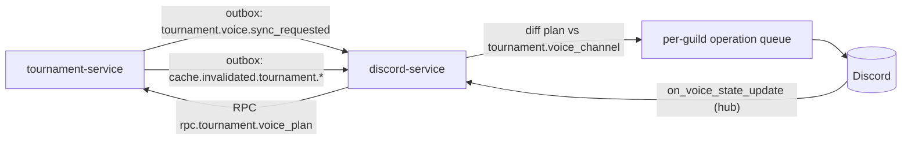

# Tournament voice channels

The bot creates Discord voice channels for a tournament's teams, a shared hub that sends each
participant to their channel, and, for an `individual_swiss` stage, a pool of round slots reused
every round. Channels of eliminated teams go away when the next stage is activated; everything
goes away after the final.

## Ownership



| Piece | Owner | Where |
|---|---|---|
| `tournament.voice_settings` (organizer settings; `last_synced_at`, `sync_issues` written by the bot) | tournament-service | `shared/models/tournament/voice.py` |
| `tournament.voice_channel` (what the bot made) | discord-service | `shared/models/tournament/voice.py` |
| Plan contract | shared | `shared/schemas/voice.py` (`VoicePlan`) |
| Plan computation | tournament-service | `rpc.tournament.voice_plan` |
| Applying the plan, hub routing, moves | discord-service | single replica |

The plan is the whole desired state. The bot is a reconciler: every sync diffs the plan against
`voice_channel` and applies only the difference, so a lost event, a 429 or a channel deleted by
hand is repaired by the next sync.

## Triggers

- `tournament.voice.sync_requested` (`TournamentVoiceSyncRequestedEvent`) — settings saved or "sync" pressed.
- `cache.invalidated.tournament.<id>` — every tournament write that stales a read: stage activation,
  standings recalculation (`Stage.is_completed`), round generation, team/player CRUD, balancer export.
- `tournament.state.changed`.

The bot ignores tournaments that have neither enabled settings nor `voice_channel` rows, debounces per
tournament (3 s) and never runs two syncs of one tournament at once. On startup it syncs every
tournament that has enabled settings or rows.

## The plan (`rpc.tournament.voice_plan`)

Empty `channels` (the bot deletes everything it made) when: settings disabled or missing, the workspace
has no guild, the tournament is `completed`/`archived`, or every stage at the highest `order` is completed
(parallel divisions share an order).
Otherwise:

| Channel | `slot_key` | Exists while | Access when private | Name |
|---|---|---|---|---|
| Hub | `hub` | any other channel exists | public | `Общий · <tournament>` |
| Team | `team:<team_id>` | the team holds a FINAL input of an active non-`individual_swiss` stage; before any stage was published (`Stage.is_published`, sticky) only with `early_teams` | every `Player` row of the team (substitutes and the players they replaced) | team name |
| Round slot | `slot:<stage_id>:<index>` | its `individual_swiss` stage is active, not completed and has a round; `index < 2 × encounters of the latest round` (= `teams_per_round`) | the members of the seat assigned to the slot in the latest round | `Лобби <n> · A/B` |

Elimination (rule "a"): activating the next stage deactivates the previous one, so a team that did not
advance drops out of the plan at that moment.

`routes` maps every participant's Discord id to their current `slot_key`; a current Swiss round slot
wins over a team voice. `warnings` lists roster members with no linked Discord (`player_without_discord`).

Round slot assignment: each round's encounters are laid onto the lobby pairs, and seats onto sides, so
that as many people as possible stay in the slot they had last round; the result is never worse than
the plain bracket order. Round 1 uses the bracket order. It is deterministic, recomputed from round 1.

## Applying the plan (discord-service)

- **Categories.** The organizer's category (`category_id`) or the bot's own one named after the tournament.
  A category holds at most 50 channels, foreign channels included; past that the bot adds its own
  `<category> · 2`, `· 3` right after it. Only the bot's own categories get `voice_channel` rows
  (`category:<n>`), so it never deletes the organizer's; its own are deleted once empty. A missing organizer
  category falls back to the bot's own and is reported.
- **Permissions.** Public: the channel follows its category. Private: the category's overwrites, then deny
  View/Connect for `@everyone`, allow View/Connect/Speak for `staff_role_ids` and the members, and the bot's
  own allow. Written in one channel edit, only when they differ.
- **Names.** Renamed only when the plan's name differs; Discord allows about 2 renames per channel per
  10 minutes, so a rename may wait.
- **Deletion.** A channel dropped from the plan is marked `deleting` and deleted once empty, or 10 minutes
  after the drop, whichever comes first.
- **Drift.** A tracked channel deleted or edited by hand triggers a sync, which restores it. Edit events during a
  sync and for 5 s after it are ignored, so the bot's own edits do not loop.
- **Hub.** Joining the hub moves the member to `routes[member]`; anyone without a route stays.
- **Round change.** After a sync, members whose route changed and who sit in one of the tournament's
  channels are moved to the new one, in slot order. Others get there through the hub. Routes live in process
  memory: after a restart nobody is moved until the routes change again.
- **Members outside the guild.** Their overwrites are dropped and reported as `member_overwrite_failed`.
- **Queue.** One sequential queue per guild, by priority: hub moves and mix moves, round moves, creates and
  permission edits, deletions. discord.py waits out 429s; Discord does not publish the move or create limits.
- **Report.** After each sync the bot writes `voice_settings.last_synced_at` and `sync_issues`
  (`guild_not_found`, `missing_permission:<name>`, `category_not_found`, `category_overflow`, ...).

The bot needs Manage Channels, Manage Roles (for permission overwrites), Move Members, View Channel and
Connect in the category.

## Admin API

| Method | Path | RPC subject | Permission |
|---|---|---|---|
| GET | `/api/v1/admin/tournaments/{id}/voice` | `rpc.tournament.voice_get` | `tournament.read` |
| PUT | `/api/v1/admin/tournaments/{id}/voice` | `rpc.tournament.voice_put` | `tournament.update` |
| POST | `/api/v1/admin/tournaments/{id}/voice/sync` | `rpc.tournament.voice_sync` | `tournament.update` |

Snowflakes travel as strings.

```ts
type VoiceSettings = {
  enabled: boolean; private: boolean; early_teams: boolean;
  category_id: string | null; staff_role_ids: string[];
};
type VoiceStatus = {
  settings: VoiceSettings;
  guild_linked: boolean;
  channels: { slot_key: string; kind: "category" | "hub" | "team" | "swiss_slot"; name: string | null;
              discord_channel_id: string | null; status: "planned" | "pending" | "active" | "deleting" }[];
  warnings: { code: string; workspace_member_id: number | null; name: string | null; team_id: number | null }[];
  sync_issues: { code: string; detail: string | null }[];
  last_synced_at: string | null;
};
```

`GET` returns `VoiceStatus` (no settings row yet → defaults, all off). `PUT` takes `VoiceSettings`, checks
the category is a category of the workspace guild and the roles exist, saves, requests a sync and returns
`VoiceStatus`. "Delete all" in the UI is `PUT` with `enabled: false`; "Create team voices now" is
`early_teams: true`. `channels` lists the plan's channels joined with the bot's rows by `slot_key`
(`planned` = in the plan, not yet made) plus rows the plan dropped.
